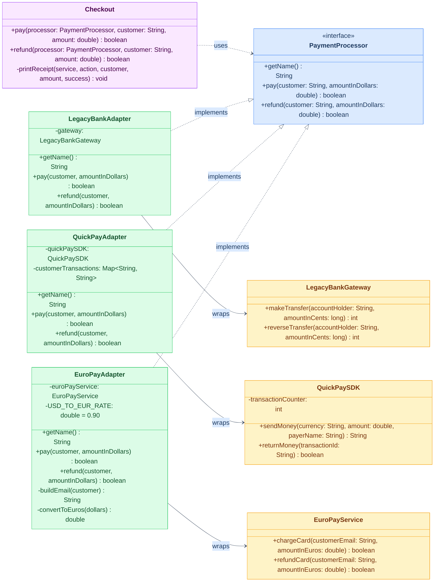
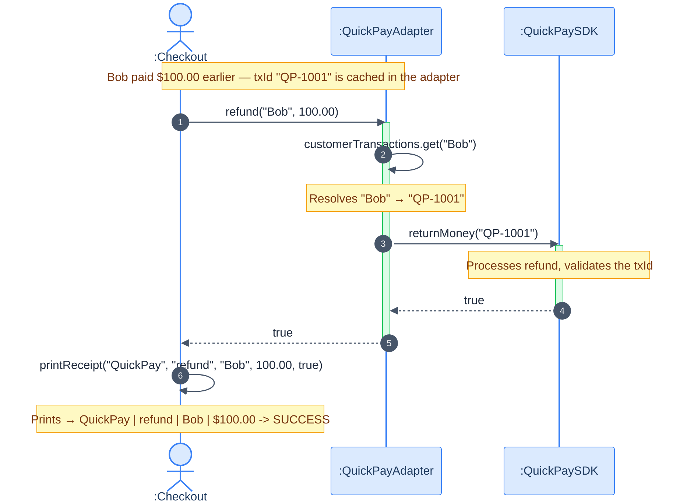

# Adapter Design Pattern: Online Store Payment System

This project implements an online store checkout and payment system in Java using the **Adapter Design Pattern**.

In real-world software, payment gateways and third-party libraries come with completely different methods, parameter orders, units (cents vs. dollars vs. euros), and return types. Instead of rewriting third-party code or cluttering the checkout system with complex `if/else` checks, the Adapter pattern lets all services speak a single, clean language through the `PaymentProcessor` interface.

---

## Task 1 – Identify the Pattern Elements

### Design Pattern Name & Justification

- **Pattern Name:** Adapter Design Pattern (specifically, the **Object Adapter** form using composition).
- **Why it fits:**
  The checkout module expects a uniform interface (`PaymentProcessor` with `pay` and `refund`). However, we have three existing third-party services (`LegacyBankGateway`, `QuickPaySDK`, and `EuroPayService`) whose source code we cannot modify and whose method signatures don't match what checkout expects. The Adapter pattern acts as a translator — wrapping each incompatible service and making it look identical to the client without touching either side.

---

### Pattern Roles Table

| Pattern Role      | Class / Interface                                    | Responsibility                                                                                                                                                                         |
| :---------------- | :--------------------------------------------------- | :------------------------------------------------------------------------------------------------------------------------------------------------------------------------------------- |
| **Target**  | `PaymentProcessor`                                 | The interface the client expects. Defines standard `getName()`, `pay(customer, amountInDollars)`, and `refund(customer, amountInDollars)` methods.                               |
| **Adaptee** | `LegacyBankGatewayQuickPaySDK``EuroPayService`     | Existing third-party service classes with incompatible method signatures, units, and return formats. We cannot change these.                                                           |
| **Adapter** | `LegacyBankAdapterQuickPayAdapter``EuroPayAdapter` | Each implements `PaymentProcessor` and wraps one Adaptee via composition. Handles all conversions: units, currencies, parameter reordering, ID caching, and return type translation. |
| **Client**  | `Checkout`                                         | The store's checkout module that processes payments and refunds strictly through the `PaymentProcessor` interface — completely unaware of which actual service runs underneath.     |

---

### Questions & Answers

#### 1. What does each adapter convert when `pay("Alice", 25.50)` is called?

- **`LegacyBankAdapter`**:

  - Converts `$25.50` dollars to `2550` cents (`25.50 * 100`).
  - Calls `gateway.makeTransfer("Alice", 2550)`.
  - Converts the integer return code (`0` = success) to `boolean` (`return statusCode == 0`).
- **`QuickPayAdapter`**:

  - Adds the required currency `"USD"` and reorders arguments: calls `quickPaySDK.sendMoney("USD", 25.50, "Alice")`.
  - Receives a transaction ID string (`"QP-1001"`) or `null`.
  - Saves the transaction ID mapped to the customer name for future refunds.
  - Returns `true` if transaction ID is not null, `false` otherwise.
- **`EuroPayAdapter`**:

  - Converts customer name to store email: `"Alice"` → `"alice@store.com"`.
  - Converts dollar amount to euros: `$25.50 * 0.90 = 22.95 EUR`.
  - Calls `euroPayService.chargeCard("alice@store.com", 22.95)`.
  - Returns the boolean result directly.

---

#### 2. Why does `QuickPayAdapter` need to store data between calls?

`QuickPaySDK.returnMoney()` requires a **transaction ID** (e.g. `"QP-1001"`) to issue a refund. But the store's `refund()` method only provides the customer name and dollar amount.

The adapter bridges this gap by acting as a memory cache:

1. During `pay()`, it stores: `"Bob" → "QP-1001"`.
2. During `refund("Bob", 100.00)`, it retrieves `"QP-1001"` from its internal map and passes it to `quickPaySDK.returnMoney("QP-1001")`.

Without this stored state, a QuickPay refund would be impossible without leaking transaction ID knowledge into the client code.

---

#### 3. Object Adapter vs. Class Adapter — which did we use and why?

We use the **Object Adapter** (composition — "has-a" relationship).

|                      | Object Adapter                               | Class Adapter                                                                 |
| -------------------- | -------------------------------------------- | ----------------------------------------------------------------------------- |
| Mechanism            | Adapter *holds a reference* to the Adaptee | Adapter *extends* the Adaptee via inheritance                               |
| Java feasibility     | Works in all cases                           | Impossible when Adaptee is `final` or when Adapter already has a base class |
| Flexibility          | Can wrap any instance at runtime             | Tightly coupled to one specific subclass                                      |
| **Our choice** | ✅ Used here                                 | ❌ Not used                                                                   |

Java only allows single inheritance. Using composition means we can wrap any version of a third-party object without restrictions, which is the standard real-world approach.

---

## Task 2 – UML Diagrams

### 1. Class Diagram



> **Color legend:**
> 🟣 **Purple** = Client (`Checkout`)
> 🔵 **Blue** = Target Interface (`PaymentProcessor`)
> 🟢 **Green** = Adapters (bridge layer)
> 🟡 **Yellow** = Adaptees (third-party services, untouched)

> [!NOTE]
> **Reading the diagram:** Dashed arrows with a hollow triangle (`--|>`) mean "implements". Dashed arrows with an open arrowhead (`..>`) mean "uses/depends on". Solid arrows (`-->`) mean "holds a reference to" (composition).

---

### 2. Sequence Diagram: `Checkout.refund("Bob", 100.00)` via QuickPayAdapter

This trace walks through exactly what happens at runtime when the checkout triggers a QuickPay refund for Bob.



> [!NOTE]
> The client (`Checkout`) never calls `QuickPaySDK` directly — it only talks to `QuickPayAdapter`. The transaction ID lookup and delegation happen entirely inside the adapter, invisible to the client.

---

## Task 3 – Implementation Details

### File Structure

```text
adapter_design_pattern/
├── PaymentProcessor.java        ← Target interface (the expected contract)
├── Checkout.java                ← Client (only talks to PaymentProcessor)
├── LegacyBankGateway.java       ← Adaptee 1: charges in cents, returns int code
├── QuickPaySDK.java             ← Adaptee 2: needs currency, returns txId string
├── EuroPayService.java          ← Adaptee 3: charges EUR, needs email address
├── LegacyBankAdapter.java       ← Adapter 1: converts cents + status code
├── QuickPayAdapter.java         ← Adapter 2: adds currency, caches txIds
├── EuroPayAdapter.java          ← Adapter 3: converts USD→EUR, builds email
└── Main.java                    ← Driver (wires everything together)
```

> [!NOTE]
> After compiling with `javac`, Java generates `.class` files (compiled bytecode) alongside your `.java` source files. The `.class` files are what the JVM actually runs. You should only commit the `.java` source files — `.class` files belong in `.gitignore` since they're automatically regenerated every time you compile.

---

### What Each Adapter Converts At a Glance

| Adapter               | Input from Client       | What it converts                                    | Call made to Adaptee                    |
| --------------------- | ----------------------- | --------------------------------------------------- | --------------------------------------- |
| `LegacyBankAdapter` | `"Alice"`, `$25.50` | `$25.50` → `2550` cents; `int 0` → `true` | `makeTransfer("Alice", 2550)`         |
| `QuickPayAdapter`   | `"Bob"`, `$100.00`  | Adds `"USD"`; saves txId; `null` → `false`   | `sendMoney("USD", 100.0, "Bob")`      |
| `EuroPayAdapter`    | `"Carol"`, `$50.00` | `$50.00 * 0.90 = 45EUR`; `"Carol"` → email     | `chargeCard("carol@store.com", 45.0)` |

---

### Key Design Points

1. **Zero changes to third-party code:** `LegacyBankGateway`, `QuickPaySDK`, and `EuroPayService` remain exactly as provided. No imports of `PaymentProcessor`, no new methods, nothing.
2. **Zero vendor logic in Checkout:** `Checkout.java` contains no `instanceof`, no currency math, no email building. It calls `processor.pay()` and `processor.refund()` — done.
3. **Open for extension:** Adding a fourth payment service only requires writing a new Adapter class. Nothing else changes.

---

## How to Run

```powershell
cd adapter_design_pattern

# Compile all source files
javac *.java

# Run the demonstration
java Main
```

---

## Sample Output

```text
==========================================================
     Online Store Payment System (Adapter Pattern Demo)
==========================================================

Configured Payment Processors:
 - Legacy Bank
 - QuickPay
 - EuroPay

--- Executing Sample Transactions ---
  [LegacyBankGateway] Processing transfer: 2550 cents for Alice...
  [LegacyBankGateway] Transfer approved: 2550 cents for Alice.
Legacy Bank | pay | Alice | $25.50 -> SUCCESS
  [QuickPaySDK] Sending 100.00 USD for payer 'Bob'...
  [QuickPaySDK] Payment succeeded. Assigned Transaction ID: QP-1001
QuickPay | pay | Bob | $100.00 -> SUCCESS
  [EuroPayService] Charging 45.00 EUR to account carol@store.com...
  [EuroPayService] Charge successful: 45.00 EUR from carol@store.com.
EuroPay | pay | Carol | $50.00 -> SUCCESS
  [LegacyBankGateway] Processing transfer: 150000 cents for Dave...
  [LegacyBankGateway] Transfer declined: 150000 cents exceeds limit of 100000 cents.
Legacy Bank | pay | Dave | $1500.00 -> FAILED
  [QuickPaySDK] Processing refund for Transaction ID: QP-1001...
  [QuickPaySDK] Refund completed for Transaction ID: QP-1001.
QuickPay | refund | Bob | $100.00 -> SUCCESS
  [EuroPayService] Refunding 45.00 EUR to account carol@store.com...
  [EuroPayService] Refund successful: 45.00 EUR to carol@store.com.
EuroPay | refund | Carol | $50.00 -> SUCCESS

All transactions completed.
```

---

## How to Add a 4th Payment Service (Live Demo Prep)

The whole point of the Adapter pattern is that adding a new service is painless. Here's how it's done:

**Step 1:** Write the new Adaptee (or receive it as a third-party SDK):

```java
public class CryptoPayService {
    public String sendCrypto(String walletAddress, double btcAmount) {
        System.out.printf("  [CryptoPayService] Sending %.6f BTC to wallet %s%n", btcAmount, walletAddress);
        return "TX-HASH-" + System.currentTimeMillis();
    }
}
```

**Step 2:** Write a new Adapter implementing `PaymentProcessor`:

```java
public class CryptoPayAdapter implements PaymentProcessor {
    private final CryptoPayService service;
    private static final double USD_TO_BTC = 1.0 / 60000.0; // 1 BTC = $60,000

    public CryptoPayAdapter(CryptoPayService service) { this.service = service; }

    @Override public String getName() { return "CryptoPay"; }

    @Override
    public boolean pay(String customer, double amountInDollars) {
        double btc = amountInDollars * USD_TO_BTC;
        String txHash = service.sendCrypto(customer + "-wallet", btc);
        return txHash != null;
    }

    @Override public boolean refund(String customer, double amountInDollars) { return false; }
}
```

**Step 3:** Use it in `Main` — Checkout doesn't change at all:

```java
PaymentProcessor crypto = new CryptoPayAdapter(new CryptoPayService());
checkout.pay(crypto, "Eve", 120.00);
```

This is the **Open/Closed Principle** in action: open for extension, closed for modification.
