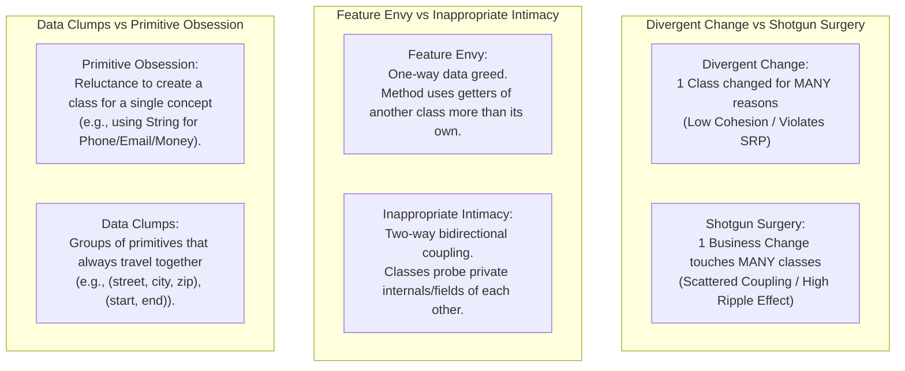
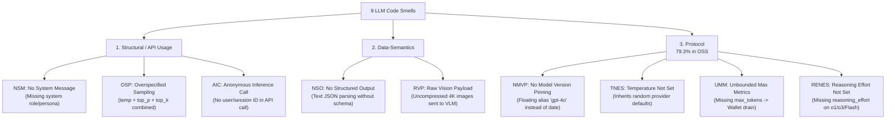
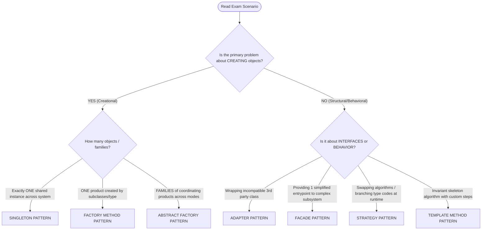

# MITE 435: Ultimate Exam Cram & Scenario Decision Engine
**Course:** Software Design Patterns | **Instructor:** Md Saeed Siddik, IIT DU

---

# SECTION 1: TRADITIONAL CODE SMELLS

## 1.1 Pairwise Comparisons of Similar Smells (High-Yield Exam Questions)



| Smell Pair | Core Difference | Diagnostic Question to Ask in Exam |
| :--- | :--- | :--- |
| **Divergent Change vs. Shotgun Surgery** | **1-to-Many vs. Many-to-1**: Divergent Change is *one* class altered for many different business reasons (SRP). Shotgun Surgery is *one* change forcing edits across *many* classes. | *"Does editing the tax rule touch 1 class (Divergent) or 15 different files (Shotgun)?"* |
| **Feature Envy vs. Inappropriate Intimacy** | **Behavior location vs. Mutual coupling**: Feature Envy calls public getters to calculate something that belongs in the other class. Inappropriate Intimacy dives into package-private/protected internals bidirectionally. | *"Is a method calling another object's getters repeatedly (Envy), or are two classes tightly coupled to internal guts (Intimacy)?"* |
| **Primitive Obsession vs. Data Clumps** | **Single entity vs. Grouped cluster**: Primitive Obsession is using a raw type for a domain concept (e.g., `String phone`). Data Clumps is multiple fields always travelling together in methods/classes. | *"Is it one raw string needing validation (Primitive), or 3 fields that always appear together (Clump)?"* |
| **Long Method vs. Large Class** | **Procedural bloat vs. Structural bloat**: Long Method is sequential execution doing multiple tasks inside one scope. Large Class accumulates too many fields, responsibilities, and helper methods. | *"Is the problem inside one 80-line function (Long Method), or in a 2,000-line class with 25 fields (Large Class)?"* |
| **Long Parameter List vs. Data Clumps** | **Method signature vs. Class definition**: Long Parameter List is just an argument list > 3-4 items. If those parameters repeatedly appear together across several methods, they form a Data Clump. | *"Do the 5 parameters appear in only this method (Long Parameter List) or across 4 different classes (Data Clump)?"* |

---

## 1.2 "Spot-the-Smell" Code Block Diagnostic Guide

When given a code snippet on the exam, scan in this order:

```
[Exam Snippet Scanner]
1. Count method lines > 25? Multiple commented paragraphs? ────────────► Long Method (Extract Method)
2. if/switch checking strings/typecodes ("CARD", "BKASH", "VIP")? ──────► Switch Statement (Polymorphism/Strategy)
3. Object A doing: b.getX() * b.getY() + b.getZ()? ─────────────────────► Feature Envy (Move Method to B)
4. Same 3 parameters (startDate, endDate, timeZone) in 3 methods? ──────► Data Clumps (Introduce Parameter Object)
5. Raw strings for domain rules (e.g. String phone = "+880...")? ──────► Primitive Obsession (Replace Data Value with Object)
6. Method has 6+ parameters (String a, int b, double c, ...)? ──────────► Long Parameter List (Parameter Object)
7. Exact same 8 lines of code in 2 different classes? ──────────────────► Duplicated Code (Extract Method / Pull Up)
8. Class modifies DB, formats HTML, calculates discounts? ──────────────► Divergent Change / God Class (Extract Class)
```

---

# SECTION 2: LLM CODE SMELLS

## 2.1 The 9 Smells Taxonomy (Chenail-Larcher et al. 2026)

**The Mental Model:** An LLM call is a software component requiring an **explicit, verifiable contract**:
1. **Input Clause:** System policy, user instructions, multimodal assets, user/session context.
2. **Model Clause:** Pinned version, reasoning effort, decoding policy.
3. **Boundary Clause:** Token cap, timeout, JSON schema.
4. **Trace Clause:** User attribution, audit tags, session ID.



## 2.2 Pairwise Comparison of LLM Smells

| Smell Pair | Core Distinction |
| :--- | :--- |
| **NMVP vs. TNES** | **Identity vs. Sampling**: NMVP is model *identity drift* (vendor changes base weights behind alias). TNES is *stochastic variance* (vendor changes default temperature from 0.7 to 1.0). |
| **OSP vs. TNES** | **Too many knobs vs. Zero knobs**: OSP simultaneously tweaks `temperature`, `top_p`, `top_k` creating conflicting decoding. TNES omits sampling controls entirely. |
| **UMM vs. RENES** | **Output token limit vs. Internal thinking limit**: UMM leaves output token length unbounded (`max_tokens`). RENES leaves internal reasoning step tokens unbounded (`reasoning_effort`). |
| **NSO vs. RVP** | **Output payload defect vs. Input payload defect**: NSO treats structured return as free-form string. RVP sends multi-megabyte uncompressed input bitmaps. |
| **NSM vs. Prompt Bloat** | **Integration code defect vs. Prompt text defect**: NSM is passing no `system` message in API payload. Prompt Bloat is writing 200 words of useless backstory inside the prompt text. |

---

# SECTION 3: PROMPT SMELLS

## 3.1 Prompt Smell Spotter Table (Scan Given Prompts)

```
[Prompt Text Scanner]
1. Mentions "software" or "architecture" with no audience, scope, or depth? ──► Vague / Missing Context
2. Uses "it", "they", "this problem", "the changes" without names? ─────────────► Ambiguous References
3. Asks for "recommendations" or "analysis" without output structure? ─────────► Format Ambiguity
4. One prompt asks for requirements + architecture + code + tests + slides? ──► Overloaded Prompt (God Prompt)
5. 3 paragraphs of "Imagine you are a world-class award-winning architect..."? ──► Prompt Bloat / Convoluted Prompt
6. "Keep it simple. Make it easy. Don't make it complex. Use easy words."? ────► Unnecessary Repetition
7. "Write a comprehensive 10-page analysis in exactly 50 words."? ──────────────► Conflicting Constraints
8. "Act as a pirate astronaut... What is a Java Interface?"? ───────────────────► Irrelevant / Excessive Persona
9. "Explain why microservices are obviously 100x better than monoliths."? ─────► Bias / Loaded Framing
10. Low-level assembly language explanation sent to Board of Directors? ───────► Formality / Audience Mismatch
```

---

# SECTION 4: UNIVERSAL DESIGN PATTERN SELECTION ALGORITHM
*(Follow this exact flowchart to solve ANY exam scenario and draw the class diagram)*

## 4.1 The 4-Step Scenario Decision Algorithm



### Scenario Clue Matrix (Keyword Triggers):
* **"Only one shared connection pool, logger, or hardware manager"** $\to$ **Singleton**
* **"Framework defines when to create, but subclasses specify WHICH class"** $\to$ **Factory Method**
* **"System supports multiple modes/themes (e.g. Online vs Offline, Dark vs Light, Mac vs Windows), each needing 2+ coordinated components"** $\to$ **Abstract Factory**
* **"Switch/if-else chains checking payment type, routing type, or compression type"** $\to$ **Strategy**
* **"Need to simplify access to 5 different subsystem services through 1 clean call"** $\to$ **Facade**
* **"Third-party library interface doesn't match our required domain interface"** $\to$ **Adapter**
* **"Algorithm steps are fixed in order, but step 2 and step 4 vary across subclasses"** $\to$ **Template Method**

---

## 4.2 Universal UML Class Diagram Architecture

### Pattern 1: Singleton
```
+---------------------------------------+
|              Singleton                |
+---------------------------------------+
| - instance: Singleton {static}        |
+---------------------------------------+
| - Singleton()                         |
| + getInstance(): Singleton {static}   |
| + businessMethod(): void              |
+---------------------------------------+
```

### Pattern 2: Factory Method
```
      <<interface>>                               <<abstract>>
       +Product+                                   +Creator+
      +---------+                                 +---------+
      |+operate()+                                |+someOperation()+
           ^                                      |+factoryMethod(): Product+
           | implements                                ^
    +---------------+                                  | extends
    |ConcreteProduct|                          +-----------------+
    +---------------+                          | ConcreteCreator |
    |+operate()+    | <.... creates .......... +-----------------+
                                               |+factoryMethod(): Product+
```

### Pattern 3: Abstract Factory (Universal for Multi-Mode / Multi-Component Scenarios)
```
       <<interface>>                               <<interface>>
       +AbstractProductA+                          +AbstractProductB+
       +---------------+                           +---------------+
       |+actionA()+    |                           |+actionB()+    |
         ^           ^                               ^           ^
         |           |                               |           |
+-------------+ +-------------+             +-------------+ +-------------+
|ProdA_Online | |ProdA_Offline|             |ProdB_Online | |ProdB_Offline|
+-------------+ +-------------+             +-------------+ +-------------+
       ^               ^                           ^               ^
       : creates       : creates                   : creates       : creates
       :               :                           :               :
+-------------------+ +--------------------+       :               :
|OnlineFactory      | |OfflineFactory      |.......:               :
+-------------------+ +--------------------+.......................:
|+createProductA()  | |+createProductA()   |
|+createProductB()  | |+createProductB()   |
+-------------------+ +--------------------+
         ^                      ^
         | implements           | implements
       +----------------------------+
       |   <<interface>>            |
       |   +CourseComponentFactory+ |
       +----------------------------+
       |+createProductA(): ProductA |
       |+createProductB(): ProductB |
       +----------------------------+
                     ^
                     | injects factory
               +-----------+
               |  Client   |
               +-----------+
```

---

## 4.3 UML Relationship Notation Rules for Exam Sheets
* **Inheritance / Generalization (`extends`):** Solid line with **hollow triangle** pointing to superclass (`───▷`).
* **Interface Realization (`implements`):** Dashed line with **hollow triangle** pointing to interface (`- - -▷`).
* **Dependency (`uses / creates`):** Dashed line with **open arrow** pointing to dependency (`- - -▶`).
* **Association (`has a field`):** Solid line with **open arrow** (`───▶`).
* **Aggregation (`shared collection`):** Solid line with **hollow diamond** at owner (`◇───`).
* **Composition (`strict ownership / lifecycle tied`):** Solid line with **filled black diamond** at owner (`◆───`).
