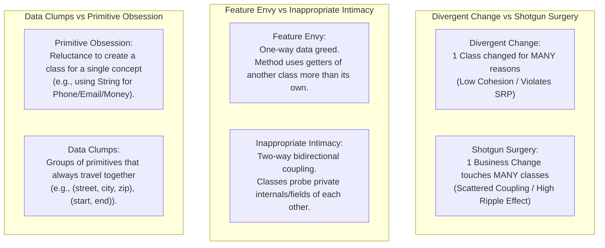
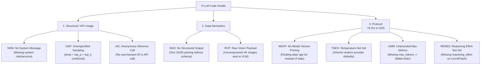
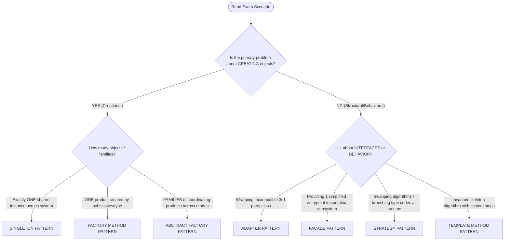

# MITE 435: Ultimate Exam Cram & Scenario Decision Engine

**Course:** Software Design Patterns | **Instructor:** Md Saeed Siddik, IIT DU

---

# SECTION 1: TRADITIONAL CODE SMELLS

## 1.1 Master Memory Table (All 12 Smells — Fowler & Beck)

| Smell                             | One-Line Memory Hook                                            | Trigger Keyword / Symptom                                       | Primary Refactoring                       | SOLID Violated     |
| :-------------------------------- | :-------------------------------------------------------------- | :-------------------------------------------------------------- | :---------------------------------------- | :----------------- |
| **Long Method**             | Method does too many steps in sequence                          | Lines of code > 30, multiple commented paragraphs               | *Extract Method*                        | SRP                |
| **Large Class (God Class)** | Class knows/does too much                                       | "Does X**and** does Y", > 10 fields                       | *Extract Class*, *Extract Subclass*   | SRP                |
| **Duplicated Code**         | Same logic copy-pasted in multiple spots                        | Identical algorithm in multiple classes/methods                 | *Extract Method*, *Pull Up Method*    | DRY                |
| **Long Parameter List**     | Method needs > 3-4 arguments                                    | Parameter count high, positional argument swaps                 | *Introduce Parameter Object*            | SRP                |
| **Feature Envy**            | Method in Class A pines for data in Class B                     | Method repeatedly calls getters on another object               | *Move Method* (to data owner)           | Cohesion           |
| **Data Clumps**             | Same group of fields always appears together                    | `(street, city, zip)`, `(startDate, endDate)`               | *Extract Class*                         | Cohesion           |
| **Switch Statements**       | Branching on type code using`switch` / `if-else`            | `if (type.equals("CARD")) ... else if ...`                    | *Replace Conditional with Polymorphism* | OCP                |
| **Primitive Obsession**     | Using`String`/`int` instead of domain objects               | Raw strings for phone, currency, email, zip                     | *Replace Data Value with Object*        | Encapsulation      |
| **Divergent Change**        | **1 Class** modified for **many unrelated reasons** | Change DB$\to$ edit class; change tax $\to$ edit same class | *Extract Class*                         | SRP                |
| **Shotgun Surgery**         | **1 Requirement change** touches **many classes**   | Add discount$\to$ must edit 10 different files                | *Move Method*, *Inline Class*         | Coupling           |
| **Inappropriate Intimacy**  | Classes know too much about each other's guts                   | Accessing private/internal internals excessively                | *Move Method*, *Hide Delegate*        | Information Hiding |
| **Speculative Generality**  | Over-engineering for hypothetical futures (YAGNI)               | Unused abstract classes, empty interfaces                       | *Collapse Hierarchy*, *Inline Class*  | YAGNI              |

---

## 1.2 Pairwise Comparisons of Similar Smells (High-Yield Exam Questions)



| Smell Pair                                        | Core Difference                                                                                                                                                                                                                   | Diagnostic Question to Ask in Exam                                                                                                    |
| :------------------------------------------------ | :-------------------------------------------------------------------------------------------------------------------------------------------------------------------------------------------------------------------------------- | :------------------------------------------------------------------------------------------------------------------------------------ |
| **Divergent Change vs. Shotgun Surgery**    | **1-to-Many vs. Many-to-1**: Divergent Change is *one* class altered for many different business reasons (SRP). Shotgun Surgery is *one* change forcing edits across *many* classes.                                  | *"Does editing the tax rule touch 1 class (Divergent) or 15 different files (Shotgun)?"*                                            |
| **Feature Envy vs. Inappropriate Intimacy** | **Behavior location vs. Mutual coupling**: Feature Envy calls public getters to calculate something that belongs in the other class. Inappropriate Intimacy dives into package-private/protected internals bidirectionally. | *"Is a method calling another object's getters repeatedly (Envy), or are two classes tightly coupled to internal guts (Intimacy)?"* |
| **Primitive Obsession vs. Data Clumps**     | **Single entity vs. Grouped cluster**: Primitive Obsession is using a raw type for a domain concept (e.g., `String phone`). Data Clumps is multiple fields always travelling together in methods/classes.                 | *"Is it one raw string needing validation (Primitive), or 3 fields that always appear together (Clump)?"*                           |
| **Long Method vs. Large Class**             | **Procedural bloat vs. Structural bloat**: Long Method is sequential execution doing multiple tasks inside one scope. Large Class accumulates too many fields, responsibilities, and helper methods.                        | *"Is the problem inside one 80-line function (Long Method), or in a 2,000-line class with 25 fields (Large Class)?"*                |
| **Long Parameter List vs. Data Clumps**     | **Method signature vs. Class definition**: Long Parameter List is just an argument list > 3-4 items. If those parameters repeatedly appear together across several methods, they form a Data Clump.                         | *"Do the 5 parameters appear in only this method (Long Parameter List) or across 4 different classes (Data Clump)?"*                |

### Core Concept Distinctions:

* **Code Smell:** Visible symptom in design (program runs correctly today, but will be brittle and hard to change).
* **Bug:** Runtime defect producing wrong output or crashing.
* **Technical Debt:** Accumulated cost and interest of poor design choices over time.

---

## 1.3 "Spot-the-Smell" Code Block Diagnostic Guide

When given a code snippet on the exam, scan in this order:

```
[Exam Code Snippet Scanner]
1. Method lines > 25? Multiple commented paragraphs? ─────────────────► Long Method (Extract Method)
2. if/switch checking strings/typecodes ("CARD", "BKASH", "VIP")? ─────► Switch Statement (Polymorphism/Strategy)
3. Object A doing: b.getX() * b.getY() + b.getZ()? ────────────────────► Feature Envy (Move Method to B)
4. Same 3 parameters (startDate, endDate, timeZone) in 3 methods? ─────► Data Clumps (Introduce Parameter Object)
5. Raw strings for domain rules (e.g. String phone = "+880...")? ─────► Primitive Obsession (Replace Data Value with Object)
6. Method has 6+ parameters (String a, int b, double c, ...)? ─────────► Long Parameter List (Parameter Object)
7. Exact same 8 lines of code in 2 different classes? ─────────────────► Duplicated Code (Extract Method / Pull Up)
8. Class modifies DB, formats HTML, calculates discounts? ─────────────► Divergent Change / God Class (Extract Class)
```

---

# SECTION 2: LLM CODE SMELLS

## 2.1 The 9 Smells Taxonomy (Chenail-Larcher et al. 2026)

**The Mental Model:** An LLM call is a software component requiring an **explicit, verifiable contract**:

1. **Input Clause:** System policy, user instructions, multimodal assets, user/session context.
2. **Model Clause:** Pinned version, reasoning effort, decoding policy.
3. **Boundary Clause:** Token cap, timeout, JSON schema.
4. **Trace Clause:** User attribution, audit tags, session ID.



| Category                                 | Acronym         | Smell Name                          | One-Line Memory Hook                                          | Solution Pattern       |
| :--------------------------------------- | :-------------- | :---------------------------------- | :------------------------------------------------------------ | :--------------------- |
| **Structural / API Usage**         | **NSM**   | No System Message                   | Sends only`user` role; no persistent system persona/policy  | Template Method        |
|                                          | **OSP**   | Overspecified Sampling Parameters   | Setting`temperature` + `top_p` + `top_k` simultaneously | Strategy Pattern       |
|                                          | **AIC**   | Anonymous Inference Call            | No user/session ID passed; untraceable & un-auditable         | Adapter / Facade       |
| **Data-Semantics**                 | **NSO**   | No Structured Output                | Asking for JSON via raw text without schema validation        | Schema / DTO Parsing   |
|                                          | **RVP**   | Raw Vision Payload                  | Sending raw, uncompressed 4K images to VLMs                   | Facade (Pre-processor) |
| **Protocol** *(79.3% of smells)* | **NMVP**  | No Model Version Pinning            | Using unpinned alias (`gpt-4o`) instead of date snapshot    | Factory Method         |
|                                          | **TNES**  | Temperature Not Explicitly Set      | Omitting`temperature`; inherits varying provider defaults   | Factory Method         |
|                                          | **UMM**   | Unbounded Max Metrics               | Omitting`max_tokens`; risks denial-of-wallet loops          | Factory Method         |
|                                          | **RENES** | Reasoning Effort Not Explicitly Set | Omitting reasoning effort on thinking models (o1/o3/Flash)    | Strategy Pattern       |

---

## 2.2 Pairwise Comparison of LLM Smells

| Smell Pair                     | Core Distinction                                                                                                                                                                                    |
| :----------------------------- | :-------------------------------------------------------------------------------------------------------------------------------------------------------------------------------------------------- |
| **NMVP vs. TNES**        | **Identity vs. Sampling**: NMVP is model *identity drift* (vendor changes base weights behind alias). TNES is *stochastic variance* (vendor changes default temperature from 0.7 to 1.0). |
| **OSP vs. TNES**         | **Too many knobs vs. Zero knobs**: OSP simultaneously tweaks `temperature`, `top_p`, `top_k` creating conflicting decoding. TNES omits sampling controls entirely.                      |
| **UMM vs. RENES**        | **Output token limit vs. Internal thinking limit**: UMM leaves output token length unbounded (`max_tokens`). RENES leaves internal reasoning step tokens unbounded (`reasoning_effort`).  |
| **NSO vs. RVP**          | **Output payload defect vs. Input payload defect**: NSO treats structured return as free-form string. RVP sends multi-megabyte uncompressed input bitmaps.                                    |
| **NSM vs. Prompt Bloat** | **Integration code defect vs. Prompt text defect**: NSM is passing no `system` message in API payload. Prompt Bloat is writing 200 words of useless backstory inside the prompt text.       |

---

# SECTION 3: PROMPT SMELLS

## 3.1 Prompt Smells Master Table (10 Teaching Smells — Ronanki 2024, Della Porta 2026)

* **Core Axiom:** Smells are warning signs, not runtime bugs. Smelly prompts can still succeed by luck; clean prompts raise probability of success.

| Category                          | Prompt Smell                         | Smelly Example                                        | Memory Fix                                           | Code Smell Analog                  |
| :-------------------------------- | :----------------------------------- | :---------------------------------------------------- | :--------------------------------------------------- | :--------------------------------- |
| **I. Context & Clarity**    | **1. Vague Context**           | *"Explain software architecture."*                  | Name audience, level, and specific topics            | Uninitialized Variables            |
|                                   | **2. Ambiguous References**    | *"They changed it because of a problem."*           | Replace pronouns (*they, it*) with concrete nouns  | Dangling Pointers                  |
|                                   | **3. Format Ambiguity**        | *"Give me some risk recommendations."*              | Explicitly request a Markdown table with columns     | Primitive Obsession                |
| **II. Complexity**          | **4. Overloaded Prompt**       | *"Design UML, DB, Java, and tests for LMS."*        | Decompose into sequential, reviewed turns            | God Class / Long Method            |
|                                   | **5. Prompt Bloat**            | 200 words of decorative intro before request          | Delete filler; state task directly in first sentence | Dead Code / Speculative Generality |
|                                   | **6. Unnecessary Repetition**  | *"Keep it simple, make it easy, don't complicate."* | State constraint once with clear scope               | Duplicated Code                    |
|                                   | **7. Conflicting Constraints** | *"Comprehensive 100-page thesis in 100 words."*     | Resolve paradox: prioritize summary topics           | Mutually Exclusive Flags           |
| **III. Semantic & Quality** | **8. Irrelevant Persona**      | *"Act as a Nobel Prize astronaut... What is Java?"* | Use persona only when it alters required output      | Inappropriate Subclassing          |
|                                   | **9. Loaded / Biased Framing** | *"Explain why X is vastly superior to Y."*          | Request balanced trade-off analysis                  | Hardcoded Return / Bias            |
|                                   | **10. Audience Mismatch**      | Deep Kubernetes CIDR jargon for Board of Directors    | Match vocabulary and abstraction to reader           | Type Incompatibility               |

---

## 3.2 Prompt Smell Spotter Scanner (Scan Given Prompts)

```
[Prompt Text Scanner]
1. Mentions "software" or "architecture" with no audience, scope, or depth? ──► Vague / Missing Context
2. Uses "it", "they", "this problem", "the changes" without names? ─────────────► Ambiguous References
3. Asks for "recommendations" or "analysis" without output structure? ─────────► Format Ambiguity
4. One prompt asks for requirements + architecture + code + tests + slides? ──► Overloaded Prompt (God Prompt)
5. 3 paragraphs of "Imagine you are a world-class award-winning architect..."? ──► Prompt Bloat / Convoluted Prompt
6. "Keep it simple. Make it easy. Don't make it complex. Use easy words."? ────► Unnecessary Repetition
7. "Write a comprehensive 10-page analysis in exactly 50 words."? ──────────────► Conflicting Constraints
8. "Act as a pirate astronaut... What is a Java Interface?"? ───────────────────► Irrelevant / Excessive Persona
9. "Explain why microservices are obviously 100x better than monoliths."? ─────► Bias / Loaded Framing
10. Low-level assembly language explanation sent to Board of Directors? ───────► Formality / Audience Mismatch
```

---

# SECTION 4: CREATIONAL DESIGN PATTERNS & SCENARIO SOLVER

## 4.1 The 6 "Factories" (Only 2 are GoF Patterns!)

1. **Factory:** General umbrella term for anything that creates an object (Not GoF).
2. **Creation Method:** Method wrapping `new` (Not GoF).
3. **Static Creation Method:** `public static` creator like `LocalDate.now()` (Not GoF).
4. **Simple Factory:** Class with a `switch` statement creating objects (Not GoF).
5. **Factory Method (GoF):** Relies on **inheritance**; defines an abstract method letting **subclasses** decide which single product to instantiate.
6. **Abstract Factory (GoF):** Relies on **composition**; interface with multiple creation methods producing **families of related products**.

---

## 4.2 Singleton Mastery Cheat Sheet

* **Intent:** Exactly 1 instance + 1 global access point (`getInstance()`).
* **The 5 Implementations:**
  1. *Eager:* `private static final INSTANCE = new S();` (Thread-safe, not lazy).
  2. *Synchronized Method:* `public static synchronized getInstance()` (Lazy, massive lock overhead).
  3. *Double-Checked Locking (DCL):* `private static volatile S instance;` + double `if (instance == null)` checks (Lazy, fast, requires `volatile`!).
  4. *Bill Pugh Holder:* `private static class Holder { static final S INSTANCE = new S(); }` (Lazy, thread-safe, zero lock overhead).
  5. *Enum Singleton:* `public enum S { INSTANCE; }` (Best; reflection & serialization proof).
* **The 4 Attacks & Defenses:**
  * *Reflection:* Throw exception in constructor if instance already exists.
  * *Serialization:* Add `protected Object readResolve() { return getInstance(); }`.
  * *Cloning:* Override `clone()` to throw `CloneNotSupportedException`.
  * *Multithreading:* Use `volatile` with DCL or use Static Holder/Enum.

---

## 4.3 Factory Method vs. Abstract Factory

| Dimension                    | Factory Method                          | Abstract Factory                                         |
| :--------------------------- | :-------------------------------------- | :------------------------------------------------------- |
| **What it creates**    | **One product** type              | **A family** of related products                   |
| **OOP Mechanism**      | **Inheritance** (override method) | **Composition** (inject factory object)            |
| **UML Structure**      | Creator class has`createProduct()`    | Factory interface has`createChair()`, `createSofa()` |
| **Adding New Variant** | Add 1 Subclass & 1 Product class        | Add 1 Factory class implementing all family methods      |

---

## 4.4 Lab Work Scenario 1: EduSphere Quick Recall

* **Abstract Factory:** `CourseComponentFactory` $\to$ methods `createLecture()`, `createAssessment()`.
* **Product 1 (Lecture):** `deliverClass()`, `shareStudyMaterials()`.
  * *Online:* "Delivering lecture via live video session" | "Uploading recording and slides to the course portal"
  * *Offline:* "Delivering lecture in the classroom" | "Distributing printed handouts to students"
* **Product 2 (Assessment):** `conductAssessment()`, `publishResults()`.
  * *Online:* "Conducting MCQ quiz on the online portal" | "Publishing auto-graded results on student dashboards"
  * *Offline:* "Conducting written exam on paper" | "Posting manually graded results on the notice board"
* **Concrete Factories:** `OnlineCourseFactory` and `OfflineCourseFactory`.
* **Client:** `Course` receives `CourseComponentFactory` via constructor.

---

## 4.5 Universal Scenario Decision Algorithm (Solve ANY Exam Problem)



### Scenario Clue Matrix (Keyword Triggers):

* **"Only one shared connection pool, logger, or hardware manager"** $\to$ **Singleton**
* **"Framework defines when to create, but subclasses specify WHICH class"** $\to$ **Factory Method**
* **"System supports multiple modes/themes (e.g. Online vs Offline, Dark vs Light, Mac vs Windows), each needing 2+ coordinated components"** $\to$ **Abstract Factory**
* **"Switch/if-else chains checking payment type, routing type, or compression type"** $\to$ **Strategy**
* **"Need to simplify access to 5 different subsystem services through 1 clean call"** $\to$ **Facade**
* **"Third-party library interface doesn't match our required domain interface"** $\to$ **Adapter**
* **"Algorithm steps are fixed in order, but step 2 and step 4 vary across subclasses"** $\to$ **Template Method**

---

## 4.6 Universal UML Class Diagram Architecture

### Pattern 1: Singleton

```
+---------------------------------------+
|              Singleton                |
+---------------------------------------+
| - instance: Singleton {static}        |
+---------------------------------------+
| - Singleton()                         |
| + getInstance(): Singleton {static}   |
| + businessMethod(): void              |
+---------------------------------------+
```

### Pattern 2: Factory Method

```
      <<interface>>                               <<abstract>>
       +Product+                                   +Creator+
      +---------+                                 +---------+
      |+operate()+                                |+someOperation()+
           ^                                      |+factoryMethod(): Product+
           | implements                                ^
    +---------------+                                  | extends
    |ConcreteProduct|                          +-----------------+
    +---------------+                          | ConcreteCreator |
    |+operate()+    | <.... creates .......... +-----------------+
                                               |+factoryMethod(): Product+
```

### Pattern 3: Abstract Factory (Multi-Mode / Multi-Component Scenarios)

```
       <<interface>>                               <<interface>>
       +AbstractProductA+                          +AbstractProductB+
       +---------------+                           +---------------+
       |+actionA()+    |                           |+actionB()+    |
         ^           ^                               ^           ^
         |           |                               |           |
+-------------+ +-------------+             +-------------+ +-------------+
|ProdA_Online | |ProdA_Offline|             |ProdB_Online | |ProdB_Offline|
+-------------+ +-------------+             +-------------+ +-------------+
       ^               ^                           ^               ^
       : creates       : creates                   : creates       : creates
       :               :                           :               :
+-------------------+ +--------------------+       :               :
|OnlineFactory      | |OfflineFactory      |.......:               :
+-------------------+ +--------------------+.......................:
|+createProductA()  | |+createProductA()   |
|+createProductB()  | |+createProductB()   |
+-------------------+ +--------------------+
         ^                      ^
         | implements           | implements
       +----------------------------+
       |   <<interface>>            |
       |   +CourseComponentFactory+ |
       +----------------------------+
       |+createProductA(): ProductA |
       |+createProductB(): ProductB |
       +----------------------------+
                     ^
                     | injects factory
               +-----------+
               |  Client   |
               +-----------+
```

### UML Notation Rules for Exam Sheets

* **Inheritance / Generalization (`extends`):** Solid line with **hollow triangle** pointing to superclass (`───▷`).
* **Interface Realization (`implements`):** Dashed line with **hollow triangle** pointing to interface (`- - -▷`).
* **Dependency (`uses / creates`):** Dashed line with **open arrow** pointing to dependency (`- - -▶`).
* **Association (`has a field`):** Solid line with **open arrow** (`───▶`).
* **Aggregation (`shared collection`):** Solid line with **hollow diamond** at owner (`◇───`).
* **Composition (`strict ownership / lifecycle tied`):** Solid line with **filled black diamond** at owner (`◆───`).
