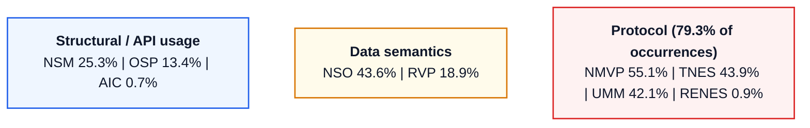
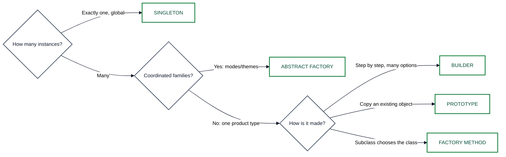
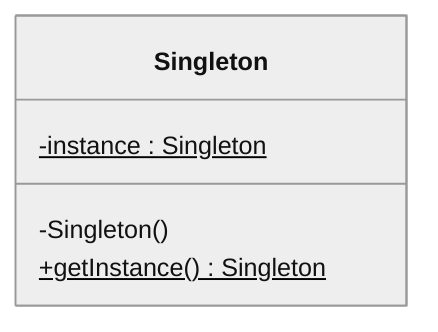
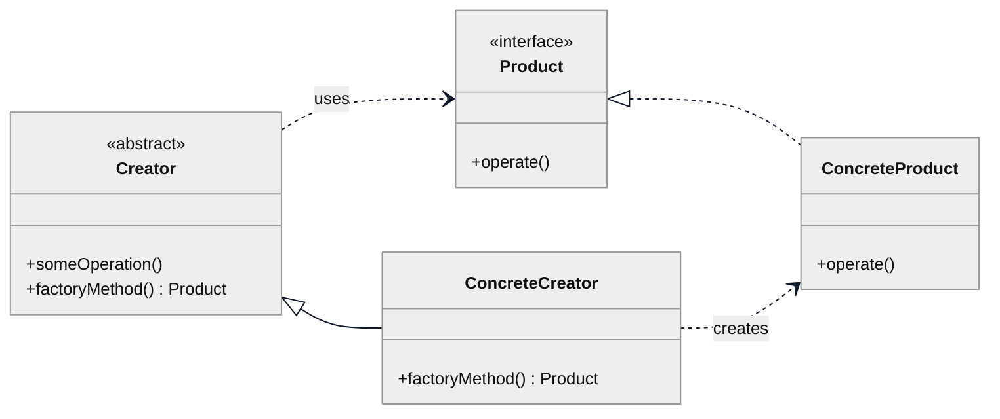
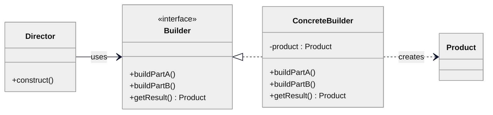
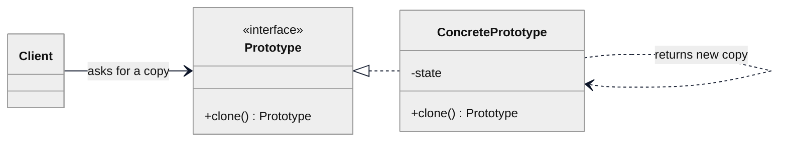
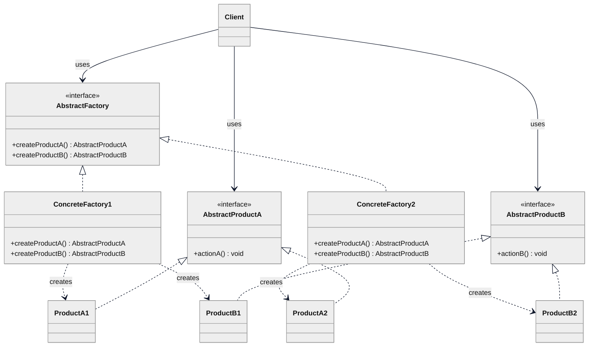
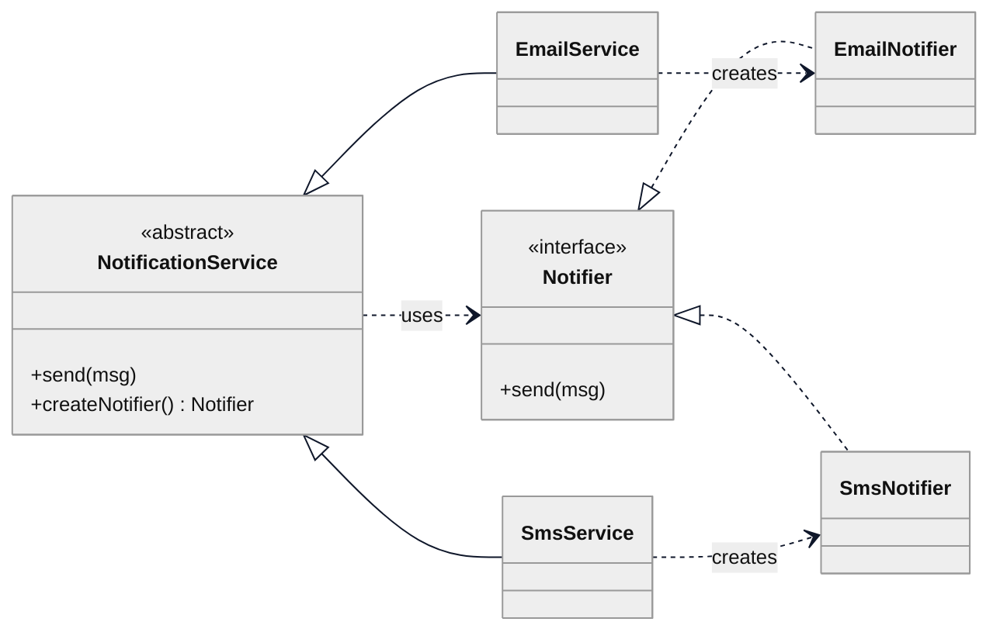

<style>
  @media print {
    @page { size: A4; margin: 0.5in; }
    body { background: #FFF !important; color: #000 !important; font-size: 9pt; line-height: 1.28; }
    h1 { font-size: 15pt !important; color: #000 !important; margin: 0 0 2px; }
    h2 { font-size: 11.5pt !important; color: #000 !important; border-bottom: 1.5px solid #000 !important;
         padding-bottom: 1px; margin: 8px 0 3px; page-break-after: avoid; }
    h3 { font-size: 9.5pt !important; color: #111827 !important; margin: 5px 0 2px; page-break-after: avoid; }
    p, ul, ol { margin: 2px 0 !important; }
    li { margin: 0 !important; }
    hr { margin: 4px 0 !important; border: 0; border-top: 1px solid #94A3B8; }
    table { width: 100% !important; border-collapse: collapse !important; margin: 3px 0 6px !important; font-size: 8pt !important; }
    tr { page-break-inside: avoid !important; }
    th, td { border: 1px solid #1E293B !important; padding: 1.5px 4px !important; color: #000 !important; }
    th { background: #E2E8F0 !important; font-weight: 700 !important; }
    pre { font-size: 7.6pt !important; line-height: 1.2 !important; background: #F8FAFC !important;
          border: 1px solid #94A3B8 !important; padding: 3px 5px !important; margin: 3px 0 !important;
          page-break-inside: avoid !important; white-space: pre; }
    code { font-size: 8pt !important; background: none !important; border: 0 !important; color: #000 !important; }
    .mermaid { page-break-inside: avoid !important; margin: 4px 0 !important; }
  }
  body { background: #FFF; color: #0F172A; font-family: -apple-system, BlinkMacSystemFont, "Segoe UI", Roboto, Arial, sans-serif; }
  table { border-collapse: collapse; width: 100%; margin-bottom: 10px; }
  th, td { border: 1px solid #CBD5E1; padding: 4px 7px; text-align: left; vertical-align: top; }
  th { background: #F1F5F9; font-weight: 600; }
  pre { background: #F8FAFC; border: 1px solid #CBD5E1; border-radius: 4px; padding: 8px; overflow-x: auto; }
  .mermaid text, svg text { font-size: 13px !important; font-weight: 600 !important;
    font-family: -apple-system, BlinkMacSystemFont, "Segoe UI", Roboto, Arial, sans-serif !important; }
</style>

# MITE 435: Exam Cram Sheet and Scenario Decision Guide

**Course:** Software Design Patterns | **Instructor:** Md Saeed Siddik, IIT DU | A4 print edition

---

# SECTION 1: TRADITIONAL CODE SMELLS

## 1.1 All 12 Smells (Fowler & Beck)

| Smell | Memory hook | Trigger / symptom | Refactoring | Violates |
| :-- | :-- | :-- | :-- | :-- |
| **Long Method** | Does too many steps in a row | > 30 lines, commented "paragraphs" | Extract Method | SRP |
| **Large Class (God Class)** | Knows and does too much | "Does X **and** Y", > 10 fields | Extract Class / Subclass | SRP |
| **Duplicated Code** | Same logic copy-pasted | Same algorithm in several places | Extract Method, Pull Up Method | DRY |
| **Long Parameter List** | Needs > 3-4 arguments | Many positional args, easy to swap | Introduce Parameter Object | none named |
| **Feature Envy** | Method wants data of class B | Repeated getters on another object | Move Method (to data owner) | Encapsulation |
| **Data Clumps** | Same fields travel together | `(street, city, zip)`, `(startDate, endDate)` | Extract Class | none named |
| **Switch Statements** | Branches on a type code | `if (type.equals("CARD")) ... else if ...` | Replace Conditional with Polymorphism | OCP |
| **Primitive Obsession** | `String`/`int` instead of a domain object | Raw strings for phone, money, email | Replace Data Value with Object | Encapsulation |
| **Divergent Change** | **1 class**, **many** unrelated reasons to change | Change DB → edit it; change tax → edit it again | Extract Class | SRP |
| **Shotgun Surgery** | **1 change**, **many** classes edited | Add a discount → edit 10 files | Move Method, Inline Class | SRP |
| **Inappropriate Intimacy** | Classes know each other's internals | Reaching into private/internal state | Move Method, Hide Delegate | Encapsulation / Law of Demeter |
| **Speculative Generality** | Built for a future that never came (YAGNI) | Unused abstract classes, empty interfaces | Collapse Hierarchy, Inline Class | YAGNI |

## 1.2 Look-Alike Smells (High-Yield Exam Questions)

| Pair | Core difference | Ask yourself |
| :-- | :-- | :-- |
| **Divergent Change vs Shotgun Surgery** | **1 class, many reasons** (low cohesion) vs **1 change, many classes** (scattered coupling). | Does the tax rule touch 1 class (Divergent) or 15 files (Shotgun)? |
| **Feature Envy vs Inappropriate Intimacy** | One-way: a method uses another class's public getters. Two-way: classes probe each other's internals. | One method using getters (Envy) or two classes tied by internals (Intimacy)? |
| **Primitive Obsession vs Data Clumps** | One raw type standing in for a concept (`String phone`) vs several fields that always appear together. | One raw string needing validation, or 3 fields always together? |
| **Long Method vs Large Class** | Bloat inside one function vs bloat in a whole class (many fields and duties). | One 80-line function, or a 2,000-line class with 25 fields? |
| **Long Parameter List vs Data Clumps** | A long argument list in one method. If the same params repeat across several methods, it is a Data Clump. | 5 params in one method, or the same 5 in 4 classes? |

**Smell vs Bug vs Debt:** a *smell* is a design symptom (code works today but is brittle). A *bug* gives wrong output or a crash. *Technical debt* is the growing cost of poor design choices.

## 1.3 Spot-the-Smell Scanner (scan a snippet in this order)

```
1. Method > 25 lines, commented paragraphs?               -> Long Method (Extract Method)
2. if/switch on strings or type codes ("CARD", "VIP")?    -> Switch Statement (Polymorphism / Strategy)
3. a.x() uses b.getX() * b.getY() + b.getZ()?             -> Feature Envy (Move Method to B)
4. Same 3 params (start, end, tz) in 3 methods?           -> Data Clumps (Parameter Object)
5. Raw strings for domain rules (String phone = "+880")?  -> Primitive Obsession (Value Object)
6. Method with 6+ params?                                 -> Long Parameter List (Parameter Object)
7. Same 8 lines in 2 classes?                             -> Duplicated Code (Extract Method / Pull Up)
8. One class does DB, HTML and discounts?                 -> Divergent Change / God Class (Extract Class)
```

---

# SECTION 2: LLM CODE SMELLS

## 2.1 The 9 Smells (Chenail-Larcher et al. 2026)

**Mental model:** an LLM call is a component that needs an explicit contract with 4 clauses: **Input** (system policy, instructions, assets, context), **Model** (pinned version, reasoning effort, decoding), **Boundary** (token cap, timeout, JSON schema), **Trace** (user, audit tag, session ID).



*Percent = share of the 692 studied projects with at least one occurrence (lecture v2).*

| Category | Code | Smell | Memory hook | Solution pattern |
| :-- | :-- | :-- | :-- | :-- |
| **Structural / API usage** | **NSM** | No System Message | Only a `user` role; no system persona or policy | Template Method / Strategy |
| | **OSP** | Overspecified Sampling Parameters | `temperature` + `top_p` + `top_k` all set | Strategy |
| | **AIC** | Anonymous Inference Call | No user/session ID; cannot trace or audit | Context Object / Facade |
| **Data semantics** | **NSO** | No Structured Output | JSON asked as free text, no schema check | Adapter (typed object) |
| | **RVP** | Raw Vision Payload | Uncompressed 4K images sent to a VLM | Chain of Responsibility (resize, compress, redact) |
| **Protocol** *(79.3% of occurrences)* | **NMVP** | No Model Version Pinning | Alias (`gpt-4o`) instead of a dated snapshot | Factory Method |
| | **TNES** | Temperature Not Explicitly Set | Inherits changing provider default | Factory / Config Object |
| | **UMM** | Unbounded Max Metrics | No `max_tokens`; denial-of-wallet risk | Facade / Gateway |
| | **RENES** | Reasoning Effort Not Explicitly Set | No effort setting on thinking models (o1/o3/Flash) | Strategy |

## 2.2 Look-Alike LLM Smells

| Pair | Core difference |
| :-- | :-- |
| **NMVP vs TNES** | Identity vs sampling. NMVP: the vendor swaps the weights behind an alias. TNES: the vendor changes the default temperature (0.7 to 1.0). |
| **OSP vs TNES** | Too many knobs vs none. OSP sets `temperature`, `top_p`, `top_k` together and they conflict. TNES sets no sampling control. |
| **UMM vs RENES** | Output limit vs thinking limit. UMM: `max_tokens` unbounded. RENES: `reasoning_effort` unbounded. |
| **NSO vs RVP** | Output defect vs input defect. NSO: structured reply treated as a free string. RVP: huge uncompressed images sent in. |
| **NSM vs Prompt Bloat** | Code defect vs text defect. NSM: no `system` message in the API payload. Prompt Bloat: 200 words of backstory inside the prompt. |

---

# SECTION 3: PROMPT SMELLS

## 3.1 The 10 Prompt Smells (Ronanki 2024, Della Porta 2026)

**Axiom:** smells are warning signs, not runtime bugs. A smelly prompt can still work by luck; a clean one raises the odds.

| Category | Smell | Smelly example | Fix | Code-smell analog |
| :-- | :-- | :-- | :-- | :-- |
| **I. Context & clarity** | **1. Vague Context** | "Explain software architecture." | Name audience, level, topics | Uninitialized variable |
| | **2. Ambiguous References** | "They changed it because of a problem." | Replace *they/it* with nouns | Dangling pointer |
| | **3. Format Ambiguity** | "Give me some risk recommendations." | Ask for a table with named columns | Primitive Obsession |
| **II. Complexity** | **4. Overloaded Prompt** | "Design UML, DB, Java and tests for an LMS." | Split into reviewed turns | God Class / Long Method |
| | **5. Prompt Bloat** | 200 words of intro before the request | Cut filler; state the task first | Dead Code / Speculative Generality |
| | **6. Unnecessary Repetition** | "Keep it simple, make it easy, don't complicate." | State the constraint once | Duplicated Code |
| | **7. Conflicting Constraints** | "A 100-page thesis in 100 words." | Resolve the conflict; set priorities | Mutually exclusive flags |
| **III. Semantic & quality** | **8. Irrelevant Persona** | "Act as a Nobel astronaut... What is Java?" | Persona only if it changes the output | Inappropriate Subclassing |
| | **9. Loaded / Biased Framing** | "Explain why X is far superior to Y." | Ask for a balanced trade-off analysis | Hardcoded return / bias |
| | **10. Audience Mismatch** | Kubernetes CIDR jargon for a board | Match vocabulary to the reader | Type incompatibility |

## 3.2 Prompt Smell Scanner

```
1. "software"/"architecture", no audience, scope or depth?   -> Vague Context
2. "it", "they", "this problem", "the changes" unnamed?      -> Ambiguous References
3. "recommendations"/"analysis" with no output structure?    -> Format Ambiguity
4. Requirements + architecture + code + tests + slides?      -> Overloaded Prompt (God Prompt)
5. 3 paragraphs of "Imagine you are a world-class expert"?   -> Prompt Bloat
6. "Keep it simple. Make it easy. Don't be complex."?         -> Unnecessary Repetition
7. "A comprehensive 10-page analysis in exactly 50 words"?    -> Conflicting Constraints
8. "Act as a pirate astronaut... What is an Interface?"       -> Irrelevant Persona
9. "Why microservices are obviously 100x better"?             -> Loaded Framing
10. Assembly-level detail sent to a board of directors?       -> Audience Mismatch
```

## 3.3 Look-Alike Prompt Smells

| Pair | Core difference |
| :-- | :-- |
| **Vague Context vs Ambiguous References** | Vague: the *topic* has no audience, scope or depth. Ambiguous: the *words* (it, they, this) point to nothing clear. |
| **Prompt Bloat vs Unnecessary Repetition** | Bloat: lots of useless *new* text (backstory, flattery). Repetition: the *same* constraint said again and again. |
| **Overloaded vs Conflicting Constraints** | Overloaded: too many *tasks*, each possible alone. Conflicting: rules that cannot *all* be true ("100 pages in 100 words"). |
| **Irrelevant Persona vs Audience Mismatch** | Persona: a role given to the *model* that changes nothing. Mismatch: the *answer's level* does not fit the reader. |
| **Loaded Framing vs Format Ambiguity** | Loaded: the prompt pushes a *conclusion*. Format Ambiguity: the *shape* of the answer is not stated. |

---

# SECTION 4: CREATIONAL DESIGN PATTERNS

## 4.1 The 5 GoF Creational Patterns

Creational patterns hide how objects are created, composed and represented.

| Pattern | Core intent | Use when | Mechanism |
| :-- | :-- | :-- | :-- |
| **Singleton** | Exactly **one instance** plus a global access point. | Shared resource: connection pool, logger, config. | Private constructor, static instance |
| **Factory Method** | Subclasses choose which single class to create. | Framework fixes the workflow; subclasses pick the product. | **Inheritance** (override factory method) |
| **Abstract Factory** | Create **families of related products**. | Modes/themes (Online/Offline, Mac/Win) with 2+ parts each. | **Composition** (inject a factory) |
| **Builder** | Build a complex object step by step. | Many constructor params, optional settings. | Method chaining `builder.setX().build()` |
| **Prototype** | Make new objects by **cloning** one. | Costly creation (DB fetch, complex state). | `clone()` / deep copy |

## 4.2 Factory Vocabulary: 6 Terms, Only 2 Are GoF

| Term | Meaning | GoF? |
| :-- | :-- | :-: |
| 1. Factory | Umbrella word for anything that creates objects | No |
| 2. Creation Method | A method wrapping a `new` call in a normal class | No |
| 3. Static Creation Method | `public static` creator (`LocalDate.now()`, `List.of()`) | No |
| 4. Simple Factory | One class with a `switch` that builds objects from an argument | No |
| 5. Factory Method | **Inheritance**: abstract method; subclass picks the product | **YES** |
| 6. Abstract Factory | **Composition**: interface creating **families of products** | **YES** |

## 4.3 Singleton

**Intent:** one instance, one global access point. **3 criteria:** *uniqueness* (logger, driver, pool), *accessible* via `getInstance()`, *extensible* by subclassing without breaking clients.

**5 Java implementations**

1. **Eager:** `private static final Singleton INSTANCE = new Singleton();` Thread-safe via class loading; not lazy.
2. **Synchronized method:** `public static synchronized getInstance()`. Lazy, but locks on every call.
3. **Double-Checked Locking:** lazy and fast; `volatile` is mandatory (stops instruction reordering that exposes a half-built object).
4. **Bill Pugh holder:** lazy, thread-safe, no locking cost.
5. **Enum** (Bloch): `enum EnumSingleton { INSTANCE; }`. Best; safe against reflection and serialization.

```java
// 3. DCL                                          // 4. Bill Pugh
private static volatile Dcl instance;              private static class Holder {
public static Dcl getInstance() {                      static final S INSTANCE = new S(); }
  if (instance == null) {                          public static S getInstance() { return Holder.INSTANCE; }
    synchronized (Dcl.class) {
      if (instance == null) instance = new Dcl(); } }
  return instance; }
```

**4 attacks and fixes:** *Reflection* (`setAccessible(true)`): throw `IllegalStateException` in the constructor if an instance exists. *Serialization*: add `readResolve() { return getInstance(); }`. *Cloning*: override `clone()` to throw `CloneNotSupportedException`. *Thread race*: use `volatile` DCL, Bill Pugh, or enum.

## 4.4 Factory Method vs Abstract Factory

| | Factory Method | Abstract Factory |
| :-- | :-- | :-- |
| **Creates** | **One product** type | **A family** of related products |
| **Mechanism** | **Inheritance**: subclass overrides creation method | **Composition**: client gets a factory object injected |
| **Structure** | Creator has `createProduct()` | Factory interface has `createProductA()`, `createProductB()` |
| **New variant** | 1 subclass + 1 product class | 1 factory class implementing all family methods |
| **Client** | Calls the creator's business logic | Uses the injected factory to assemble related parts |

## 4.5 Abstract Factory: 7-Step Recipe

1. **Product matrix:** product types (`Button`, `Checkbox`) against families (`Win`, `Mac`).
2. **Abstract products:** one interface per product type.
3. **Concrete products:** one class per type for *every* family (`WinButton`, `MacButton`, ...).
4. **Abstract factory:** one interface with a create method for *each* abstract product.
5. **Concrete factories:** one per family (`WinFactory`, `MacFactory`), each building its own products.
6. **Runtime setup:** pick the concrete factory at startup from config, environment or user input.
7. **Client:** receives the factory by constructor injection and uses only interfaces (zero coupling to concrete classes).

**Lab Scenario 1: EduSphere LMS.** Matrix: `Lecture`, `Assessment` x `Online`, `Offline`.

* Abstract products: `Lecture` (`deliverClass()`, `shareStudyMaterials()`); `Assessment` (`conductAssessment()`, `publishResults()`).
* Online: `OnlineLecture` (live video / portal recordings), `OnlineAssessment` (MCQ quiz / auto-graded results).
* Offline: `OfflineLecture` (classroom / printed handouts), `OfflineAssessment` (paper exam / notice board).
* Factory: `CourseComponentFactory` with `createLecture()`, `createAssessment()`; implemented by `OnlineCourseFactory`, `OfflineCourseFactory`. `Course` takes the factory in its constructor.

## 4.6 Creational Scenario Decision Guide



**Keyword triggers**

| Scenario says... | Pattern | Participants to draw |
| :-- | :-- | :-- |
| "one shared resource", "global access point", "prevent multiple connections" | **Singleton** | `Singleton` (`-instance`, `-Singleton()`, `+getInstance()`) |
| "framework decides when, subclasses decide which class" | **Factory Method** | `Creator`, `ConcreteCreator`, `Product`, `ConcreteProduct` |
| "modes/themes (Online/Offline, Mac/Win), each with 2+ coordinated parts" | **Abstract Factory** | `AbstractFactory`, `ConcreteFactories`, `AbstractProductA/B`, `ConcreteProducts` |
| "step-by-step construction", "optional parameters", "method chaining" | **Builder** | `Builder`, `ConcreteBuilder`, `Director`, `Product` |
| "avoid costly creation by copying a configured instance" | **Prototype** | `Prototype` (`clone()`), `ConcretePrototype` |

**5-part full-marks answer**

1. **Pattern and intent:** GoF name plus a one-sentence definition.
2. **Problem:** hardcoded `new ConcreteClass()` breaks OCP and DIP and couples the client to concrete classes.
3. **SOLID gained:** *OCP* (add products/factories without editing the client), *SRP* (creation logic isolated), *DIP* (client depends on abstractions).
4. **Participant table:** map each noun in the problem to a GoF role.
5. **Class diagram and Java skeleton:** correct arrow types and interface/class stubs.

## 4.7 UML Class Diagrams

**SINGLETON**: one private constructor, one static instance, one global access point.



**FACTORY METHOD**: the subclass decides which product to create.



**BUILDER**: the Director drives the steps, the ConcreteBuilder assembles the Product.



**PROTOTYPE**: copy an existing object with `clone()` instead of calling a constructor.



<p style="break-after:avoid;margin-bottom:2px"><b>ABSTRACT FACTORY</b>: one factory per family. The Client sees only the abstract types.</p>



*EduSphere mapping:* `AbstractFactory` = `CourseComponentFactory`; `ConcreteFactory1/2` = `OnlineCourseFactory` / `OfflineCourseFactory`; `AbstractProductA/B` = `Lecture` / `Assessment`; `ProductA1/A2` = `OnlineLecture` / `OfflineLecture`; `ProductB1/B2` = `OnlineAssessment` / `OfflineAssessment`; `Client` = `Course` (gets the factory by constructor).

**UML arrows**

| Relationship | Line |
| :-- | :-- |
| Inheritance (`extends`) | Solid line, hollow triangle at superclass |
| Realization (`implements`) | Dashed line, hollow triangle at interface |
| Dependency (`uses`/`creates`) | Dashed line, open arrow at the dependency |
| Association (`has a field`) | Solid line, open arrow |
| Aggregation (shared collection) | Solid line, hollow diamond at owner |
| Composition (lifecycle tied to owner) | Solid line, filled diamond at owner |

---

# SECTION 5: WORKED EXAMPLES (typical exam tasks)

**How to use this section:** each item shows the task, the steps to solve it, and the reason behind every answer. Cover the answer and try it first.

## 5.1 Code smells: identify and compare in code

**Task A: compare two look-alike smells.** *Divergent Change* and *Shotgun Surgery* are the most common pair. Both mean "a change hurts", but the cause is opposite.

```java
class Employee {                              // Divergent: edit for DB, tax AND report changes
  void save()          { /* SQL */ }          //   -> Extract Class: EmployeeRepository,
  double tax()         { /* tax rules */ }    //      TaxCalculator, PaySlipPrinter
  String payslipHtml() { /* HTML */ }
}
// "Add a GOLD discount" forces the same edit in three places:       // Shotgun
class Cart    { double total()  { if (type.equals("GOLD")) return t * 0.9; /*...*/ } }
class Invoice { double amount() { if (type.equals("GOLD")) return a * 0.9; /*...*/ } }
class Report  { double figure() { if (type.equals("GOLD")) return f * 0.9; /*...*/ } }
// Fix: Move Method into one Discount class (or polymorphism). Also a Switch Statement smell.
```

| | Divergent Change | Shotgun Surgery |
| :-- | :-- | :-- |
| Shape | 1 class, many reasons to change | 1 reason to change, many classes |
| Root cause | Low cohesion: unrelated duties in one class | Scatter: one duty split over many classes |
| Fix | Split the class (Extract Class) | Gather the logic (Move Method, Inline Class) |
| Principle | SRP | SRP (the duty has no single owner) |

**Task B: find every smell in one block.**

```java
double ship(Order o, String type) {                       // 1
  if (type.equals("AIR"))  return o.getCustomer().getAddress().getZone() * o.getWeight() * 2;  // 2
  else if (type.equals("SEA")) return o.getWeight() * 0.5;
  return 0; }
void create(String street, String city, String zip, String phone, String email, int age) { }   // 3
```

| Line | Smell | Why | Fix | Principle |
| :-: | :-- | :-- | :-- | :-- |
| 1 | Switch Statements | Branches on a type string; a new method needs a new branch | Replace Conditional with Polymorphism (Strategy) | OCP |
| 2 | Feature Envy | `ship` reads getters of `Order` and `Customer` and uses none of its own data | Move Method into `Order` | Encapsulation |
| 3 | Long Parameter List, Data Clumps, Primitive Obsession | 6 args; `street, city, zip` travel together; `phone` and `email` are raw strings | Parameter Object, `Address`, `PhoneNumber`, `Email` classes | none named / Encapsulation |

**Task C: a second block (Long Method, Intimacy, Duplicated Code, Speculative Generality).**

```java
class Report {
  void print(Order o) {
    // ---- header ----                                  // 1  Long Method: three "paragraphs"
    System.out.println("Order " + o.id + " for " + o.customer.name);
    // ---- lines ----
    double sum = 0;
    for (Line l : o.lines) { sum += l.price * l.qty; }
    // ---- footer ----
    System.out.println("Total " + sum);
    o.customer.history.add(o.id);                          // 2  Intimacy: edits Customer's internal list
  } }
class Invoice { double total(Order o) { double s = 0;      // 3  Duplicated Code: same loop as Report
  for (Line l : o.lines) { s += l.price * l.qty; } return s; } }
interface Exporter { }                                     // 4  Speculative Generality: no implementer
```

| # | Smell | Fix |
| :-: | :-- | :-- |
| 1 | Long Method (commented paragraphs) | Extract Method: `printHeader`, `computeSum`, `printFooter` |
| 2 | Inappropriate Intimacy (`Report` writes into `Customer.history`) | Hide Delegate: `customer.record(o.id)` |
| 3 | Duplicated Code | Extract Method `Order.total()`, call it from both |
| 4 | Speculative Generality (YAGNI) | Delete the interface (Inline Class) |

**Task D: "which smell breaks which principle?"** SRP: Long Method, Large Class, Divergent Change, Shotgun Surgery. OCP: Switch Statements. Encapsulation: Feature Envy, Inappropriate Intimacy, Primitive Obsession. DRY: Duplicated Code. YAGNI: Speculative Generality. Long Parameter List and Data Clumps: no principle named in the lecture; say "poor cohesion".

## 5.2 LLM smells: find them, define them, compare them

**Task A: find the smells in a call.**

```python
resp = client.chat.completions.create(
    model="gpt-4o",                                          # NMVP: floating alias
    messages=[{"role": "user", "content": "Reply in JSON"}], # NSM: no system role; NSO: JSON by prompt only
    temperature=0.2, top_p=0.9,                              # OSP: two sampling knobs
)                                                            # UMM: no max_tokens; AIC: no user id
```

| Smell | Evidence in the code | Risk if left | Fix |
| :-- | :-- | :-- | :-- |
| NMVP | `"gpt-4o"` is an alias | Vendor swaps the weights; behaviour drifts silently | Dated snapshot `gpt-4o-2024-08-06` |
| NSM | Only a `user` message | No policy or persona; easy to jailbreak | Add a `system` message |
| NSO | "Reply in JSON" in plain text | `json.loads` fails on a stray word | `response_format` with a JSON schema |
| OSP | `temperature` and `top_p` both set | The two controls overlap; results are hard to reason about | Set one |
| UMM | No `max_tokens` | Runaway output, denial-of-wallet | Set a token cap |
| AIC | No `user` field | Cannot trace or audit a request | Pseudonymous user or session ID |

**Fix as a design:** one gateway class (Facade) owns all of these settings, so every call in the project gets them. Add reasoning effort (RENES) if it is a thinking model.

**Task B: a vision and reasoning call.**

```python
client.chat.completions.create(model="o3",                    # NMVP (alias); RENES (no reasoning_effort)
    messages=[{"role": "user", "content": [
        {"type": "text", "text": "Read this scan"},
        {"type": "image_url", "image_url": {"url": big_4k_png}}]}])   # RVP: raw 4K image; also UMM, NSM, AIC
```

Answer: RVP (resize and compress before sending; Chain of Responsibility), RENES (set `reasoning_effort`), plus NMVP, UMM, NSM, AIC as above.

**Task C: "define and compare" answer template** (2 to 3 lines each).

- *NMVP vs TNES:* NMVP leaves the model identity open (alias). TNES leaves the sampling default open. Both let the provider change behaviour without a code change.
- *NSO vs RVP:* NSO is a weak output contract (free text). RVP is a weak input contract (raw image). One guards the reply, the other the request.
- *UMM vs RENES:* UMM puts no cap on visible output tokens. RENES puts no cap on hidden thinking effort. Both cost money without a limit.

## 5.3 Prompt smells: find them, fix them, compare them

**Task A: a prompt with many smells.**

> "Act as a legendary world-class genius architect. Explain why microservices are clearly the best. Make it simple, easy, not complex. Also write the code, the tests and a 5-slide deck. Keep it under 20 words but fully detailed."

| Phrase | Smell | Why |
| :-- | :-- | :-- |
| "legendary world-class genius architect" | Irrelevant Persona (also Prompt Bloat) | The role adds no skill or constraint |
| "why microservices are clearly the best" | Loaded / Biased Framing | The prompt already picks the answer |
| "simple, easy, not complex" | Unnecessary Repetition | One idea, said three times |
| "code, tests and a 5-slide deck" | Overloaded Prompt | Three deliverables in one turn |
| "under 20 words but fully detailed" | Conflicting Constraints | Both cannot be true |
| no audience, no system named, no output format | Vague Context, Format Ambiguity | The model must guess |

**Clean version:** "Compare microservices and a monolith for a 5-person student team building an LMS. Give a table of pros, cons and a recommendation, 150 words."

**Task B: a shorter prompt with different smells.**

> "They said it failed because of the change. Give me some recommendations for the board."

| Phrase | Smell | Fix |
| :-- | :-- | :-- |
| "They", "it", "the change" | Ambiguous References | Name who, what and which change |
| "some recommendations" | Format Ambiguity | "a 3-row table: option, cost, risk" |
| no topic, scope or depth | Vague Context | Say what failed and in which system |
| "for the board" with no level given | Audience Mismatch (risk) | Say "non-technical, one page" |

**Task C: how to tell close pairs apart.** Ask what is wrong with the prompt's text:

- Words point at nothing: Ambiguous References. Topic has no scope: Vague Context.
- Too many tasks: Overloaded. Rules that cannot all hold: Conflicting Constraints.
- New useless text: Prompt Bloat. Same rule again: Unnecessary Repetition.

## 5.4 Design pattern: refactor a code sample (Factory Method)

```java
class NotificationService {
  void send(String type, String msg) {
    Notifier n;
    if (type.equals("EMAIL"))    n = new EmailNotifier();   // hardcoded new + switch
    else if (type.equals("SMS")) n = new SmsNotifier();     // new channel = edit this class
    n.send(msg); } }
```

**Step 1, diagnose.** Switch Statement smell. The class is tied to concrete classes, so it breaks OCP (a new channel edits it) and DIP (it depends on `EmailNotifier`, not on `Notifier`).

**Step 2, choose.** One product type, and creation varies by subclass: Factory Method (see the keyword table in 4.6).

**Step 3, refactor.** The service keeps the workflow; each subclass picks the notifier.

```java
abstract class NotificationService {
  abstract Notifier createNotifier();                  // factory method
  void send(String msg) { createNotifier().send(msg); } }
class EmailService extends NotificationService { Notifier createNotifier() { return new EmailNotifier(); } }
class SmsService   extends NotificationService { Notifier createNotifier() { return new SmsNotifier(); } }
```




**Step 4, check.** A new channel (Push) is one new `PushService` and one `PushNotifier`. Nothing existing changes (OCP). The service depends on `Notifier` only (DIP).

## 5.5 Design pattern: draw a diagram from a scenario

**How to draw any scenario (5 steps):** (1) underline the nouns, (2) pick the pattern from the keyword table in 4.6, (3) map the nouns to GoF roles in a participant table, (4) draw interfaces first, then concrete classes, then the creator or factory, (5) label arrows: `extends` solid, `implements` dashed with a hollow triangle, `creates` and `uses` dashed with an open arrow.

**Scenario 1: Abstract Factory.** *"A GUI toolkit must run on Windows and Mac. Each platform has its own buttons and checkboxes, and one window must never mix them."*

| Scenario noun | GoF role | Class |
| :-- | :-- | :-- |
| the toolkit that creates the controls | AbstractFactory | `GuiFactory` (`createButton()`, `createCheckbox()`) |
| Windows family, Mac family | ConcreteFactory | `WinFactory`, `MacFactory` |
| button, checkbox | AbstractProductA / B | `Button`, `Checkbox` |
| each platform's version | ConcreteProduct | `WinButton`, `MacButton`, `WinCheckbox`, `MacCheckbox` |
| the window | Client | `Window` (holds a `GuiFactory`, calls `createButton()`) |

Draw it as the Abstract Factory diagram in 4.7 with these names. State the key point: the families cannot mix because the Client gets **one** factory.

```java
interface GuiFactory { Button createButton(); Checkbox createCheckbox(); }
class WinFactory implements GuiFactory {
  public Button createButton()     { return new WinButton(); }
  public Checkbox createCheckbox() { return new WinCheckbox(); } }
class Window { private final GuiFactory f; Window(GuiFactory f) { this.f = f; }   // constructor injection
  void render() { f.createButton().paint(); f.createCheckbox().paint(); } }
```

**Scenario 2: Builder.** *"A pizza order has a required size and many optional toppings, sauces and extras. Constructors with 8 arguments are unreadable."*
Roles: Product = `Pizza`; Builder = `PizzaBuilder` (`size()`, `addTopping()`, `sauce()`, `build()`); ConcreteBuilder = `PizzaBuilderImpl`; Director (optional) = `Chef` with fixed recipes such as `makeMargherita()`. Why Builder: it fixes Long Parameter List and gives readable, step-by-step construction. Call style: `new PizzaBuilder().size(L).addTopping("olive").build()`.

**Scenario 3: Prototype.** *"A game spawns hundreds of enemies. Each one needs a slow setup (load model, read stats). Most are copies with small changes."*
Roles: Prototype = `Enemy` (`clone()`); ConcretePrototype = `Orc`; Client = `Spawner` (keeps a ready `Orc`, calls `clone()` per spawn). Why Prototype: copy a configured object instead of repeating the costly setup. Mention the shallow vs deep copy risk: nested objects must be copied too.

**Scenario 4: Singleton.** *"One logger must write to one file for the whole app, and two loggers would corrupt it."*
Roles: `Logger` with a `private static instance`, a `private` constructor and `static getInstance()`. Why Singleton: exactly one instance and one global access point. Mention the thread race and the fixes (enum, Bill Pugh holder, or DCL with `volatile`) from 4.3.

**Scenario 5: choose between two close patterns.** *"The framework calls `createView()`; each app subclass returns its own view."* This is Factory Method (inheritance, one product). If the scenario says "a set of matching views, buttons and menus per theme", it is Abstract Factory (composition, a family).
