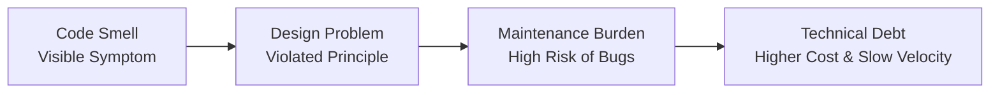
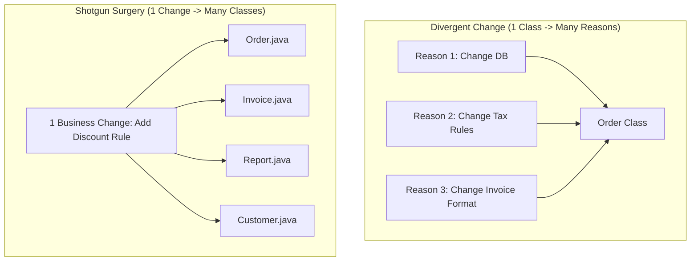

# MITE 435: Software Design Patterns — Module 1
# Traditional Code Smells & Refactoring

Course Teacher: **Md Saeed Siddik**, Assistant Professor, IIT, University of Dhaka  
Primary Source: Lecture Notes, Martin Fowler & Kent Beck (*Refactoring: Improving the Design of Existing Code*)

---

## 1. Core Foundations

### 1.1 What is a Code Smell?
* **Intuition:** A code smell is a **symptom**, not a disease. A program with smells compiles and may run correctly, but the underlying design makes it brittle, hard to understand, expensive to modify, or difficult to test.
* **Formal Definition:** A surface indication in source code that usually corresponds to a deeper problem in the system's design (Beck & Fowler).
* **The "Canary in the Coal Mine":** It alerts developers to design decay before bugs emerge.

```java
// Example: Surface symptom of branching on a type code
if (paymentType.equals("CASH")) {
    // cash payment logic
} else if (paymentType.equals("CARD")) {
    // card payment logic
} else if (paymentType.equals("BKASH")) {
    // bKash payment logic
}
// Runs fine today, but every new payment method forces edits here and everywhere else it branches!
```

---

### 1.2 Code Smell vs. Bug vs. Technical Debt

| Dimension | Code Smell | Bug | Technical Debt |
| :--- | :--- | :--- | :--- |
| **Nature** | Design weakness / symptom | Defect / failure | Accumulated systemic liability |
| **Correctness** | Program works correctly (valid output) | Program fails or outputs incorrect result | System functions, but change velocity drops |
| **Immediate Action**| Usually refactored during maintenance | Requires immediate bug fix | Paid down through architectural refactoring sprints |
| **Impact** | Maintainability, readability, testability | Reliability, correctness, user trust | Long-term total cost of ownership (TCO) |



---

## 2. The 12 Traditional Code Smells (MITE 435 Catalogue)

---

### Smell 1: Long Method
* **Definition:** A method containing excessive lines of code that performs multiple unrelated operations sequentially.
* **Why it happens:** "Just add one more line" mentality during feature addition.
* **SOLID Violated:** Single Responsibility Principle (SRP).
* **Refactorings:** 
  * *Extract Method* (break steps into intention-revealing helpers)
  * *Replace Temp with Query*
  * *Introduce Parameter Object* or *Preserve Whole Object*

#### Smelly Java Code:
```java
public void processOrder(Order order) {
    // 1. Validation
    if (order.getItems().isEmpty()) return;
    
    // 2. Total calculation
    double total = 0;
    for (Item item : order.getItems()) {
        total += item.getPrice() * item.getQuantity();
    }
    
    // 3. Tax & Shipping calculation
    double tax = total * 0.15;
    double shipping = (total > 1000) ? 0 : 100;
    double finalAmount = total + tax + shipping;
    
    // 4. Persistence & Notifications
    database.save(order, finalAmount);
    emailService.sendInvoice(order.getCustomerEmail(), finalAmount);
}
```

#### Refactored Code:
```java
public void processOrder(Order order) {
    validateOrder(order);
    double finalAmount = calculateFinalAmount(order);
    database.save(order, finalAmount);
    notifyCustomer(order, finalAmount);
}

private void validateOrder(Order order) {
    if (order.getItems().isEmpty()) {
        throw new IllegalArgumentException("Order cannot be empty");
    }
}

private double calculateFinalAmount(Order order) {
    double total = order.calculateSubtotal();
    double tax = order.calculateTax(total, 0.15);
    double shipping = order.calculateShipping(total);
    return total + tax + shipping;
}
```

---

### Smell 2: Large Class / God Class
* **Definition:** A class that knows too much or does too much, accumulating dozens of fields and responsibilities.
* **SOLID Violated:** Single Responsibility Principle (SRP).
* **Refactorings:** *Extract Class*, *Extract Subclass*, *Extract Interface*.
* **Diagnosis Tip:** Does the class description require the conjunction "AND"? (e.g., "Manages student enrollment AND generates fee slips AND sends SMS").

---

### Smell 3: Duplicated Code
* **Definition:** Identical or very similar code structures appear in more than one place.
* **Why it hurts:** If logic needs updating, you must remember every copied location. Missing one introduces a latent bug.
* **Refactorings:**
  * Same class: *Extract Method*
  * Sibling subclasses: *Extract Method* -> *Pull Up Method* into superclass
  * Unrelated classes: *Extract Class* or delegate to a utility/strategy component

---

### Smell 4: Long Parameter List
* **Definition:** A method accepting more than 3-4 parameters.
* **Why it hurts:** Hard to read, prone to positional argument transposition (e.g., swapping `width` and `height`), indicates the method does too much.
* **Refactorings:**
  * *Introduce Parameter Object* (group related parameters into a class)
  * *Preserve Whole Object*
  * *Builder Pattern* for complex constructors

```java
// Smelly
public void registerUser(String fname, String lname, String street, String city, String zip, String phone, String email) { ... }

// Refactored
public void registerUser(PersonalName name, Address address, ContactInfo contact) { ... }
```

---

### Smell 5: Feature Envy
* **Definition:** A method in Class A is more interested in the data/methods of Class B than its own.
* **Classic Symptom:** A method continuously calling getters on another object to compute something.
* **Refactoring:** *Move Method* to the class that owns the data.
* **Heuristic:** "Put data and behavior together in the same place."

```java
// Smelly: OrderService envies Customer
public double calculateDiscount(Customer customer) {
    if (customer.getMembership().equals("GOLD") && customer.getLoyaltyPoints() > 500) {
        return 0.20;
    }
    return 0.05;
}

// Refactored: Moved inside Customer
public class Customer {
    public double getDiscountRate() {
        return (isGoldMember() && this.loyaltyPoints > 500) ? 0.20 : 0.05;
    }
}
```

---

### Smell 6: Data Clumps
* **Definition:** Groups of 2, 3, or more data fields that always hang out together in multiple classes or method parameter signatures (e.g., `startDate, endDate`, `street, city, zipCode`, `latitude, longitude`).
* **Test to Confirm:** If you delete one of these fields, do the others become nonsensical? If yes, it's a data clump!
* **Refactoring:** *Extract Class* / *Introduce Parameter Object*.

---

### Smell 7: Switch Statements (Type Code Branching)
* **Definition:** Complex switch statements or nested `if-else` chains switching on an object's type code.
* **Why it hurts:** Violates the Open/Closed Principle (OCP). Adding a new type requires editing every switch statement across the codebase.
* **Refactoring:** *Replace Conditional with Polymorphism* (using Strategy Pattern or Factory + Subclasses).

---

### Smell 8: Primitive Obsession
* **Definition:** Reluctance to create small domain types for small tasks, relying entirely on primitives (`String`, `int`, `double`, `Map`) to represent domain concepts (e.g., phone numbers, money, ZIP codes, email addresses, coordinates).
* **Consequences:** Loss of type safety, duplicated validation logic everywhere.
* **Refactoring:** *Replace Data Value with Object* (create Value Objects).

```java
// Smelly: Primitive Obsession
String phone = "+8801700000000"; // Can be assigned any invalid string

// Refactored: Value Object encapsulates validation and semantics
public record PhoneNumber(String value) {
    public PhoneNumber {
        if (!value.matches("^\\+880\\d{10}$")) {
            throw new IllegalArgumentException("Invalid Bangladeshi mobile number");
        }
    }
}
```

---

### Smell 9 vs Smell 10: Divergent Change vs. Shotgun Surgery
*(Crucial Exam Topic: Frequently contrasted in university tests)*



| Criteria | Divergent Change | Shotgun Surgery |
| :--- | :--- | :--- |
| **Cardinality** | **One class**, many different reasons to change. | **One reason to change**, touches **many classes**. |
| **Root Cause** | Class lacks cohesion (poor Single Responsibility). | Logic is fragmented across multiple classes. |
| **Analogy** | A Swiss Army knife: whenever you upgrade scissors, knife, or screwdriver, you alter the same unit. | A shotgun blast: firing one pellet spreads buckshot into 10 different walls. |
| **Primary Refactoring** | *Extract Class* (split responsibilities into separate classes). | *Move Method* / *Move Field* / *Inline Class* (gather fragmented logic together). |
| **Coupling / Cohesion** | Low cohesion inside a single class. | High coupling scattered across multiple classes. |

---

### Smell 11: Inappropriate Intimacy
* **Definition:** Two classes know too much about each other’s internal private details or fields, spending excessive time delving into each other's guts.
* **Refactorings:** *Move Method*, *Extract Class*, *Hide Delegate*, or establish clean interfaces.

---

### Smell 12: Speculative Generality
* **Definition:** "We might need this someday in the future." Unused abstract classes, over-engineered hooks, unused parameters, and empty interfaces created for hypothetical requirements that never materialized.
* **Guiding Principle:** **YAGNI** (You Aren't Gonna Need It).
* **Refactorings:** *Collapse Hierarchy*, *Inline Class*, *Remove Parameter*.

---

## 3. SOLID Mapping to Traditional Code Smells

| SOLID Principle | Violated By Smells | Key Remedy |
| :--- | :--- | :--- |
| **S - Single Responsibility** | Long Method, Large Class, Divergent Change | *Extract Method*, *Extract Class* |
| **O - Open/Closed** | Switch Statements (Type Code), Primitive Obsession | *Polymorphism*, *Strategy Pattern* |
| **L - Liskov Substitution** | Refused Bequest (subclass throwing `UnsupportedOperationException`) | *Replace Inheritance with Delegation* |
| **I - Interface Segregation** | Fat Interfaces caused by Large Class | *Extract Interface* |
| **D - Dependency Inversion** | Inappropriate Intimacy, Hardcoded Instantiations | *Dependency Injection*, *Factory Pattern* |
