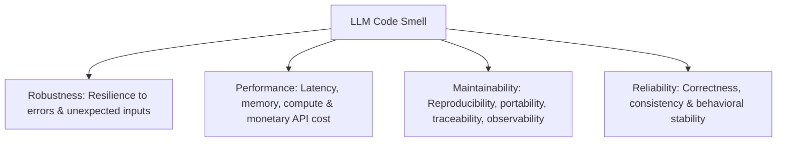
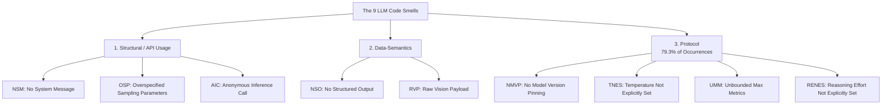

# MITE 435: Software Design Patterns — Module 2
# LLM Code Smells & Architectural Refactoring

Course Teacher: **Md Saeed Siddik**, Assistant Professor, IIT, University of Dhaka  
Primary Source: Chenail-Larcher et al. (2026), *Taxonomy of LLM Code Smells in Open-Source Software*

---

## 1. Why Do We Need LLM-Specific Code Smells?

### 1.1 Traditional vs. LLM Software Components

| Traditional Component | LLM Component |
| :--- | :--- |
| **Deterministic interface**: Same inputs always yield same outputs. | **Non-deterministic output**: Same prompt can produce different answers. |
| **Known configuration semantics**: Clear compiler flags or config types. | **Natural language interface**: Unstructured text inputs and outputs. |
| **Predictable execution time**: Bounded CPU/IO operations. | **Variable latency & cost**: Depends on token length, reasoning steps, provider load. |
| **Stable across deployments**: Code doesn't alter behavior on its own. | **Behavior changes over time**: Providers silently update model weights and defaults. |

> **The Big Idea:** An LLM call is a software component. Like any component, it deserves an **explicit contract** — and design patterns are how we make that contract enforceable.

---

### 1.2 Definition of an LLM Code Smell
> *"A recurring, low-level coding practice in human-written source code that integrates or orchestrates LLM/VLM inference and degrades software quality: without necessarily being an explicit bug."*  
> — Chenail-Larcher et al. (2026)

#### Critical Exam Distinctions:
* **LLM Code Smell:** Flaw in the **integration code** written by human developers calling the LLM API (e.g., omitting system message, unpinned models).
* **Smells in LLM-Generated Code:** Code quality issues (e.g., long methods, duplications) inside code produced *by* an AI assistant.
* **Prompt Smell:** Defect or poor wording in the prompt text itself (e.g., ambiguity, bloated instructions).
* **System-Level Failure:** Runtime catastrophic failures (e.g., hallucinations, jailbreaks, prompt injection, RAG retrieval drift).
* **Model Quality Issue:** Inaccuracies inherent to the underlying neural network weights.

---

### 1.3 Four Quality Attributes at Risk



---

## 2. The Mental Model: The LLM Inference Contract

An LLM API call must satisfy four explicit clauses:

1. **Input Clause:** System policies, user prompts, multimodal assets, session context.
2. **Model Clause:** Pinned model version, sampling policy, reasoning effort configuration.
3. **Boundary Clause:** Max tokens / metrics, timeout limits, retries, structured JSON schema.
4. **Trace Clause:** User pseudonyms, session/tenant IDs, logging metadata, configuration versioning.

---

## 3. The Nine-Smell Taxonomy

Protocol smells represent **79.3%** of all occurrences in empirical studies of open-source projects!



---

### Category 1: Structural / API-Usage Smells

#### 1. NSM: No System Message
* **Symptom:** Passing only a `user` role message to a chat/completion API without a `system` instruction.
* **Impact:** Loss of behavioral alignment. The model has no persistent global persona, safety guidelines, or formatting rules.
* **Design Pattern Solution:** **Template Method** or **Strategy** (wrap prompt assembly in a pipeline that injects the immutable system policy).

```python
# SMELLY (NSM)
response = client.chat.completions.create(
    model="gpt-4o",
    messages=[{"role": "user", "content": user_input}]
)

# REFACTORED
SYSTEM_PROMPT = "You are an academic advisor at IIT. Answer concisely using markdown."
response = client.chat.completions.create(
    model="gpt-4o",
    messages=[
        {"role": "system", "content": SYSTEM_PROMPT},
        {"role": "user", "content": user_input}
    ]
)
```

#### 2. OSP: Overspecified Sampling Parameters
* **Symptom:** Concurrently tuning conflicting randomness hyperparameters: `temperature`, `top_p`, and `top_k`.
* **Impact:** Unpredictable decoding behavior. When both `temperature` and `top_p` are tweaked, developers cannot tell which parameter caused output variation.
* **Refactoring:** Keep one primary randomness control (usually `temperature`) with an explicit documented rationale. Encapsulate in a **Strategy Pattern**.

```python
# SMELLY (OSP)
response = client.generate(prompt, temperature=0.8, top_p=0.95, top_k=40)

# REFACTORED (Strategy Pattern: named sampling preset)
response = client.generate(prompt, temperature=0.2) # Deterministic grading strategy
```

#### 3. AIC: Anonymous Inference Call
* **Symptom:** Calling inference endpoints without passing user, session, or tenant identifiers.
* **Impact:** Inability to audit abuse, track per-user token costs, rate-limit individual bad actors, or debug session-specific failures.
* **Refactoring:** Attach anonymized/pseudonymized session credentials (`user=hash(user_id)`).

---

### Category 2: Data-Semantics Smells

#### 4. NSO: No Structured Output
* **Symptom:** Requesting structured data (e.g., "return JSON") via free-text prompts and manually parsing it with string regex or `json.loads()` without schema enforcement.
* **Impact:** Brittle parsing errors when the model includes markdown backticks or extra commentary; runtime crashes.
* **Refactoring:** Use native SDK Schema validation / Pydantic Structured Outputs (`response_format={"type": "json_schema", ...}`).

```python
# SMELLY (NSO)
prompt = "Extract student name and roll as JSON: " + text
res = client.chat.completions.create(model=M, messages=[{"role": "user", "content": prompt}])
data = json.loads(res.choices[0].message.content) # Runtime crash if LLM writes markdown!

# REFACTORED: Pydantic / Schema enforcement
class StudentDTO(BaseModel):
    name: str
    roll: int

res = client.beta.chat.completions.parse(
    model=M,
    messages=[{"role": "user", "content": prompt}],
    response_format=StudentDTO
)
student = res.choices[0].message.parsed
```

#### 5. RVP: Raw Vision Payload
* **Symptom:** Transmitting uncompressed, full-resolution camera/canvas images directly to Vision Language Models (VLMs).
* **Impact:** Astronomical token consumption, severe latency spikes, and out-of-memory errors.
* **Refactoring:** **Facade / Adapter Pattern** that automatically downsizes, compresses (JPEG/WebP), and normalizes images before dispatch.

---

### Category 3: Protocol Smells (Configuration & Governance)

#### 6. NMVP: No Model Version Pinning
* **Symptom:** Using floating aliases like `gpt-4o`, `claude-3-5-sonnet`, or `gemini-1.5-flash` instead of pinned point-in-time snapshots (e.g., `gpt-4o-2024-08-06`).
* **Impact:** Silent behavioral drift. When the vendor updates the model snapshot behind the alias, prompt behavior and outputs break unexpectedly.

#### 7. TNES: Temperature Not Explicitly Set
* **Symptom:** Omitting the `temperature` parameter and silently inheriting provider defaults.
* **Impact:** Vendor defaults vary wildly (e.g., 1.0 vs 0.7 vs 0.0) and change across SDK revisions, eliminating test reproducibility.

#### 8. UMM: Unbounded Max Metrics
* **Symptom:** Omitting `max_tokens` or `max_completion_tokens`.
* **Impact:** Denial-of-Wallet vulnerability. A prompt injection or looping model can generate up to the full context window, draining API credit.

#### 9. RENES: Reasoning Effort Not Explicitly Set
* **Symptom:** Omitting reasoning effort controls on reasoning models (e.g., `reasoning_effort="low"|"medium"|"high"` on OpenAI `o1`/`o3` or Gemini `thinkingConfig`).
* **Impact:** Uncontrolled latency and hidden token burn as the model allocates excessive internal thinking steps.

---

## 4. Refactoring LLM Smells with Gang of Four (GoF) Patterns

| Smell | Primary Design Pattern | Refactoring Architecture |
| :--- | :--- | :--- |
| **NSM, AIC** | **Template Method** | Abstract prompt generator defines the workflow: (1) add system policy, (2) attach user context, (3) inject user prompt. |
| **OSP, TNES** | **Strategy Pattern** | Create interchangeble decoding strategies (`DeterministicGradingStrategy`, `CreativeBrainstormStrategy`). |
| **NMVP, UMM** | **Abstract Factory / Factory Method** | Centralized `ModelFactory` instantiates clients with pinned versions, max tokens, and timeout boundaries pre-configured. |
| **RVP, NSO** | **Facade / Adapter** | A unified `VLMServiceFacade` automatically resizes images, parses JSON schemas, and handles retries. |

---

## 5. Static Analysis: Capabilities & Limitations

* **What Static Analysis CAN Detect:**
  * Direct AST inspection: missing `max_tokens`, missing `temperature`, alias strings in `model=` arguments, presence of multiple sampling arguments.
* **What Static Analysis CANNOT Detect (False Positives/Negatives):**
  * Dynamic configurations loaded from environment variables or databases.
  * Middleware wrappers or centralized facades that inject system messages or session IDs behind the scenes.
  * Quality of the prompt text itself.
