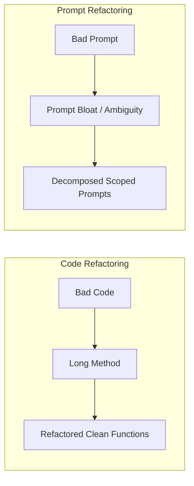

# MITE 435: Software Design Patterns — Module 3
# Prompt Smells & Prompt Refactoring

Course Teacher: **Md Saeed Siddik**, Assistant Professor, IIT, University of Dhaka  
Primary Sources: Ronanki, Cabrero-Daniel & Berger (2024); Della Porta et al. (2026)

---

## 1. Framing the Concept: From Code Smells to Prompt Smells

### 1.1 What is a Prompt Smell?
> *"A prompt smell is a surface-level indicator in a prompt's wording or structure that correlates with a higher risk of an undesirable or suboptimal AI response."*  
> — Ronanki et al. (2024)

Just as Kent Beck and Martin Fowler recognized that bad code structure smells before it fails, prompt engineers recognize that poorly structured prompts degrade response reliability long before the model hallucinates.

---

### 1.2 Core Axioms of Prompt Smells
1. **A prompt can smell and still work:** Because modern LLMs are robust, they often compensate for poor prompts and guess user intent. However, reliance on luck is not engineering.
2. **A clean prompt can still fail:** Zero smells does not guarantee a perfect answer (stochastic output, model limitations).
3. **Smells shift the probability:** Eliminating smells drastically raises the odds of deterministic, high-quality, reproducible outputs.

---

## 2. The Complete 10-Smell Teaching Catalogue

---

### Part I: Context & Clarity Smells

#### 1. Vague / Missing Context
* **Analogy:** Passing uninitialized variables or empty environment configuration.
* **Problem:** Omission of target audience, expected technical depth, or system environment.
* **Smelly Prompt:**  
  > *"Explain software architecture."*
* **Refactored Prompt:**  
  > *"Explain software architecture to second-year Software Engineering students. Cover layered, client-server, and microservices architectures, with one practical industry example for each."*

---

#### 2. Ambiguous References
* **Analogy:** Variable naming collisions or dangling pointers (`temp`, `data`, `it`).
* **Rule of Thumb:** If a pronoun (*it*, *they*, *this*, *that*) could grammatically refer to more than one noun in your prompt, replace it with the explicit noun!
* **Smelly Prompt:**  
  > *"The team changed it because they found a problem. Explain what they should do next."*
* **Refactored Prompt:**  
  > *"The frontend team refactored the checkout state store because the payment gateway was timing out. Recommend three specific integration testing steps the QA team should execute next."*

---

#### 3. Format Ambiguity
* **Analogy:** A function returning `Object` or raw binary bytes instead of a strongly typed DTO.
* **Problem:** Leaving output presentation to model whim (paragraphs vs tables vs lists).
* **Smelly Prompt:**  
  > *"Analyze these project risks and give me some recommendations."*
* **Refactored Prompt:**  
  > *"Analyze these project risks. Return a markdown table with four columns: Risk Name, Probability (Low/Med/High), Impact (Low/Med/High), and Recommended Mitigation. Order by Impact descending."*

---

### Part II: Complexity Smells

#### 4. Overloaded Prompt
* **Analogy:** **God Class / Long Method** (violating Single Responsibility).
* **Problem:** Forcing the LLM to perform requirements engineering, architectural design, coding, testing, and deployment documentation in a single turn. Early hallucinations corrupt later sections.
* **Smelly Prompt:**  
  > *"Design the requirements, UML diagrams, database schema, Java code, unit tests, and documentation for a university LMS."*
* **Refactored Prompt:**  
  > Break into an intentional chained pipeline:  
  > Step 1: *"Define the core requirements and actors for the LMS."* -> (Human Review) ->  
  > Step 2: *"Generate the Class Diagram in Mermaid syntax based on these approved requirements..."*

---

#### 5. Prompt Bloat / Convoluted Prompt
* **Analogy:** **Dead Code** or **Speculative Generality**.
* **Problem:** Burying the actual action item beneath hundreds of words of decorative fluff or irrelevant backstory.
* **Smelly Prompt:**  
  > *"Imagine you are a world-class award-winning software titan who has advised Silicon Valley startups and published ten bestselling books on object-oriented programming since the 1990s... Please give me an example of the Factory Method in Java."*
* **Refactored Prompt:**  
  > *"Provide a minimal Java implementation of the Factory Method pattern. Clearly label the Creator, ConcreteCreator, Product, and ConcreteProduct participants."*

---

#### 6. Unnecessary Repetition
* **Analogy:** **Duplicated Code** (DRY violation).
* **Problem:** Repeating the exact same constraint using 5 different synonyms. Adds token cost without adding semantic clarity.
* **Smelly Prompt:**  
  > *"Explain inheritance in simple terms. Keep it simple. Don't make it complex. Make it really easy to understand. Use beginner words."*
* **Refactored Prompt:**  
  > *"Explain inheritance using beginner-friendly language and one Java real-world example."*

---

#### 7. Conflicting Constraints
* **Analogy:** Contradictory unit test assertions or mutually exclusive compiler flags.
* **Problem:** Imposing constraints that pull in opposite directions, forcing the model to arbitrarily violate one.
* **Smelly Prompt:**  
  > *"Write an exhaustive, comprehensive analysis of all 23 GoF design patterns in exactly 100 words."*
* **Refactored Prompt:**  
  > *"Write a 100-word executive summary summarizing why creational, structural, and behavioral design patterns are used in object-oriented software."*

---

### Part III: Semantic & Quality Smells

#### 8. Irrelevant / Excessive Persona
* **Analogy:** Inappropriate subclassing or inheritance purely for aesthetic decoration.
* **Problem:** Adding high-flown personas that have zero influence on technical accuracy.
* **Smelly Prompt:**  
  > *"Act as an ancient Greek philosopher who also knows cybersecurity. How do I fix a SQL injection vulnerability?"*
* **Refactored Prompt:**  
  > *"How do I remediate a SQL injection vulnerability in a Java Spring Boot repository using PreparedStatement?"*

---

#### 9. Bias / Loaded Framing
* **Analogy:** Hardcoded return values or prejudiced test fixtures.
* **Problem:** Forcing the LLM to confirm the author's preconceived bias rather than providing objective trade-offs.
* **Smelly Prompt:**  
  > *"Explain why Microservices are vastly superior to Monoliths in every way."*
* **Refactored Prompt:**  
  > *"Compare Microservices and Modular Monoliths. Provide a balanced trade-off analysis covering deployment complexity, data consistency, scalability, and operational costs."*

---

#### 10. Formality / Audience Mismatch
* **Analogy:** Mismatched types (passing raw SQL strings directly to an end-user UI label).
* **Problem:** Explaining low-level bitwise operations to a business CEO or high-level buzzwords to a kernel debugger.
* **Smelly Prompt:**  
  > *"Explain our cloud architecture to the executive board."* (Produces Kubernetes pod CIDR diagrams)
* **Refactored Prompt:**  
  > *"Summarize our cloud migration architecture for the Board of Directors, focusing on business business continuity, annual cost savings, and SLA improvements without deep DevOps jargon."*

---

## 3. Direct Mapping: Traditional Code Smells vs. Prompt Smells

| Traditional Code Smell | Corresponding Prompt Smell | Shared Underlying Flaw |
| :--- | :--- | :--- |
| **Long Method / God Class** | Overloaded Prompt | Violating Single Responsibility Principle (SRP). |
| **Duplicated Code** | Unnecessary Repetition | Violating DRY (Don't Repeat Yourself). |
| **Primitive Obsession** | Format Ambiguity | Failure to enforce an explicit data structure/schema. |
| **Speculative Generality** | Irrelevant Persona / Prompt Bloat | Adding useless fluff that does not solve the immediate task. |
| **Inappropriate Intimacy** | Ambiguous References | Relying on hidden or leaked contextual assumptions. |
