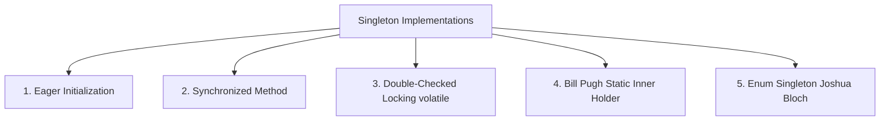
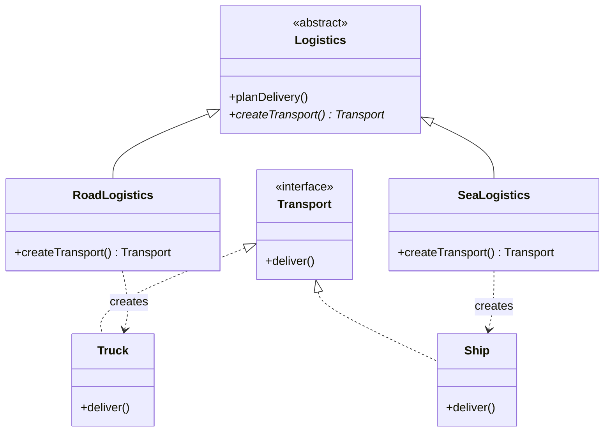
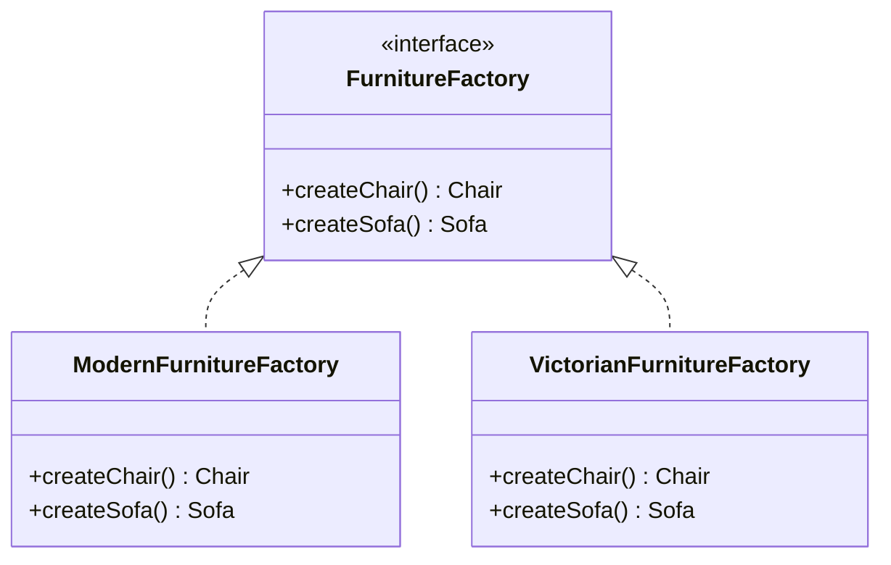

# MITE 435: Software Design Patterns — Module 4
# Creational Design Patterns: Singleton, Factory Method & Abstract Factory

Course Teacher: **Md Saeed Siddik**, Assistant Professor, IIT, University of Dhaka  
Primary Source: GoF (*Design Patterns: Elements of Reusable Object-Oriented Software*); Refactoring.Guru

---

## 1. Factory Vocabulary: The 6 "Factories"

In everyday software discussions, the word *"factory"* is used loosely. The course establishes an essential distinction:

| Term | What it is | Is it a GoF Pattern? |
| :--- | :--- | :---: |
| **1. Factory** | An umbrella term for any function, method, or class that produces an object. | ❌ No |
| **2. Creation Method** | A method on an ordinary class that wraps a `new` expression (e.g., `new Order()`). | ❌ No |
| **3. Static Creation Method** | A `public static` method on a class that returns an instance (e.g., `LocalDate.now()`, `List.of()`, `Integer.valueOf()`). | ❌ No |
| **4. Simple Factory** | A dedicated helper class with a single method (often with a switch statement) that creates objects based on arguments. | ❌ No |
| **5. Factory Method** | Defines an interface for creating an object, but lets **subclasses** decide which class to instantiate (relies on inheritance). | **✅ YES (GoF)** |
| **6. Abstract Factory** | An interface for creating **families of related or dependent objects** without specifying their concrete classes (relies on object composition). | **✅ YES (GoF)** |

---

## 2. Singleton Design Pattern

### 2.1 Intent & Analogy
* **Intent:** Ensure a class has only one instance, and provide a global point of access to it.
* **Analogy:** A sovereign nation has only one official government. Whoever is elected, "The Government" remains the single point of contact.

### 2.2 The 3 Criteria for Using Singleton
1. **Uniqueness:** There must be exactly one instance of a system resource (e.g., Logger, Thread Pool, Configuration Manager, Hardware Driver).
2. **Accessible:** The sole instance must be accessible to clients from a well-known global access point (`getInstance()`).
3. **Controlled Extensibility:** Clients must use the instance without needing to know whether it's the base class or a subclass.

---

### 2.3 Five Java Implementations of Singleton



#### 1. Eager Initialization
```java
public class EagerSingleton {
    private static final EagerSingleton INSTANCE = new EagerSingleton();
    private EagerSingleton() {}
    public static EagerSingleton getInstance() { return INSTANCE; }
}
```
* **Pros:** Simple, thread-safe (JVM guarantees static initialization safety).
* **Cons:** No lazy loading; consumes memory even if the application never requests it.

#### 2. Thread-Safe Lazy (Synchronized Method)
```java
public class SynchronizedSingleton {
    private static SynchronizedSingleton instance;
    private SynchronizedSingleton() {}
    public static synchronized SynchronizedSingleton getInstance() {
        if (instance == null) {
            instance = new SynchronizedSingleton();
        }
        return instance;
    }
}
```
* **Pros:** Lazy loading.
* **Cons:** Major performance bottleneck: `synchronized` overhead hits *every* single read call, even though synchronization is only needed during first creation.

#### 3. Double-Checked Locking (DCL) with `volatile`
```java
public class DclSingleton {
    // volatile prevents instruction reordering in multithreaded environments!
    private static volatile DclSingleton instance;
    
    private DclSingleton() {}

    public static DclSingleton getInstance() {
        if (instance == null) { // 1st check (no lock)
            synchronized (DclSingleton.class) {
                if (instance == null) { // 2nd check (with lock)
                    instance = new DclSingleton();
                }
            }
        }
        return instance;
    }
}
```
* **Why `volatile` is mandatory:** Modern JVMs reorder instructions: (1) allocate memory, (2) assign reference to `instance`, (3) run constructor. Without `volatile`, Thread B may see a non-null `instance` whose constructor has not finished executing!

#### 4. Bill Pugh Static Inner Holder Singleton (Recommended for standard classes)
```java
public class HolderSingleton {
    private HolderSingleton() {}
    
    // Loaded only when getInstance() is called!
    private static class Holder {
        private static final HolderSingleton INSTANCE = new HolderSingleton();
    }
    
    public static HolderSingleton getInstance() {
        return Holder.INSTANCE;
    }
}
```
* **Pros:** Truly lazy, 100% thread-safe, and zero synchronization runtime overhead.

#### 5. Enum Singleton (The Golden Standard — Joshua Bloch, *Effective Java*)
```java
public enum EnumSingleton {
    INSTANCE;
    public void executeBusinessLogic() { ... }
}
```
* **Pros:** Naturally immune to Reflection, Serialization, and Cloning attacks.

---

### 2.4 Four Ways Singleton Can Be Broken & Hardening

1. **Reflection Attack:** Using `AccessibleObject.setAccessible(true)` to call the private constructor.  
   * *Defense:* Throw an `IllegalStateException` inside the constructor if `instance != null`.
2. **Serialization Attack:** Serializing and deserializing returns a brand new instance.  
   * *Defense:* Implement the `readResolve()` method returning `getInstance()`.
3. **Cloning Attack:** Invoking `super.clone()`.  
   * *Defense:* Override `clone()` to throw `CloneNotSupportedException`.
4. **Multithreading Race Conditions:** In naive lazy initialization, two threads checking `instance == null` simultaneously instantiate two objects.  
   * *Defense:* Use DCL with `volatile`, Inner Holder, or Enum.

---

## 3. Factory Method Design Pattern

### 3.1 Intent & Participants
* **Intent:** Define an interface for creating an object, but let subclasses decide which class to instantiate.
* **Participants:**
  * **Product:** Declares the interface of objects created by the factory method.
  * **ConcreteProduct:** Implements the Product interface.
  * **Creator:** Declares the abstract `factoryMethod()`, which returns a `Product`. May also contain core business logic that works with Products.
  * **ConcreteCreator:** Overrides `factoryMethod()` to return a `ConcreteProduct`.



---

## 4. Abstract Factory Design Pattern

### 4.1 Intent
Provide an interface for creating **families of related or dependent objects** without specifying their concrete classes.

### 4.2 The "Family of Products" Matrix
* A system requires furniture in distinct thematic styles:
  * **Family 1:** Modern (ModernChair, ModernSofa, ModernTable)
  * **Family 2:** Victorian (VictorianChair, VictorianSofa, VictorianTable)
* The client code must never mix a Victorian Chair with a Modern Table!



---

## 5. Factory Method vs. Abstract Factory Side-by-Side

| Feature | Factory Method | Abstract Factory |
| :--- | :--- | :--- |
| **Creation Focus** | Creates **one product** type. | Creates **families of related products**. |
| **Mechanism** | Uses **Inheritance** (subclasses override a method). | Uses **Object Composition** (a client holds a factory object). |
| **Pattern Level** | Method-level (a single method handles creation). | Class/Interface-level (an interface with multiple factory methods). |
| **Extending with New Types** | Easy: add a new `ConcreteCreator` and `ConcreteProduct`. | Adding a new *family* is easy; adding a new *product type* requires editing the factory interface. |
| **Client Interaction** | Client calls creator’s business logic or creator itself. | Client is injected with an `AbstractFactory` and requests multiple parts. |
