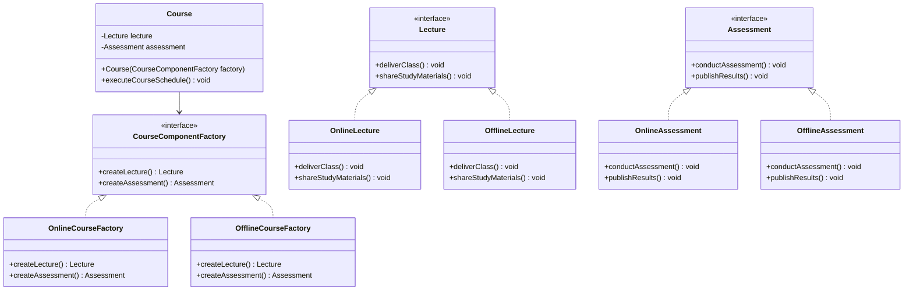

# MITE 435: Software Design Patterns — Module 5
# Exam Mastery: Complete Lab Solutions & High-Yield Exam Scenarios

Course Teacher: **Md Saeed Siddik**, Assistant Professor, IIT, University of Dhaka  
Course: **MITE 435 — Software Design Patterns**

---

## 1. Official Lab Work Scenario 1: EduSphere LMS (Full Java Implementation)

### 1.1 Problem Summary
* **Domain:** IIT EduSphere Learning Management System.
* **Component Families:** Each course requires a **Lecture** component and an **Assessment** component.
* **Modes (Product Families):**
  * **Online Mode:** Live video, portal recordings/slides, auto-graded MCQ quiz on portal.
  * **Offline Mode:** Face-to-face classroom, printed handouts, written paper exam, notice board results.
* **Requirement:** Design and implement using the **Abstract Factory Pattern**.

---

### 1.2 Architectural Diagram



---

### 1.3 Clean Java Implementation (Production & Exam Ready)

```java
package edu.iit.edusphere;

// ==========================================
// 1. ABSTRACT PRODUCTS
// ==========================================

interface Lecture {
    void deliverClass();
    void shareStudyMaterials();
}

interface Assessment {
    void conductAssessment();
    void publishResults();
}

// ==========================================
// 2. CONCRETE PRODUCTS: ONLINE FAMILY
// ==========================================

class OnlineLecture implements Lecture {
    @Override
    public void deliverClass() {
        System.out.println("Delivering lecture via live video session");
    }

    @Override
    public void shareStudyMaterials() {
        System.out.println("Uploading recording and slides to the course portal");
    }
}

class OnlineAssessment implements Assessment {
    @Override
    public void conductAssessment() {
        System.out.println("Conducting MCQ quiz on the online portal");
    }

    @Override
    public void publishResults() {
        System.out.println("Publishing auto-graded results on student dashboards");
    }
}

// ==========================================
// 3. CONCRETE PRODUCTS: OFFLINE FAMILY
// ==========================================

class OfflineLecture implements Lecture {
    @Override
    public void deliverClass() {
        System.out.println("Delivering lecture in the classroom");
    }

    @Override
    public void shareStudyMaterials() {
        System.out.println("Distributing printed handouts to students");
    }
}

class OfflineAssessment implements Assessment {
    @Override
    public void conductAssessment() {
        System.out.println("Conducting written exam on paper");
    }

    @Override
    public void publishResults() {
        System.out.println("Posting manually graded results on the notice board");
    }
}

// ==========================================
// 4. ABSTRACT FACTORY
// ==========================================

interface CourseComponentFactory {
    Lecture createLecture();
    Assessment createAssessment();
}

// ==========================================
// 5. CONCRETE FACTORIES
// ==========================================

class OnlineCourseFactory implements CourseComponentFactory {
    @Override
    public Lecture createLecture() {
        return new OnlineLecture();
    }

    @Override
    public Assessment createAssessment() {
        return new OnlineAssessment();
    }
}

class OfflineCourseFactory implements CourseComponentFactory {
    @Override
    public Lecture createLecture() {
        return new OfflineLecture();
    }

    @Override
    public Assessment createAssessment() {
        return new OfflineAssessment();
    }
}

// ==========================================
// 6. CLIENT CLASS
// ==========================================

class Course {
    private final String courseName;
    private final Lecture lecture;
    private final Assessment assessment;

    // Factory is injected via constructor (Dependency Inversion)
    public Course(String courseName, CourseComponentFactory factory) {
        this.courseName = courseName;
        this.lecture = factory.createLecture();
        this.assessment = factory.createAssessment();
    }

    public void runCourseCycle() {
        System.out.println("\n--- Running Course: " + courseName + " ---");
        lecture.deliverClass();
        lecture.shareStudyMaterials();
        assessment.conductAssessment();
        assessment.publishResults();
    }
}

// ==========================================
// 7. DEMONSTRATION / DRIVER
// ==========================================

public class EduSphereDriver {
    public static void main(String[] args) {
        // Teacher creates an Online course
        CourseComponentFactory onlineFactory = new OnlineCourseFactory();
        Course distributedSystems = new Course("SWE 435: Distributed Systems (Online)", onlineFactory);
        distributedSystems.runCourseCycle();

        // Teacher creates an Offline course
        CourseComponentFactory offlineFactory = new OfflineCourseFactory();
        Course designPatterns = new Course("MITE 435: Software Design Patterns (Offline)", offlineFactory);
        designPatterns.runCourseCycle();
    }
}
```

---

## 2. High-Yield Exam Trace Problems & Solutions

### Scenario A: "Spot the LLM Code Smells"
**Question:** Analyze the following Python code snippet. Identify all LLM code smells present and explain which design pattern resolves them.

```python
# EXAM SNIPPET TO ANALYZE
def evaluate_student(essay_text):
    client = OpenAI()
    response = client.chat.completions.create(
        model="gpt-4o",
        messages=[{"role": "user", "content": f"Score this essay from 1-100: {essay_text}"}],
        temperature=0.7,
        top_p=0.9,
        top_k=50
    )
    return response.choices[0].message.content
```

#### Diagnostic Answer:
1. **NMVP (No Model Version Pinning):** Uses floating alias `model="gpt-4o"` instead of fixed date snapshot (e.g., `gpt-4o-2024-08-06`).
2. **NSM (No System Message):** Only sends a `user` role; lacks a system persona establishing strict scoring rubric and guardrails.
3. **OSP (Overspecified Sampling Parameters):** Simultaneously specifies `temperature`, `top_p`, and `top_k`, producing unpredictable stochastic behavior.
4. **UMM (Unbounded Max Metrics):** Missing `max_tokens` / `max_completion_tokens`, risking unbounded response length and token exhaustion.
5. **AIC (Anonymous Inference Call):** Does not pass a `user` identifier to the API, preventing telemetry, audit trails, and abuse tracking.
6. **NSO (No Structured Output):** Returns raw string instead of enforcing a schema (e.g., JSON with `{"score": int, "feedback": str}`).
* **Design Pattern Solution:** Wrap in a **Factory Method / Strategy Pattern** enforcing a standardized inference contract.

---

### Scenario B: Traditional Smell Diagnostic
**Question:** A class `CustomerManager` has 2,500 lines. When changing the database from MySQL to PostgreSQL, you must edit `CustomerManager`. When marketing changes the discount formula, you must edit `CustomerManager`. When finance changes invoice formatting, you must edit `CustomerManager`.
* What code smell is this?
* How does it differ from Shotgun Surgery?
* What refactoring should be applied?

#### Diagnostic Answer:
1. **Smell:** **Divergent Change** (Single Responsibility Principle violation).
2. **Difference from Shotgun Surgery:** In Divergent Change, **one single class** is modified for many unrelated reasons. In Shotgun Surgery, **one single business reason** requires touching dozens of different classes scattered across the system.
3. **Refactoring:** Apply **Extract Class** to split `CustomerManager` into `CustomerRepository` (persistence), `DiscountService` (business rules), and `InvoiceFormatter` (presentation).

---

## 3. Two-Hour University Exam Time Management Strategy

```mermaid
gantt
    title 120-Minute University Exam Strategy
    dateFormat mm
    axisFormat %M min
    section Reading & Triage
    Read all questions & identify patterns : 00, 10
    section Section A: Code Smells
    Traditional Smells & SOLID mappings  : 10, 30
    section Section B: LLM & Prompt Smells
    Taxonomy, Contract & Refactoring      : 30, 55
    section Section C: Design Patterns
    Singleton, Factory & Lab Scenario Code: 55, 105
    section Review & Polish
    Verify UML, edge cases, volatile tags: 105, 120
```



1. **Minutes 0–10 (Triage):** Read all questions. Star the scenario design questions and spot-the-smell questions.
2. **Minutes 10–30 (Traditional Smells):** Answer definitions and compare-and-contrast tables (Divergent Change vs Shotgun Surgery; Smell vs Bug vs Tech Debt).
3. **Minutes 30–55 (LLM & Prompt Smells):** Clearly state the 9 LLM smells taxonomy, the 4 contract clauses, and the 10 prompt smells.
4. **Minutes 55–105 (Design Patterns & Coding):** Implement patterns cleanly with interfaces, classes, and complete client code (like EduSphere above). Always include `volatile` on DCL Singleton.
5. **Minutes 105–120 (Review):** Verify class diagrams have proper arrowheads (inheritance $\to$ open triangle, composition $\to$ diamond) and check edge cases.
