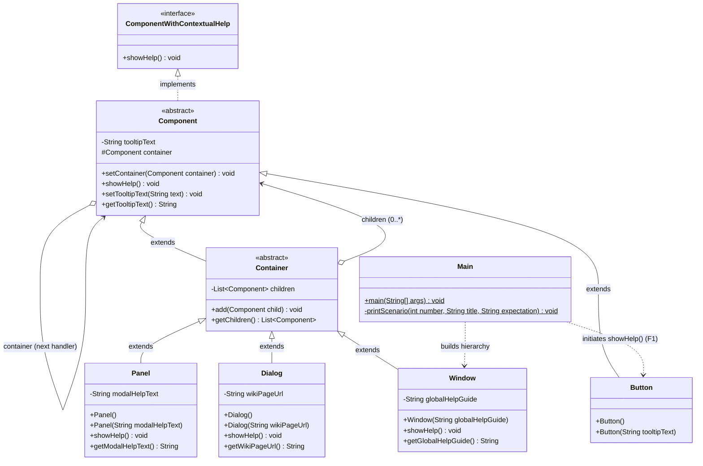
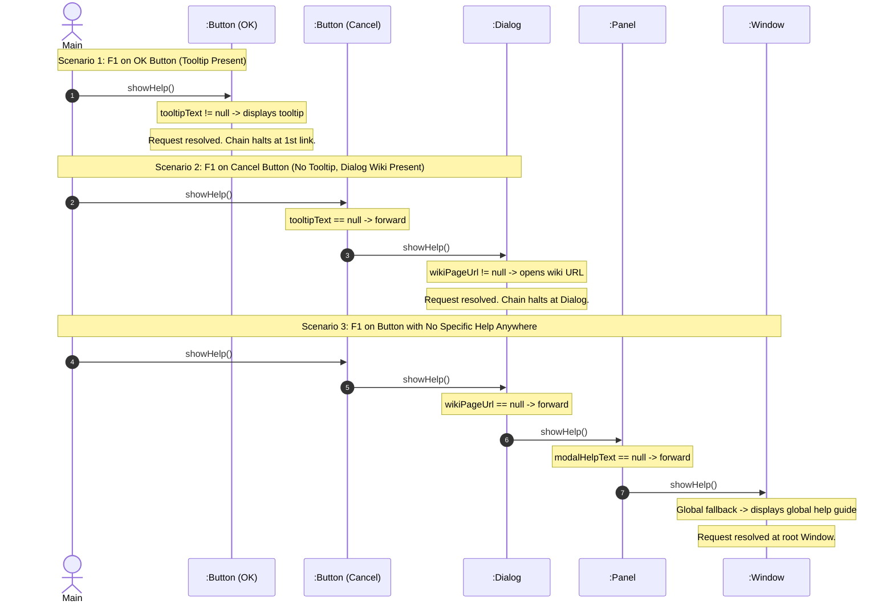

# Refactoring Guru: ComponentWithContextualHelp — Chain of Responsibility Design Pattern

A clean, production-grade Java implementation of the **Chain of Responsibility** behavioural design pattern based on Refactoring Guru's GUI Contextual Help System architecture.

> **Source:** [Refactoring Guru — Chain of Responsibility](https://refactoring.guru/design-patterns/chain-of-responsibility)  
> **Category:** Behavioural Design Pattern — Behavioural design patterns focus on communication, interaction, and the distribution of responsibilities between collaborating objects at runtime. Unlike creational patterns (which manage object instantiation) or structural patterns (which organize composition and interfaces), behavioural patterns characterize complex, dynamic control flows. In **Chain of Responsibility**, control flow is transformed into a flexible pipeline of standalone handler objects linked via composition: a sender dispatches a request without coupling itself to any concrete receiver, and the request travels sequentially through handlers until one handles it or the chain ends.

---

## 1. Component Definitions

| Component | Pattern Role | File | Responsibility |
| :--- | :--- | :--- | :--- |
| **`ComponentWithContextualHelp`** | **Handler Interface** | [`ComponentWithContextualHelp.java`](ComponentWithContextualHelp.java) | Declares the common request-handling contract (`showHelp()`). Enables uniform handling across arbitrary UI components. |
| **`Component`** | **Base Abstract Handler** | [`Component.java`](Component.java) | Maintains the reference to the parent container (`container` successor link), provides default pass-along forwarding logic, and manages optional local tooltips. |
| **`Container`** | **Composite Abstract Handler** | [`Container.java`](Container.java) | Intermediate handler representing UI containers; manages child components and automatically wires each child's parent link upon `add(Component)`. |
| **`Button`** | **Concrete Leaf Handler** | [`Button.java`](Button.java) | Leaf UI element. Serves as the initial sender/handler in the chain; halts propagation if a tooltip is present, otherwise delegates to parent container. |
| **`Panel`** | **Concrete Container Handler** | [`Panel.java`](Panel.java) | Intermediate panel container. Intercepts help requests with a modal help popup if configured; otherwise forwards to enclosing container. |
| **`Dialog`** | **Concrete Container Handler** | [`Dialog.java`](Dialog.java) | Intermediate dialog container. Intercepts help requests by launching a contextual wiki documentation page if configured; otherwise forwards to enclosing container. |
| **`Window`** | **Concrete Root / Terminal Handler** | [`Window.java`](Window.java) | Root application window. Acts as the ultimate fallback in the chain; always resolves unhandled requests by presenting the global help guide. |
| **`Main`** | **Client Driver** | [`Main.java`](Main.java) | Assembles the UI containment hierarchy (auto-wiring handler successor links) and executes demonstration scenarios showcasing chain propagation and early termination. |

---

## 2. Core Concepts & Short Understanding Notes

### Problem: Contextual UI Help in Dynamic Layouts
In modern graphical user interfaces, users expect **context-sensitive help** when pressing `F1` or hovering over an active widget (e.g., a button, form field, or checkbox). However, contextual information depends heavily on the surrounding UI hierarchy:
1. A specialized button might have an immediate, granular **tooltip** (e.g., *"Click OK to submit your login credentials"*).
2. A generic button (e.g., *"Cancel"*) has no specific tooltip; its help belongs to the enclosing **Dialog** (e.g., an external documentation wiki page for the login procedure).
3. A bare dialog inside an administrative dashboard might rely on the enclosing **Panel** for section-level instructions.
4. If no intermediary component has custom documentation, the application's top-level **Window** must provide a general fallback guide.

#### Why Naive Solutions Fail
- **Rigid `if/else` Type Checks**: Checking `if (focused instanceof Button) ... else if (focused instanceof Dialog) ...` introduces severe coupling. Any new component forces changes across existing conditional blocks.
- **Tight Upward Coupling**: If child components explicitly store concrete references to their parent dialogs or windows (`button.dialog.panel.window`), reorganizing widgets or placing a button into a different panel breaks compilation and runtime logic.
- **Sender-Receiver Coupling**: The sender of the help request (the focused widget) should not need to know which container will ultimately answer the question.

```
UI Containment Hierarchy (Bottom-Up Request Propagation):

Window  (Global Help Guide — Guaranteed Fallback)
  ▲
Panel   (Optional Modal Help Pop-up)
  ▲
Dialog  (Optional Contextual Wiki URL)
  ▲
Button  (Optional Tooltip Text — First Handler / Sender)
```

### Solution: Chain of Responsibility Pattern
- **Decoupled Request Pipeline**: The sender widget simply triggers `showHelp()`. It neither knows nor cares which component down the line will respond.
- **Sequential Forwarding (Relay Mechanism)**: Each handler evaluates its local capability. If it holds an answer (`tooltipText != null`, `wikiPageUrl != null`, or `modalHelpText != null`), it processes the request and terminates traversal. Otherwise, it delegates to its successor (`container.showHelp()`).
- **Guaranteed Termination**: The root handler (`Window`) serves as the definitive fallback, ensuring requests never drop silently.

### Architectural Principles Applied
- **Single Responsibility Principle (SRP)**: Each component handles only the help context intrinsic to its scope (button tooltips, dialog wiki links, panel help popups, or global guides) while delegating traversal.
- **Open/Closed Principle (OCP)**: New handlers (e.g., Toolbars, TabbedPanes) or new help strategies can be added to the hierarchy without modifying existing UI component code.
- **Liskov Substitution Principle (LSP)**: All components implement `ComponentWithContextualHelp` and can be treated uniformly by clients or parent containers.

---

## 3. Implementation Details as per Pattern

This project implements the GoF **Chain of Responsibility** pattern as adapted for GUI contextual help systems (Refactoring Guru). The architecture maps directly to the standard pattern roles:

```
[Client: Main]
      │ triggers showHelp()
      ▼
[Handler Interface: ComponentWithContextualHelp]
      ▲ implements
[Base Handler: Component] ──successor (container)──▶ [Next Component]
      ▲ extends
  ┌───┴────────────────────────┐
[Leaf: Button]        [Composite Handler: Container]
                               ▲ extends
                  ┌────────────┼────────────┐
             [Dialog]       [Panel]      [Window (Root Fallback)]
```

### 1. Handler Interface (`ComponentWithContextualHelp`)
- **Role in Pattern**: Declares the single contract (`showHelp()`) for request processing across all handlers.
- **Implementation**: Defines `void showHelp()`. By establishing this uniform interface, any UI element can initiate or propagate a help request without exposing its concrete internal state or hierarchy level to client code.

### 2. Base Abstract Handler (`Component`)
- **Role in Pattern**: Holds the reference to the successor in the chain and supplies default forwarding behavior.
- **Implementation**:
  - **Successor Pointer**: Stores `protected Component container` representing the enclosing parent container.
  - **Dynamic Chain Linking**: Provides `setContainer(Component container)` to wire the chain links.
  - **Handle-or-Forward Template**: Implements `showHelp()`:
    ```java
    if (tooltipText != null) {
        // Can handle -> process and terminate chain
        System.out.println("[...] Showing tooltip: \"" + tooltipText + "\"");
    } else if (container != null) {
        // Cannot handle -> forward to successor
        container.showHelp();
    } else {
        // End of chain reached without a handler
        System.out.println("[...] End of chain — no help available.");
    }
    ```
  - This default implementation allows leaf elements like `Button` to participate in the chain with zero boilerplate forwarding logic.

### 3. Intermediate Composite Handler (`Container`)
- **Role in Pattern**: Bridges Composite UI tree construction with Chain of Responsibility upward delegation.
- **Implementation**:
  - Extends `Component`, so every container is itself a handler capable of forwarding to an enclosing container.
  - Manages `private final List<Component> children`.
  - **Automatic Chain Wiring**: When `add(Component child)` is called, it registers the child and automatically sets `child.setContainer(this)`. This eliminates manual, error-prone chain wiring; assembling the UI tree implicitly configures the bottom-up Chain of Responsibility.

### 4. Concrete Handlers (Selective Overrides & Early Stopping)
- **`Button` (Concrete Leaf Handler / Request Origin)**:
  - Non-container widget at the bottom of the tree.
  - Inherits `showHelp()` from `Component`. If constructed with a tooltip (`new Button("Click OK...")`), the chain terminates at this first link. If no tooltip is set (`new Button()`), the request bubbles up to its parent `Dialog`.
- **`Dialog` (Concrete Intermediate Handler)**:
  - Extends `Container`. Represents dialog boxes with an optional web documentation link (`wikiPageUrl`).
  - Overrides `showHelp()`: If `wikiPageUrl != null`, displays the documentation link and halts the chain. Otherwise, delegates upward to `container.showHelp()`.
- **`Panel` (Concrete Intermediate Handler)**:
  - Extends `Container`. Represents layout sections with an optional modal help topic (`modalHelpText`).
  - Overrides `showHelp()`: If `modalHelpText != null`, displays the modal pop-up and halts the chain. Otherwise, delegates upward to `container.showHelp()`.
- **`Window` (Concrete Root / Terminal Fallback Handler)**:
  - Extends `Container` at the root of the hierarchy (`container == null`).
  - Overrides `showHelp()` unconditionally: Displays the application-wide `globalHelpGuide`. Because it never forwards, it acts as the guaranteed terminal boundary of the chain.

### 5. Client Driver (`Main`)
- **Role in Pattern**: Builds the hierarchy and dispatches requests to the initial handler.
- **Implementation**:
  - Builds the UI tree (`Window` -> `Panel` -> `Dialog` -> `Button`).
  - Demonstrates three distinct execution paths:
    1. **Early Termination (Link 1)**: `okButton` has tooltip → handled immediately at leaf.
    2. **Mid-Chain Termination (Link 2)**: `cancelButton` (no tooltip) → handled at `Dialog` via wiki URL.
    3. **Full Traversal (Root Fallback)**: `bareButton` (no tooltip) → `bareDialog` (no wiki) → `barePanel` (no modal) → handled at root `Window` via global guide.

---

## 4. UML Class Diagram

*Based on Refactoring Guru's Chain of Responsibility architecture and synchronized with this repository's Java implementation.*



---

## 5. UML Sequence Diagram

Demonstrating early stopping vs. full-chain traversal across the three scenarios:



---

## 6. Step-by-Step Dry Run Walkthrough

### Initial State & Successor Wiring

When `Main` executes, containers automatically wire their children's successor links (`container`) upon calling `add(child)`:

```
[okButton]      ──(container)──▶ [loginDialog] ──(container)──▶ [mainPanel] ──(container)──▶ [appWindow] ──▶ null
[cancelButton]  ──(container)──▶ [loginDialog]
```

| Object | Type | Local Help State | Successor (`container`) |
| :--- | :--- | :--- | :--- |
| `okButton` | `Button` | `tooltipText = "Click OK..."` | `loginDialog` |
| `cancelButton` | `Button` | `tooltipText = null` | `loginDialog` |
| `loginDialog` | `Dialog` | `wikiPageUrl = "https://example.com/docs/login-dialog"` | `mainPanel` |
| `mainPanel` | `Panel` | `modalHelpText = null` | `appWindow` |
| `appWindow` | `Window` | `globalHelpGuide = "Welcome to Help Center..."` | `null` (Terminal Handler) |

---

### Scenario 1: `okButton.showHelp()` (Early Termination at Link 1)

1. **Hop 1 — `okButton` (`Button` extends `Component`)**:
   - Executes inherited `Component.showHelp()`.
   - Evaluates: `if (tooltipText != null)` $\rightarrow$ **`true`** (`"Click OK to submit your login credentials."`).
   - Action: Prints `[Button] Showing tooltip: "Click OK to submit your login credentials."`.
   - **Chain Terminates**: Neither `container` nor any upstream parent is invoked.

```text
[Button] Showing tooltip: "Click OK to submit your login credentials."
```

---

### Scenario 2: `cancelButton.showHelp()` (Passes Button → Terminates at Dialog)

1. **Hop 1 — `cancelButton` (`Button` extends `Component`)**:
   - Evaluates: `if (tooltipText != null)` $\rightarrow$ `false` (`tooltipText == null`).
   - Evaluates: `else if (container != null)` $\rightarrow$ **`true`** (`container == loginDialog`).
   - Action: Prints `[Button] No tooltip — forwarding to Dialog...`.
   - Delegates: `loginDialog.showHelp()`.
2. **Hop 2 — `loginDialog` (`Dialog` extends `Container`)**:
   - Executes overridden `Dialog.showHelp()`.
   - Evaluates: `if (wikiPageUrl != null)` $\rightarrow$ **`true`** (`"https://example.com/docs/login-dialog"`).
   - Action: Prints `[Dialog] Opening wiki page for context-specific help: https://example.com/docs/login-dialog`.
   - **Chain Terminates**: `mainPanel` and `appWindow` are never contacted.

```text
[Button] No tooltip — forwarding to Dialog...
[Dialog] Opening wiki page for context-specific help: https://example.com/docs/login-dialog
```

---

### Scenario 3: `bareButton.showHelp()` (Full Traversal to Terminal Window Fallback)

Hierarchy: `bareButton` (`tooltip = null`) $\rightarrow$ `bareDialog` (`wiki = null`) $\rightarrow$ `barePanel` (`modal = null`) $\rightarrow$ `appWindow` (`globalHelpGuide`).

1. **Hop 1 — `bareButton` (`Button`)**:
   - `tooltipText == null` $\rightarrow$ delegates to `bareDialog`.
   - Output: `[Button] No tooltip — forwarding to Dialog...`.
2. **Hop 2 — `bareDialog` (`Dialog`)**:
   - `wikiPageUrl == null` $\rightarrow$ delegates to `barePanel`.
   - Output: `[Dialog] No wiki page — forwarding to Panel...`.
3. **Hop 3 — `barePanel` (`Panel`)**:
   - `modalHelpText == null` $\rightarrow$ delegates to `appWindow`.
   - Output: `[Panel] No modal help — forwarding to Window...`.
4. **Hop 4 — `appWindow` (`Window`)**:
   - `Window.showHelp()` acts as root fallback (`container == null`).
   - Action: Prints global help guide.
   - **Chain Terminates**.

```text
[Button] No tooltip — forwarding to Dialog...
[Dialog] No wiki page — forwarding to Panel...
[Panel] No modal help — forwarding to Window...
[Window] No specific help found in the chain.
[Window] Displaying global help guide: "Welcome to the Help Center! Use the navigation bar to find topics."
```

---

## 7. Build & Execution

### Compile
```powershell
javac *.java
```

### Run
```powershell
java Main
```

### Verified Console Output
```text
=================================================================
  Scenario 1: F1 pressed on OK Button (has tooltip)
  Expected  : Chain stops at Button — most specific answer wins.
=================================================================
[Button] Showing tooltip: "Click OK to submit your login credentials."

=================================================================
  Scenario 2: F1 pressed on Cancel Button (no tooltip)
  Expected  : Chain passes Button → stops at Dialog (wiki page found).
=================================================================
[Button] No tooltip — forwarding to Dialog...
[Dialog] Opening wiki page for context-specific help: https://example.com/docs/login-dialog

=================================================================
  Scenario 3: F1 pressed on a Button with no tooltip, inside a no-wiki Dialog, inside a no-modal Panel
  Expected  : Chain travels all the way to the Window (global fallback).
=================================================================
[Button] No tooltip — forwarding to Dialog...
[Dialog] No wiki page — forwarding to Panel...
[Panel] No modal help — forwarding to Window...
[Window] No specific help found in the chain.
[Window] Displaying global help guide: "Welcome to the Help Center! Use the navigation bar to find topics."

=================================================================
   Chain of Responsibility Demonstration Complete
=================================================================
```

---

## 8. Cross-Pattern References & Deep Comparison

The full 5-pattern comparative analysis (head-to-head confusion pairs, restaurant analogies, combined architecture, and decision flowcharts) is documented separately in:

👉 **[Master 5-Pattern Deep Comparison Guide](../../docs/5_Pattern_Comparison_Composite_Decorator_CoR_Observer_Proxy.md)**  
*(Composite · Decorator · Chain of Responsibility · Observer · Proxy)*

### Related Pattern Implementations in This Repository

| Pattern | Category | Repo Project | Core Distinction from Chain of Responsibility |
| :--- | :--- | :--- | :--- |
| **Observer** | Behavioural | [`observer_pattern/EventManager/`](../../observer_pattern/EventManager/README.md) | **1-to-Many broadcast**: Publisher notifies *all* subscribers simultaneously; CoR is a 1-to-1-to-1 relay where only *one* handler acts. |
| **Observer** | Behavioural | [`observer_pattern/StockMonitoring/`](../../observer_pattern/StockMonitoring/README.md) | Ticker price change broadcast to multi-role notification subscribers. |
| **Proxy** | Structural | [`proxy_design_pattern/YouTubeManager/`](../../proxy_design_pattern/YouTubeManager/README.md) | **1-to-1 gatekeeper**: Proxy controls access to or caches a single real subject; CoR forwards along a dynamic multi-link chain. |
| **Composite** | Structural | [`composite-pattern/`](../../composite-pattern/README.md) | **Top-down tree broadcast**: In Composite, calls cascade downwards to *all* children; in CoR, requests travel *up* until the first match. |
| **Decorator** | Structural | [`decorator_design_pattern/`](../../decorator_design_pattern/README.md) | **All-layers execution**: Every decorator wrapper adds behavior and passes through; CoR stops early at the first capable handler. |
| **Adapter** | Structural | [`adapter_design_pattern/`](../../adapter_design_pattern/README.md) | **Interface translation**: Converts incompatible interface into expected format without chaining or conditional handling. |
| **Comprehensive Tutorial** | Educational | [`docs/GoF_Design_Patterns_Restaurant_Tutorial.md`](../../docs/GoF_Design_Patterns_Restaurant_Tutorial.md) | Full 23-pattern tutorial with real-world analogies and code examples. |
