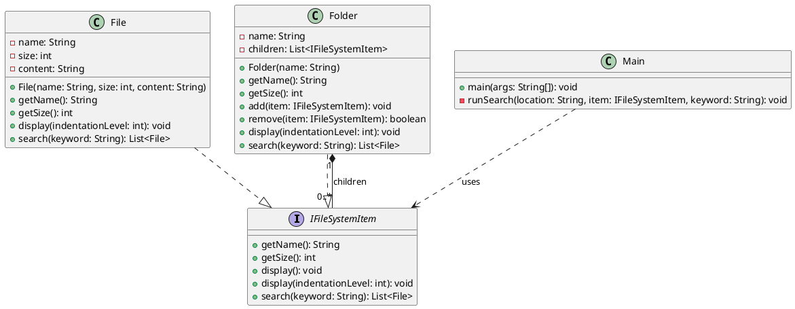

# Composite Design Pattern: Searchable File System

This example implements the assignment's searchable file system in plain Java.
The `IFileSystemItem` interface is the common component for both `File` and
`Folder`; the client can call the same operations without checking the
concrete type.

## Problem description

A file system organizes information into files and folders. A file stores
text, while a folder can contain files, other folders, or nothing at all.
Because folders can be nested to any depth, a search started at a folder must
look through every descendant folder and check the contents of each file it
finds. A search started at a single file checks only that file's text.

The challenge is to support the same operations—getting a name and size,
displaying a tree, and searching for text—on either a file or a folder without
making client code ask which kind of item it has. Folder size should reflect
the sum of all files beneath it, and adding or removing items should affect
subsequent size and search results. The Composite pattern addresses this by
giving files and folders a shared interface and letting folders delegate
operations to their children.

## Task 1 — Pattern elements

The **Composite** design pattern fits because it lets a client treat individual
objects (files) and groups of objects (folders) through one common interface.
A folder delegates operations to its children, so nested structures can be
handled recursively.

| Pattern role | Class/interface | Responsibility |
| --- | --- | --- |
| Component | `IFileSystemItem` | Declares the common name, size, display, and search operations. |
| Leaf | `File` | Stores a file's name, size, and text; searches its own content. |
| Composite | `Folder` | Stores child components; aggregates their sizes, display, and search results. |
| Client | `Main` | Builds the tree and calls operations through `IFileSystemItem`. |

When `search(keyword)` is called on a folder, it asks each child to search for
the keyword and combines the returned files. A child folder repeats the same
process for its own children, while a file checks only its content. Matching is
case-insensitive, and the folder does not need to distinguish files from
folders.

## Task 2 — UML class diagram

The child association from `Folder` to `IFileSystemItem` has multiplicity
`0..*`, so a folder may be empty. The client depends on the component
interface.


The diagram uses standard UML notation: each class is drawn as a box with
compartments for its name, attributes, and operations. `File` and `Folder`
connect to `IFileSystemItem` with dashed realization lines and hollow
triangular arrowheads. `Folder` has a composition relationship to its children:
one folder owns zero or more (`0..*`) `IFileSystemItem` children. `Main` has a
dashed dependency arrow to the interface, showing that client code uses the
common component instead of depending on concrete classes.
The SVG automatically switches its text, boxes, and relationship lines between
light and dark palettes according to the system or browser color-scheme
preference.

The editable PlantUML source for this diagram is included below:



`display()` is a convenience operation declared as a default method on the
component. It calls `display(indentationLevel)` so a folder can increase the
indentation as it delegates display to each child.

## Learning notes — concepts and definitions

- **Design pattern:** A reusable approach to a recurring software-design
  problem. It describes a structure and collaboration, rather than a
  ready-made implementation.
- **Composite pattern:** A structural pattern that arranges objects as a
  tree. A client uses the same component operations for a single object and
  for a group of objects.
- **Component (`IFileSystemItem`):** The shared interface that defines
  operations available on both files and folders. The `I` prefix is used here
  as requested to make the interface easy to identify.
- **Leaf (`File`):** An object with no children. It stores its own content,
  checks that content during search, and returns itself only when the keyword
  matches.
- **Composite (`Folder`):** An object that contains zero or more components.
  It delegates work to its children and combines their results. Since a child
  uses the same interface, a folder can contain either files or folders.
- **Client (`Main`):** Code that uses the component abstraction. The
  `runSearch` method accepts `IFileSystemItem`, so it works for the root, a
  subfolder, or one file without checking concrete types.
- **Recursion:** A method solving a problem by applying the same operation to
  smaller nested parts. A folder searches each child; if a child is another
  folder, that folder searches its children in turn. This naturally supports
  any nesting depth.
- **Aggregation of size:** A file returns its stored size. A folder adds the
  sizes of its children. The total is calculated when requested, so adding or
  removing a child is reflected immediately without maintaining a separate
  cached total.

### UML notation in the diagram

- A **class box** is split into compartments: class name, attributes, then
  operations. `-` means private and `+` means public.
- **Realization** (a dashed line ending in a hollow triangle) means that
  `File` and `Folder` implement the `IFileSystemItem` interface. The triangle
  points at the interface being implemented.
- **Composition** (a solid line with a filled diamond) represents the
  whole-part relationship: a `Folder` owns its child items.
- **Multiplicity** describes how many objects may participate in a
  relationship. `0..*` means zero or any number of children; `1` means each
  child is associated with one containing folder in this model.
- A **dependency** (a dashed arrow) means one class uses another. `Main`
  depends on `IFileSystemItem`, not on the concrete classes for its search
  operation.
- **`List<File>` search results:** Searching a folder may traverse folders,
  but only files can match content, so results contain files.

## Task 3 — Run the program

From this directory, compile and run with a JDK:

```text
javac IFileSystemItem.java File.java Folder.java Main.java
java Main
```

The program builds the supplied sample tree, prints it, displays aggregate
sizes, and demonstrates searches on the root, `docs`, and a single file using
the same client method. It also checks a no-match query, searches for
`composite`, adds a 2 KB file to `docs` to show the changed sizes and search
results, then removes that file to demonstrate `remove`.

The matching physical directory tree and text files are in `sample-data/`.
The sizes in the Java demonstration are the assignment's logical KB values;
they are specified when constructing each `File`, rather than calculated
from the byte lengths of these sample text files.

Expected initial values:

- `root.getSize()` — 24 KB
- `docs.getSize()` — 17 KB
- `root.search("design")` — `readme.txt`, `q1.txt`, `todo.txt`
- `docs.search("design")` — `readme.txt`, `q1.txt`
- `root.search("composite")` — `notes.txt`, `Main.java`
- `todo.txt.search("design")` — `todo.txt`
- `todo.txt.search("sales")` — no results

After adding `design-extra.txt` (2 KB) to `docs`, the sizes become 26 KB for
`root` and 19 KB for `docs`, and the root search for `design` includes the new
file.
