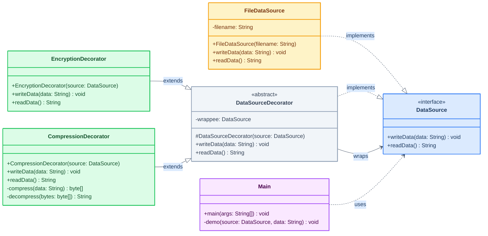
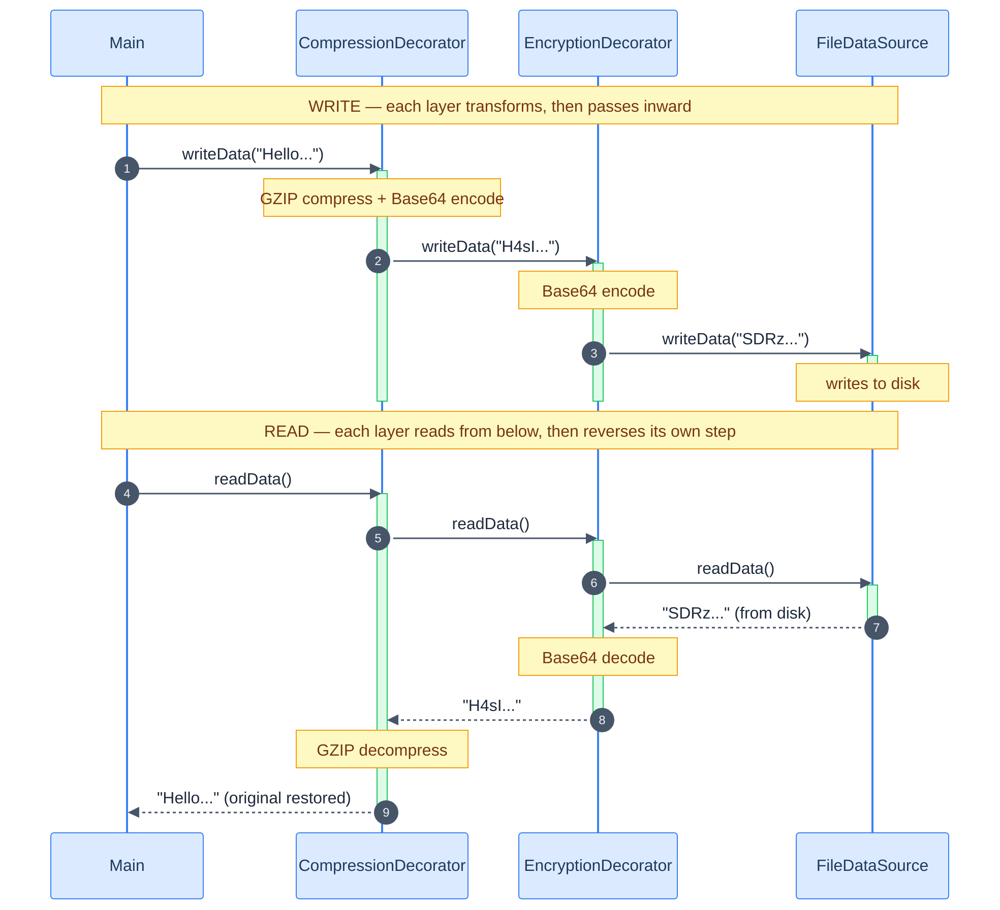

# Decorator Design Pattern: File System Data Source

Source: [refactoring.guru/design-patterns/decorator](https://refactoring.guru/design-patterns/decorator)

---

## The Problem

You have a class that reads and writes files. Now requirements grow:

- Some files need encryption before saving.
- Some files need compression.
- Some files need both.

The first instinct is to subclass for each combination:

```
FileDataSource
EncryptedFileDataSource
CompressedFileDataSource
EncryptedAndCompressedFileDataSource
```

That is 4 classes for just 2 features. Add a third feature and it becomes 8.
This approach breaks fast.

**The real problem:** you are mixing unrelated responsibilities into the same class
hierarchy. Encryption has nothing to do with compression. Neither should know about
the other.

---

## The Solution — Decorator (Wrapper) Pattern

Instead of building combinations into subclasses, you **wrap and decorate** objects inside each other
at runtime. Each **wrapper (decorator)** adds exactly one responsibility and delegates
everything else to the object it wraps and decorates (the **wrappee / decorated component**).

### Core Concepts: Wrapper (Decorator) vs. Wrappee (Decorated Component)

- **Wrapper / Decorator:** An object that encloses and decorates a target object (`wrappee`).
  It implements the target interface, holds a reference to the wrappee, and intercepts incoming
  method calls to dynamically attach behavior before or after delegating to the wrapped object.
- **Wrappee / Decorated Component:** The target object being enclosed/wrapped and decorated.
  It can be the core concrete component (`FileDataSource`) or an inner wrapper/decorator.
- **To Wrap / To Decorate:** The composition technique of enclosing an object within a decorator
  at runtime, avoiding rigid compile-time inheritance hierarchies.
- **Chain Duality:** In a multi-layered chain, an intermediate layer plays **both** roles
  simultaneously — it is a *wrapper / decorator* to the layer inside it, and a *wrappee / decorated component*
  to the layer outside it.

```
client
  -> CompressionDecorator    [Outer Wrapper / Decorator]
    -> EncryptionDecorator   [Wrappee/Decorated by Compression; Wrapper/Decorator to FileDataSource]
      -> FileDataSource      [Innermost Wrappee / Decorated Core Component]
```

The client only ever talks to `DataSource`. It never knows — or cares — how many
layers are in the chain, or whether an object is a wrapper/decorator or an undecorated wrappee.

---

## Pattern Roles & Terminology

| Pattern Role (Decorator) | Alternate Term (Wrapper) | Class | What it does |
| :--- | :--- | :--- | :--- |
| Component | Shared Interface | `DataSource` | The shared contract implemented by both Decorators (Wrappers) and Components (Wrappees). |
| Concrete Component | Innermost Wrappee | `FileDataSource` | The raw, undecorated file. Core target performing disk I/O; never wraps or decorates anything. |
| Base Decorator | Base Wrapper | `DataSourceDecorator` | Holds the `wrappee` reference (`DataSource wrappee`); forwards calls to the wrappee by default. |
| Concrete Decorator | Concrete Wrapper | `EncryptionDecorator` | Wraps and decorates a wrappee; Base64-encodes on write, decodes on read. |
| Concrete Decorator | Concrete Wrapper | `CompressionDecorator` | Wraps and decorates a wrappee; GZIP-compresses on write, decompresses on read. |
| Client | Caller / Assembler | `Main` | Wraps and decorates components dynamically, invoking `writeData` / `readData`. |

---

## Class Diagram



Color key: Blue = interface, Yellow = real file, Grey = abstract base, Green = decorators, Purple = client

---

## Understanding Each Piece

### 1. The Interface — `DataSource`

This is the common contract. Every layer, whether a raw component (innermost wrappee) or
a decorator (wrapper), must implement it.
Because of this shared interface:
- A wrapper/decorator can accept any `DataSource` as its wrappee/decorated target.
- The client can hold any wrapper (decorator) or wrappee (component) in a `DataSource` reference
  and swap it without changing client code.

```java
public interface DataSource {
    void writeData(String data);
    String readData();
}
```

---

### 2. The Real File (Innermost Wrappee / Decorated Core) — `FileDataSource`

This is the innermost layer and the root **wrappee (decorated core component)**. It reads and writes
raw bytes to disk with no transformations. All decorators (wrappers) enclose and decorate this
object, adding behavior before or after delegating to it.

```java
public class FileDataSource implements DataSource {
    private final String filename;

    @Override
    public void writeData(String data) {
        // writes data straight to disk — raw, undecorated
        try (OutputStream fos = new FileOutputStream(new File(filename))) {
            fos.write(data.getBytes(), 0, data.length());
        }
    }

    @Override
    public String readData() {
        // reads raw bytes from disk — raw, undecorated
        // whatever is in the file is exactly what comes back
    }
}
```

---

### 3. The Base Decorator (Base Wrapper) — `DataSourceDecorator`

This abstract class is the core wrapping and decorating mechanism. It does three things:

1. **Implements `DataSource`** — so it can serve as a wrapper/decorator or be passed as a wrappee to another decorator.
2. **Holds a `wrappee` reference** — the wrapped/decorated component (`private final DataSource wrappee`).
3. **Delegates all calls to the wrappee by default** — so a concrete decorator/wrapper only overrides what it alters.

```java
public abstract class DataSourceDecorator implements DataSource {

    private final DataSource wrappee;  // the target object being wrapped and decorated

    protected DataSourceDecorator(DataSource source) {
        this.wrappee = source;         // stores the wrappee / decorated component
    }

    @Override
    public void writeData(String data) {
        wrappee.writeData(data);       // forward to wrappee / decorated component by default
    }

    @Override
    public String readData() {
        return wrappee.readData();     // forward to wrappee / decorated component by default
    }
}
```

Concrete decorators extend this base wrapper and override only what they need.
Everything else passes through automatically to the wrappee.

---

### 4. Concrete Decorator (Wrapper) — `EncryptionDecorator`

A concrete wrapper and decorator that adds Base64 encoding. The interaction between wrapper/decorator and wrappee/component is:
- `writeData`: wrapper/decorator transforms the data, then delegates inward to its wrappee (`super.writeData`).
- `readData`: wrapper/decorator calls its wrappee first (`super.readData`), then reverses the transform on the output.

```java
public class EncryptionDecorator extends DataSourceDecorator {

    public EncryptionDecorator(DataSource source) {
        super(source); // wraps and decorates the wrappee
    }

    @Override
    public void writeData(String data) {
        // 1. wrapper/decorator encodes the data
        String encoded = Base64.getEncoder().encodeToString(data.getBytes());
        // 2. wrapper/decorator passes encoded data inward to the wrappee
        super.writeData(encoded);
    }

    @Override
    public String readData() {
        // 1. wrapper/decorator gets data from the wrappee
        String encoded = super.readData();
        // 2. wrapper/decorator decodes it back to original text
        return new String(Base64.getDecoder().decode(encoded));
    }
}
```

---

### 5. Concrete Decorator (Wrapper) — `CompressionDecorator`

A concrete wrapper and decorator that adds GZIP compression. Same wrapper/decorator to wrappee/component delegation:

```java
public class CompressionDecorator extends DataSourceDecorator {

    public CompressionDecorator(DataSource source) {
        super(source); // wraps and decorates the wrappee
    }

    @Override
    public void writeData(String data) {
        // 1. wrapper/decorator compresses the data
        byte[] compressed = compress(data);
        // 2. wrapper/decorator Base64-encodes for safe string transmission
        String encoded = Base64.getEncoder().encodeToString(compressed);
        // 3. wrapper/decorator passes result inward to the wrappee
        super.writeData(encoded);
    }

    @Override
    public String readData() {
        // 1. wrapper/decorator gets compressed data from the wrappee
        String encoded = super.readData();
        // 2. wrapper/decorator decodes Base64 to raw bytes
        byte[] compressed = Base64.getDecoder().decode(encoded);
        // 3. wrapper/decorator decompresses to restore original text
        return decompress(compressed);
    }
}
```

---

### 6. The Client (Chaining Wrappers / Decorators around Wrappees) — `Main`

The client builds the chain by nesting wrappers/decorators around wrappees/components, then calls `writeData`
and `readData` through the common `DataSource` interface:

```java
// Scenario 1: Innermost wrappee only — plain file (undecorated / no wrappers)
DataSource plain = new FileDataSource("plain.txt");

// Scenario 2: Single wrapper/decorator around a wrappee
// Wrapper (Decorator): EncryptionDecorator | Wrappee (Component): FileDataSource
DataSource encrypted = new EncryptionDecorator(
        new FileDataSource("encrypted.txt")
);

// Scenario 3: Single wrapper/decorator around a wrappee
// Wrapper (Decorator): CompressionDecorator | Wrappee (Component): FileDataSource
DataSource compressed = new CompressionDecorator(
        new FileDataSource("compressed.txt")
);

// Scenario 4: Stacked chain (Nested wrappers/decorators)
// Outer Wrapper / Decorator: CompressionDecorator
// Middle Layer:              EncryptionDecorator (Wrappee to Comp, Wrapper to File)
// Innermost:                 FileDataSource (Innermost Wrappee / Decorated Core)
DataSource both = new CompressionDecorator(
        new EncryptionDecorator(
                new FileDataSource("compressed_encrypted.txt")
        )
);

// All are invoked identically via the DataSource interface
plain.writeData(data);
encrypted.writeData(data);
both.writeData(data);
```

The `demo()` helper shows this clearly — same two lines for every scenario:

```java
private static void demo(DataSource source, String data) {
    source.writeData(data);   // client does not know what is inside
    String result = source.readData();
    System.out.println("Round-trip OK: " + data.equals(result));
}
```

---

## How Stacking Works (Delegation Through Wrappers / Decorators to Wrappee)

When `both.writeData("Hello")` is called on the stacked chain:

```
CompressionDecorator.writeData("Hello")     [Outer Wrapper / Decorator]
  compress("Hello") -> raw bytes
  Base64 encode     -> "H4sI..."
  calls super.writeData("H4sI...")          [Delegates to Wrappee / Decorated Component]

    EncryptionDecorator.writeData("H4sI...")  [Middle Layer: Wrappee to Comp, Wrapper to File]
      Base64 encode -> "SDRz..."
      calls super.writeData("SDRz...")        [Delegates to Wrappee / Decorated Component]

        FileDataSource.writeData("SDRz...")   [Innermost Wrappee / Decorated Core]
          writes "SDRz..." to disk
```

On `both.readData()` the layers unwind in reverse from innermost wrappee back through decorators/wrappers:

```
CompressionDecorator.readData()             [Outer Wrapper / Decorator]
  calls super.readData()                    [Requests data from Wrappee / Decorated Component]

    EncryptionDecorator.readData()          [Middle Layer]
      calls super.readData()                [Requests data from Wrappee / Decorated Component]

        FileDataSource.readData()           [Innermost Wrappee / Decorated Core]
          reads "SDRz..." from disk

      Base64 decode -> "H4sI..."
      returns "H4sI..."                     [Returns to outer Wrapper / Decorator]

  Base64 decode -> raw bytes
  GZIP decompress -> "Hello"
  returns "Hello"                           [Returns to Client]
```

Each wrapper/decorator undoes exactly its own decoration step. Order matters — the outermost
wrapper/decorator on write becomes the outermost on read.

---

## Sequence Diagram — Stacked Write and Read



---

## File Structure

```
decorator_design_pattern/
├── DataSource.java              — interface (shared contract for Wrappers & Wrappees)
├── FileDataSource.java          — concrete component, innermost wrappee (raw file I/O)
├── DataSourceDecorator.java     — base wrapper, holds wrappee reference, delegates by default
├── EncryptionDecorator.java     — concrete wrapper (Base64 encryption)
├── CompressionDecorator.java    — concrete wrapper (GZIP compression)
├── Main.java                    — client, composes wrappers around wrappees
└── README.md                    — documentation detailing pattern, wrapper/wrappee concepts
```

---

## How to Run

```powershell
cd decorator_design_pattern
javac -encoding UTF-8 *.java
java Main
```

---

## Scenarios: What Is Happening in Code

Below is a detailed walkthrough of each scenario executed in `Main.java`, detailing the object roles, the flow of execution in the code during `writeData()` and `readData()`, and the resulting console output.

---

### Scenario 1: Plain File (Undecorated / No Wrappers)

#### Code Configuration
```java
DataSource plain = new FileDataSource("plain.txt");
demo(plain, data);
```
- **Wrapper (Decorator):** None.
- **Wrappee (Decorated Component):** `FileDataSource("plain.txt")` (acting directly as the target).

#### What Happens in Code
- **WRITE (`plain.writeData(data)`):**
  1. Client calls `writeData()` on the `DataSource` reference.
  2. Directly enters `FileDataSource.writeData(data)`.
  3. No transformations occur. The string (76 characters) is converted to raw bytes (`data.getBytes()`).
  4. Writes 76 bytes directly to disk via `FileOutputStream`.
- **READ (`plain.readData()`):**
  1. Client calls `readData()` on the `DataSource` reference.
  2. Directly enters `FileDataSource.readData()`.
  3. Reads 76 raw bytes from disk via `FileReader` into a char buffer.
  4. Returns the unmodified original string. Round-trip matches perfectly.

#### Console Output
```
=== Scenario 1: Plain file ===
  WRITE:
  [FileDataSource] Wrote 76 bytes to 'plain.txt'
  READ:
  [FileDataSource] Read 76 bytes from 'plain.txt'
  Round-trip OK: true
```

---

### Scenario 2: Encrypted File (Single Wrapper)

#### Code Configuration
```java
DataSource encrypted = new EncryptionDecorator(
        new FileDataSource("encrypted.txt")
);
demo(encrypted, data);
```
- **Wrapper (Decorator):** `EncryptionDecorator`.
- **Wrappee (Decorated Component):** `FileDataSource("encrypted.txt")` (stored in `super.wrappee`).

#### What Happens in Code
- **WRITE (`encrypted.writeData(data)`):**
  1. Client calls `writeData()` on the `EncryptionDecorator`.
  2. `EncryptionDecorator.writeData(data)` intercepts the original 76-character plain text.
  3. **Pre-processing:** Base64-encodes the bytes, producing a 104-character encrypted string (`"SGVsbG8..."`).
  4. **Delegation:** Calls `super.writeData(encoded)`, which invokes `wrappee.writeData(encoded)`.
  5. `FileDataSource.writeData()` receives the 104-character ciphertext and writes 104 bytes to disk (`encrypted.txt`).
- **READ (`encrypted.readData()`):**
  1. Client calls `readData()` on the `EncryptionDecorator`.
  2. **Inward Delegation:** `EncryptionDecorator.readData()` calls `super.readData()` -> `wrappee.readData()`.
  3. `FileDataSource.readData()` reads 104 bytes of Base64 ciphertext from disk and returns it.
  4. **Post-processing:** `EncryptionDecorator` decodes the 104-character Base64 string back into the original 76-character plain text.
  5. Returns decoded plain text to the client.

#### Console Output
```
=== Scenario 2: Encrypted file ===
  WRITE:
  [EncryptionDecorator] Encrypted: 'Hello...' -> 'SGVsbG8...'
  [FileDataSource] Wrote 104 bytes to 'encrypted.txt'
  READ:
  [FileDataSource] Read 104 bytes from 'encrypted.txt'
  [EncryptionDecorator] Decrypted: 'SGVsbG8...' -> 'Hello...'
  Round-trip OK: true
```

---

### Scenario 3: Compressed File (Single Wrapper)

#### Code Configuration
```java
DataSource compressed = new CompressionDecorator(
        new FileDataSource("compressed.txt")
);
demo(compressed, data);
```
- **Wrapper (Decorator):** `CompressionDecorator`.
- **Wrappee (Decorated Component):** `FileDataSource("compressed.txt")` (stored in `super.wrappee`).

#### What Happens in Code
- **WRITE (`compressed.writeData(data)`):**
  1. Client calls `writeData()` on `CompressionDecorator`.
  2. `CompressionDecorator.writeData(data)` intercepts the 76-character text.
  3. **Pre-processing:**
     - Compresses text into raw binary bytes using `GZIPOutputStream`.
     - Base64-encodes the binary bytes into a 120-character ASCII string (making it safe for string storage and transfer).
  4. **Delegation:** Calls `super.writeData(encoded)`, forwarding the 120-character string to `wrappee.writeData(encoded)`.
  5. `FileDataSource.writeData()` writes 120 bytes of compressed+encoded text to `compressed.txt`.
- **READ (`compressed.readData()`):**
  1. Client calls `readData()` on `CompressionDecorator`.
  2. **Inward Delegation:** `CompressionDecorator.readData()` calls `super.readData()` -> `wrappee.readData()`.
  3. `FileDataSource.readData()` reads 120 bytes from `compressed.txt` and returns the encoded string.
  4. **Post-processing:**
     - Decodes Base64 string back to raw GZIP byte array.
     - Decompresses byte array using `GZIPInputStream` back to the original 76-character string.
  5. Returns uncompressed plain text to the client.

#### Console Output
```
=== Scenario 3: Compressed file ===
  WRITE:
  [CompressionDecorator] Compressed 76 chars -> 120 chars
  [FileDataSource] Wrote 120 bytes to 'compressed.txt'
  READ:
  [FileDataSource] Read 120 bytes from 'compressed.txt'
  [CompressionDecorator] Decompressed 120 chars -> 76 chars
  Round-trip OK: true
```

---

### Scenario 4: Compressed + Encrypted (Stacked Wrappers / Decorator Chain)

#### Code Configuration
```java
DataSource both = new CompressionDecorator(
        new EncryptionDecorator(
                new FileDataSource("compressed_encrypted.txt")
        )
);
demo(both, data);
```
- **Outer Wrapper (Decorator):** `CompressionDecorator`.
- **Middle Layer:** `EncryptionDecorator` (Wrappee to `CompressionDecorator`, Wrapper to `FileDataSource`).
- **Innermost Wrappee (Decorated Core):** `FileDataSource("compressed_encrypted.txt")`.

#### What Happens in Code
- **WRITE Pipeline (`both.writeData(data)`):**
  1. **Client** calls `writeData(76 chars)` on the outermost wrapper (`CompressionDecorator`).
  2. **Layer 1 (`CompressionDecorator`):**
     - Compresses 76 chars into GZIP bytes and Base64-encodes them into a 120-char string (`"H4sI..."`).
     - Delegates inward: calls `super.writeData("H4sI...")`.
  3. **Layer 2 (`EncryptionDecorator`):**
     - Intercepts `"H4sI..."` (120 chars) from its outer wrapper.
     - Encrypts/encodes `"H4sI..."` with Base64 into a 160-char string (`"SDRz..."`).
     - Delegates inward: calls `super.writeData("SDRz...")`.
  4. **Layer 3 (`FileDataSource`):**
     - Receives `"SDRz..."` (160 chars) from its wrapper.
     - Writes 160 raw bytes to disk in `compressed_encrypted.txt`.

- **READ Pipeline (`both.readData()`):**
  1. **Client** calls `readData()` on the outermost wrapper (`CompressionDecorator`).
  2. **Layer 1 (`CompressionDecorator`):**
     - Calls `super.readData()` to request raw content from its wrappee (`EncryptionDecorator`).
  3. **Layer 2 (`EncryptionDecorator`):**
     - Calls `super.readData()` to request raw content from its wrappee (`FileDataSource`).
  4. **Layer 3 (`FileDataSource`):**
     - Reads 160 bytes (`"SDRz..."`) from disk and returns the string upward to Layer 2.
  5. **Layer 2 (`EncryptionDecorator`):**
     - Receives `"SDRz..."`.
     - Decrypts/decodes Base64 back into `"H4sI..."` (120 chars) and returns it upward to Layer 1.
  6. **Layer 1 (`CompressionDecorator`):**
     - Receives `"H4sI..."`.
     - Decodes Base64 to GZIP bytes and decompresses them back into the original 76-character string.
  7. **Client** receives the original unmodified string.

#### Console Output
```
=== Scenario 4: Compressed + Encrypted ===
  WRITE:
  [CompressionDecorator] Compressed 76 chars -> 120 chars
  [EncryptionDecorator] Encrypted: 'H4sI...' -> 'SDRz...'
  [FileDataSource] Wrote 160 bytes to 'compressed_encrypted.txt'
  READ:
  [FileDataSource] Read 160 bytes from 'compressed_encrypted.txt'
  [EncryptionDecorator] Decrypted: 'SDRz...' -> 'H4sI...'
  [CompressionDecorator] Decompressed 120 chars -> 76 chars
  Round-trip OK: true
```

---

## Adding a New Feature (New Wrapper / Decorator)

To add another behavior (such as logging), implement one new wrapper/decorator class. Nothing else changes.

```java
// Create a new Wrapper / Decorator
public class LoggingDecorator extends DataSourceDecorator {
    public LoggingDecorator(DataSource source) {
        super(source); // wraps and decorates the wrappee
    }

    @Override
    public void writeData(String data) {
        System.out.println("  [Log] Writing " + data.length() + " chars");
        super.writeData(data); // delegates to wrappee / decorated component
    }

    @Override
    public String readData() {
        String result = super.readData(); // reads from wrappee / decorated component
        System.out.println("  [Log] Read " + result.length() + " chars");
        return result;
    }
}
```

Wrap and decorate in any position in the chain:

```java
DataSource source = new LoggingDecorator(
        new CompressionDecorator(
                new FileDataSource("log.txt")));
source.writeData("some data");
```
