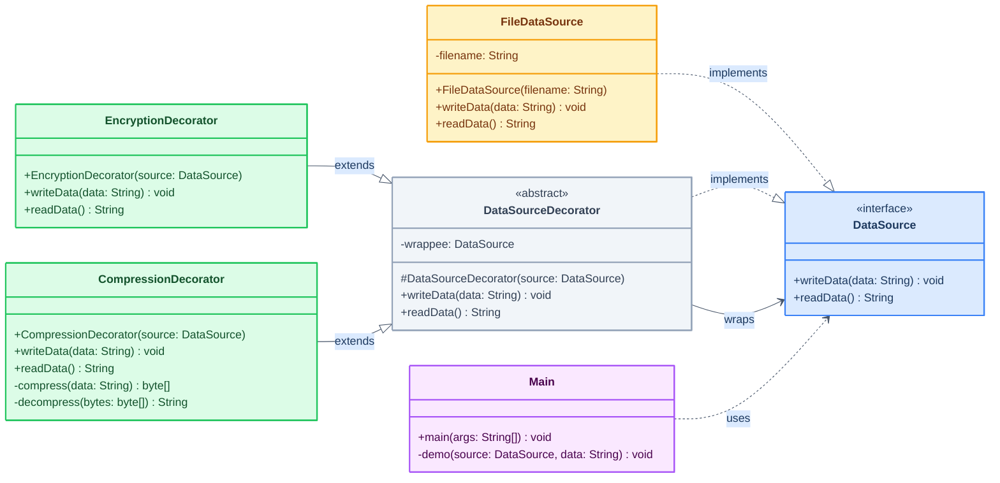
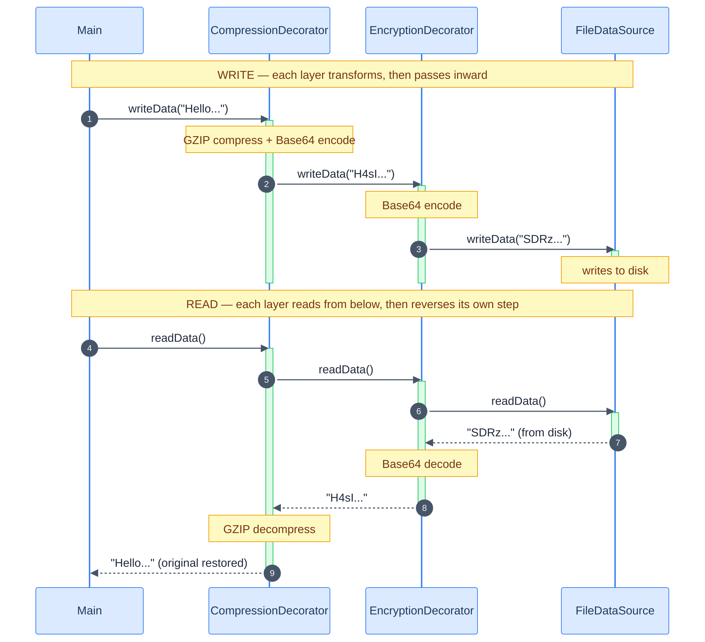

# Decorator Design Pattern: File System Data Source

Source: [refactoring.guru/design-patterns/decorator](https://refactoring.guru/design-patterns/decorator)

---

## The Problem

You have a class that reads and writes files. Now requirements grow:

- Some files need encryption before saving.
- Some files need compression.
- Some files need both.

The first instinct is to subclass for each combination:

```
FileDataSource
EncryptedFileDataSource
CompressedFileDataSource
EncryptedAndCompressedFileDataSource
```

That is 4 classes for just 2 features. Add a third feature and it becomes 8.
This approach breaks fast.

**The real problem:** you are mixing unrelated responsibilities into the same class
hierarchy. Encryption has nothing to do with compression. Neither should know about
the other.

---

## The Solution — Decorator Pattern

Instead of building combinations into subclasses, you wrap objects inside each other
at runtime. Each wrapper (decorator) adds exactly one responsibility and delegates
everything else to the object it wraps.

```
client
  -> CompressionDecorator    (adds compression)
    -> EncryptionDecorator   (adds encryption)
      -> FileDataSource      (the real file)
```

The client only ever talks to `DataSource`. It never knows — or cares — how many
layers are in the chain.

---

## Pattern Roles

| Role | Class | What it does |
| :--- | :--- | :--- |
| Component | `DataSource` | The shared interface. Every layer implements this. |
| Concrete Component | `FileDataSource` | The real file. Reads and writes raw bytes. No decoration. |
| Base Decorator | `DataSourceDecorator` | Holds the wrapped object. Delegates all calls by default. |
| Concrete Decorator | `EncryptionDecorator` | Base64-encodes on write, decodes on read. |
| Concrete Decorator | `CompressionDecorator` | GZIP-compresses on write, decompresses on read. |
| Client | `Main` | Builds chains, calls `writeData` / `readData` via `DataSource`. |

---

## Class Diagram



Color key: Blue = interface, Yellow = real file, Grey = abstract base, Green = decorators, Purple = client

---

## Understanding Each Piece

### 1. The Interface — `DataSource`

This is the contract. Every layer, real or decorator, must implement it.
Because of this, the client can hold any layer in a `DataSource` variable and
swap it out without changing a single line of client code.

```java
public interface DataSource {
    void writeData(String data);
    String readData();
}
```

---

### 2. The Real File — `FileDataSource`

This is the innermost layer. It just reads and writes raw bytes. No transformation.
All decorators sit around this and add behaviour before or after calling it.

```java
public class FileDataSource implements DataSource {
    private final String filename;

    @Override
    public void writeData(String data) {
        // writes data straight to disk — no changes at all
        try (OutputStream fos = new FileOutputStream(new File(filename))) {
            fos.write(data.getBytes(), 0, data.length());
        }
    }

    @Override
    public String readData() {
        // reads raw bytes from disk — no changes at all
        // whatever is in the file is exactly what comes back
    }
}
```

---

### 3. The Base Decorator — `DataSourceDecorator`

This abstract class is the core mechanism. It does three things:

1. Implements `DataSource` — so it fits anywhere a `DataSource` is expected.
2. Holds a `wrappee` reference — the object it is decorating.
3. Delegates all calls to the wrappee by default — so a concrete decorator
   only has to override the method where it adds something.

```java
public abstract class DataSourceDecorator implements DataSource {

    private final DataSource wrappee;  // the object being wrapped

    protected DataSourceDecorator(DataSource source) {
        this.wrappee = source;
    }

    @Override
    public void writeData(String data) {
        wrappee.writeData(data);  // just forward by default
    }

    @Override
    public String readData() {
        return wrappee.readData();  // just forward by default
    }
}
```

Concrete decorators extend this and override only what they need.
Everything else passes through automatically.

---

### 4. Concrete Decorator — `EncryptionDecorator`

Adds Base64 encoding. The shape is always:
- `writeData`: transform the data, then delegate inward.
- `readData`: delegate inward first, then reverse-transform on the way out.

```java
public class EncryptionDecorator extends DataSourceDecorator {

    @Override
    public void writeData(String data) {
        // 1. encode the data
        String encoded = Base64.getEncoder().encodeToString(data.getBytes());
        // 2. pass encoded data to the next layer (file or another decorator)
        super.writeData(encoded);
    }

    @Override
    public String readData() {
        // 1. get whatever the layer below stored
        String encoded = super.readData();
        // 2. decode it back to the original text
        return new String(Base64.getDecoder().decode(encoded));
    }
}
```

---

### 5. Concrete Decorator — `CompressionDecorator`

Adds GZIP compression. Same shape as above, but with an extra Base64 step
because GZIP output is raw binary bytes that cannot safely travel as a Java String.

```java
public class CompressionDecorator extends DataSourceDecorator {

    @Override
    public void writeData(String data) {
        // 1. GZIP compress the data
        byte[] compressed = compress(data);
        // 2. Base64-encode so the bytes are safe to pass as a String
        String encoded = Base64.getEncoder().encodeToString(compressed);
        // 3. pass to the next layer
        super.writeData(encoded);
    }

    @Override
    public String readData() {
        // 1. get data from the layer below
        String encoded = super.readData();
        // 2. Base64-decode back to raw GZIP bytes
        byte[] compressed = Base64.getDecoder().decode(encoded);
        // 3. GZIP decompress to get the original string
        return decompress(compressed);
    }
}
```

---

### 6. The Client — `Main`

The client builds the chain at the top, then calls `writeData` and `readData`
through the `DataSource` interface. It has no idea what is inside the chain.

```java
// No decorators — plain file
DataSource plain = new FileDataSource("plain.txt");

// One decorator — encryption only
DataSource encrypted = new EncryptionDecorator(
        new FileDataSource("encrypted.txt")
);

// Two decorators stacked — compress first, then encrypt
DataSource both = new CompressionDecorator(
        new EncryptionDecorator(
                new FileDataSource("compressed_encrypted.txt")
        )
);

// All three are used exactly the same way
plain.writeData(data);
encrypted.writeData(data);
both.writeData(data);
```

The `demo()` helper shows this clearly — same two lines for every scenario:

```java
private static void demo(DataSource source, String data) {
    source.writeData(data);   // client does not know what is inside
    String result = source.readData();
    System.out.println("Round-trip OK: " + data.equals(result));
}
```

---

## How Stacking Works

When `both.writeData("Hello")` is called on the stacked chain:

```
CompressionDecorator.writeData("Hello")
  compress("Hello") -> raw bytes
  Base64 encode     -> "H4sI..."
  calls super.writeData("H4sI...")

    EncryptionDecorator.writeData("H4sI...")
      Base64 encode -> "SDRz..."
      calls super.writeData("SDRz...")

        FileDataSource.writeData("SDRz...")
          writes "SDRz..." to disk
```

On `both.readData()` the layers unwind in reverse:

```
CompressionDecorator.readData()
  calls super.readData()

    EncryptionDecorator.readData()
      calls super.readData()

        FileDataSource.readData()
          reads "SDRz..." from disk

      Base64 decode -> "H4sI..."
      returns "H4sI..."

  Base64 decode -> raw bytes
  GZIP decompress -> "Hello"
  returns "Hello"
```

Each decorator undoes exactly its own step. Order matters — the outermost
decorator on write becomes the innermost on read.

---

## Sequence Diagram — Stacked Write and Read



---

## File Structure

```
decorator_design_pattern/
├── DataSource.java              — interface (shared contract for all layers)
├── FileDataSource.java          — the real file, innermost layer
├── DataSourceDecorator.java     — abstract base, holds wrappee, delegates by default
├── EncryptionDecorator.java     — Base64 encode on write, decode on read
├── CompressionDecorator.java    — GZIP compress on write, decompress on read
├── Main.java                    — client, builds and runs 4 scenarios
└── README.md                    — this file
```

---

## How to Run

```powershell
cd decorator_design_pattern
javac -encoding UTF-8 *.java
java Main
```

---

## Sample Output

```
=== Scenario 1: Plain file ===
  WRITE:
  [FileDataSource] Wrote 76 bytes to 'plain.txt'
  READ:
  [FileDataSource] Read 76 bytes from 'plain.txt'
  Round-trip OK: true

=== Scenario 2: Encrypted file ===
  WRITE:
  [EncryptionDecorator] Encrypted: 'Hello...' -> 'SGVsbG8...'
  [FileDataSource] Wrote 104 bytes to 'encrypted.txt'
  READ:
  [FileDataSource] Read 104 bytes from 'encrypted.txt'
  [EncryptionDecorator] Decrypted: 'SGVsbG8...' -> 'Hello...'
  Round-trip OK: true

=== Scenario 3: Compressed file ===
  WRITE:
  [CompressionDecorator] Compressed 76 chars -> 120 chars
  [FileDataSource] Wrote 120 bytes to 'compressed.txt'
  READ:
  [FileDataSource] Read 120 bytes from 'compressed.txt'
  [CompressionDecorator] Decompressed 120 chars -> 76 chars
  Round-trip OK: true

=== Scenario 4: Compressed + Encrypted ===
  WRITE:
  [CompressionDecorator] Compressed 76 chars -> 120 chars
  [EncryptionDecorator] Encrypted: 'H4sI...' -> 'SDRz...'
  [FileDataSource] Wrote 160 bytes to 'compressed_encrypted.txt'
  READ:
  [FileDataSource] Read 160 bytes from 'compressed_encrypted.txt'
  [EncryptionDecorator] Decrypted: 'SDRz...' -> 'H4sI...'
  [CompressionDecorator] Decompressed 120 chars -> 76 chars
  Round-trip OK: true
```

---

## Adding a New Feature

One new class. Nothing else changes.

```java
public class LoggingDecorator extends DataSourceDecorator {
    public LoggingDecorator(DataSource source) { super(source); }

    @Override
    public void writeData(String data) {
        System.out.println("  [Log] Writing " + data.length() + " chars");
        super.writeData(data);
    }

    @Override
    public String readData() {
        String result = super.readData();
        System.out.println("  [Log] Read " + result.length() + " chars");
        return result;
    }
}
```

Use it in any position in the chain:

```java
DataSource source = new LoggingDecorator(
        new CompressionDecorator(
                new FileDataSource("log.txt")));
source.writeData("some data");
```
