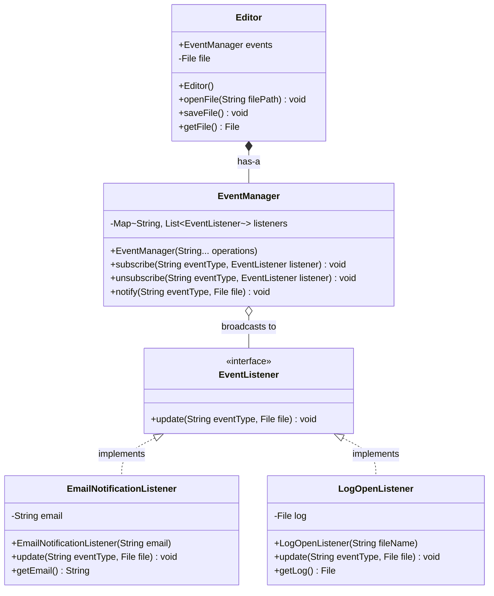
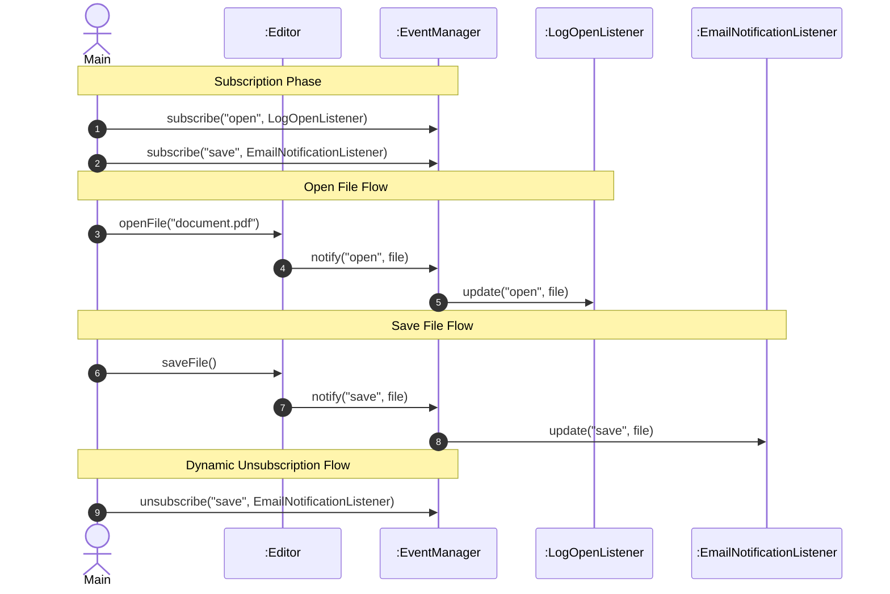

# Refactoring Guru: EventManager — Observer Design Pattern

A clean, production-grade Java implementation of the **Observer** design pattern based on Refactoring Guru's EventManager and File Editor architecture.

---

## 1. Component Definitions

| Component | Pattern Role | File | Responsibility |
| :--- | :--- | :--- | :--- |
| **`EventListener`** | **Observer / Subscriber Interface** | [`EventListener.java`](file:///c:/Users/HabiburRahmanShalin/workstation/shaleen/iit/DesignPatterns/observer_pattern/EventManager/EventListener.java) | Declares the common update contract (`update(String eventType, File file)`). Decouples publishers from concrete subscriber implementations. |
| **`EventManager`** | **Subject / Event Publisher** | [`EventManager.java`](file:///c:/Users/HabiburRahmanShalin/workstation/shaleen/iit/DesignPatterns/observer_pattern/EventManager/EventManager.java) | Maintains subscription registry (`Map<String, List<EventListener>>`), and provides methods to `subscribe`, `unsubscribe`, and broadcast notifications via `notify`. |
| **`Editor`** | **Context / Concrete Publisher** | [`Editor.java`](file:///c:/Users/HabiburRahmanShalin/workstation/shaleen/iit/DesignPatterns/observer_pattern/EventManager/Editor.java) | Contains business logic (opening and saving files). Owns an `EventManager` and triggers event notifications upon state changes. |
| **`EmailNotificationListener`** | **Concrete Observer** | [`EmailNotificationListener.java`](file:///c:/Users/HabiburRahmanShalin/workstation/shaleen/iit/DesignPatterns/observer_pattern/EventManager/EmailNotificationListener.java) | Reacts to subscribed events by dispatching an email notification to a specified recipient. |
| **`LogOpenListener`** | **Concrete Observer** | [`LogOpenListener.java`](file:///c:/Users/HabiburRahmanShalin/workstation/shaleen/iit/DesignPatterns/observer_pattern/EventManager/LogOpenListener.java) | Reacts to subscribed events by outputting an audit log entry to a specified log file. |
| **`Main`** | **Client Driver** | [`Main.java`](file:///c:/Users/HabiburRahmanShalin/workstation/shaleen/iit/DesignPatterns/observer_pattern/EventManager/Main.java) | Configures listeners, demonstrates subscription lifecycle (subscribe/unsubscribe), executes business operations, and verifies exception handling. |

---

## 2. Core Concepts & Short Understanding Notes

### Problem
An application component (e.g., `Editor`) performs important business tasks like opening or saving files. Other components (such as an audit logging service or an email notification service) need to execute actions whenever these tasks occur. Directly hardcoding logging and email calls inside `Editor` tightly couples it to those services, violates the Open/Closed Principle, and makes it impossible for 3rd-party consumers to listen to events dynamically.

### Solution: Observer Pattern
- **Decoupled Subscription Mechanism**: `Editor` delegates event management to `EventManager`.
- **Subscriber Interface**: Subscribers implement `EventListener`, exposing only a uniform `update(eventType, file)` method.
- **Dynamic Configuration**: Clients can subscribe or unsubscribe any number of listeners at runtime without modifying the `Editor` class.

### Architectural Principles Applied
- **Single Responsibility Principle (SRP)**: `Editor` manages file state; `EventManager` manages subscriber registries and broadcasts; concrete listeners handle specific side effects (emailing, logging).
- **Open/Closed Principle (OCP)**: New subscriber types (e.g., SMS alerts, webhook dispatchers, cloud telemetry) can be introduced without modifying existing publisher or client code.
- **Loose Coupling / Dependency Inversion**: `EventManager` interacts strictly with the `EventListener` abstraction, never with concrete classes.

---

## 3. UML Class Diagram

Standalone SVG diagram: [`uml-class-diagram.svg`](file:///c:/Users/HabiburRahmanShalin/workstation/shaleen/iit/DesignPatterns/observer_pattern/EventManager/uml-class-diagram.svg)



---

## 4. UML Sequence Diagram

Standalone SVG diagram: [`uml-sequence-diagram.svg`](file:///c:/Users/HabiburRahmanShalin/workstation/shaleen/iit/DesignPatterns/observer_pattern/EventManager/uml-sequence-diagram.svg)



---

## 5. Build & Execution

### Compile
```powershell
javac *.java
```

### Run
```powershell
java Main
```

### Verified Console Output
```text
=================================================================
   Refactoring Guru: EventManager Observer Pattern Demonstration
=================================================================

[Step 1] Subscribing listeners to events...
 -> 'open' event subscribed by: LogOpenListener, DevOps Email
 -> 'save' event subscribed by: Admin Email, DevOps Email

[Step 2] Executing Editor operations...

--- Opening 'document.pdf' ---
Save to log app_events.log: Someone has performed open operation with the following file: document.pdf
Email to devops@example.com: Someone has performed open operation with the following file: document.pdf

--- Saving 'document.pdf' ---
Email to admin@example.com: Someone has performed save operation with the following file: document.pdf
Email to devops@example.com: Someone has performed save operation with the following file: document.pdf

[Step 3] Dynamic Unsubscription: Removing DevOps from 'open' and 'save'...

--- Opening 'report.xlsx' ---
Save to log app_events.log: Someone has performed open operation with the following file: report.xlsx

--- Saving 'report.xlsx' ---
Email to admin@example.com: Someone has performed save operation with the following file: report.xlsx

[Step 4] Testing error handling: Saving with uninitialized editor...
Expected error caught successfully: Please open a file first.

=================================================================
   Observer Pattern Demonstration Completed Successfully
=================================================================
```
