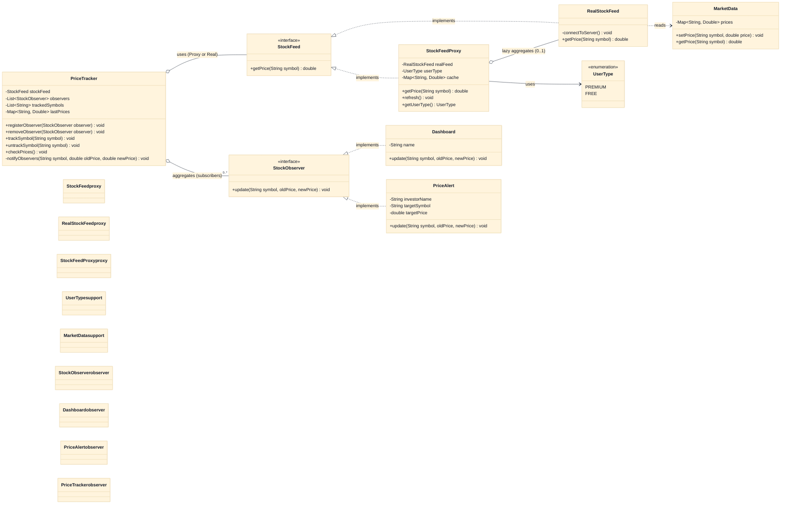
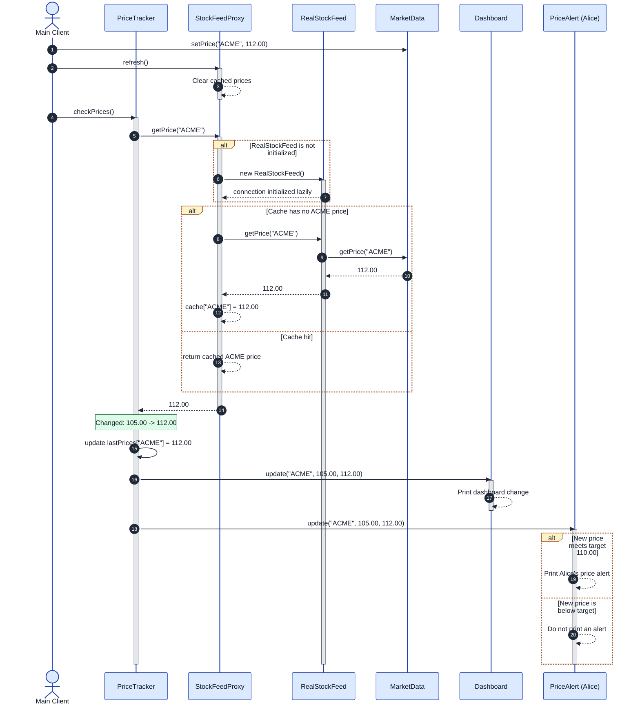

# Stock Price Monitoring System (Proxy & Observer Patterns)

---

## 1. Problem Statement

Imagine you are building an app to monitor stock prices. There are two major technical challenges to solve:

1. **The Remote Server is Slow and Expensive (Proxy Problem):**
   - Connecting to the remote stock server takes noticeable time, and every single network request costs money.
   - We do not want to connect until someone actually asks for a price (**Lazy Loading**).
   - If we recently fetched the price of a stock (e.g. `ACME`), we should reuse that saved price instead of calling the expensive server again (**Caching**).
   - Some stock symbols (like `BETA`) are reserved for paid members. Free users should be blocked from accessing them (**Access Control**).

2. **Multiple Parts of the App Need Instant Updates (Observer Problem):**
   - When a stock price changes, different parts of the application need to know:
     - A **Dashboard** wants to display every single price change on screen.
     - An investor's **Price Alert** only cares about a specific stock and wants to be alerted only when the price reaches or exceeds a target price.
   - The price tracking engine shouldn't be hard-coded to know about specific screens or alerts. It should simply notify registered subscribers whenever a price moves without caring who they are (**Loose Coupling**).

---

## 2. How It Works

To solve these two problems cleanly, we combine two classic design patterns:

### Part 1: The Proxy Pattern (Smart Gatekeeper)
- **`StockFeed` (Interface):** The contract defining `getPrice(symbol)`.
- **`RealStockFeed` (Real Subject):** The actual class that makes the slow, expensive connection to the stock exchange.
- **`StockFeedProxy` (Proxy):** Stands between the client and `RealStockFeed`.
  - It does **not** connect to the server right away. It waits until the very first valid request arrives.
  - It saves prices in an internal map (`cache`). If asked for the same stock again, it answers instantly from memory. Calling `refresh()` empties this cache when fresh data is needed.
  - It checks whether the user is `FREE` or `PREMIUM`. If a `FREE` user requests `BETA`, it rejects the request on the spot.

### Part 2: The Observer Pattern (Event Broadcast)
- **`StockObserver` (Interface):** An interface with `update(symbol, oldPrice, newPrice)`.
- **`PriceTracker` (Subject / Publisher):**
  - Keeps track of a list of stock symbols using any `StockFeed` (it doesn't even know whether it has the real feed or the proxy!).
  - When `checkPrices()` is called, it checks each stock. If the price changed since last check, it broadcasts the update to all registered observers.
- **`Dashboard` (Concrete Observer):** Receives the broadcast and prints every change.
- **`PriceAlert` (Concrete Observer):** Receives the broadcast, checks if the symbol matches its own stock, and only prints an alert if the new price meets or exceeds the target threshold (without needing any type-casting or `instanceof`).

---

## 3. Tasks & Answers

### Task 1: Identify Pattern Elements

#### Why each pattern fits:
- **Proxy Pattern:** Fits because we need to control access to a remote, expensive resource by adding lazy loading, caching, and role-based permissions without modifying how clients call `getPrice()`.
- **Observer Pattern:** Fits because we need a one-to-many relationship where multiple independent listeners (dashboards, alerts) get notified of state changes without the publisher knowing their concrete implementations.

#### Proxy Role Table
| Proxy Role | Your Class / Interface | Responsibility |
| :--- | :--- | :--- |
| **Subject** | `StockFeed` | Defines common interface (`getPrice`) for both proxy and real feed. |
| **Real Subject** | `RealStockFeed` | Connects to remote stock server (slow/costly) and fetches actual prices. |
| **Proxy** | `StockFeedProxy` | Controls access (denies `BETA` for free users), initializes lazily, and caches prices. |
| **Client** | `PriceTracker` / `Main` | Calls `getPrice()` via the `StockFeed` interface without knowing if it's the proxy or real feed. |

#### Observer Role Table
| Observer Role | Your Class / Interface | Responsibility |
| :--- | :--- | :--- |
| **Subject (Observable)** | `PriceTracker` | Holds subscribers, watches symbols, and notifies observers when prices change. |
| **Observer** | `StockObserver` | Interface with `update(symbol, oldPrice, newPrice)`. |
| **Concrete Observers** | `Dashboard`, `PriceAlert` | `Dashboard` logs all changes; `PriceAlert` alerts when target price is hit. |

---

## 4. Task 2: UML Diagrams

### UML Class Diagram



### UML Sequence Diagram (Price Check with Cache Miss & Notification)



---

## 5. Code Walkthrough

```java
// 1. PROXY: Controls access, caches results, and delays server connection
public class StockFeedProxy implements StockFeed {
    // Only connects to server when realFeed is needed (Lazy)
    private RealStockFeed realFeed; 
    private final Map<String, Double> cache = new HashMap<>(); // In-memory cache

    public double getPrice(String symbol) {
        // Protection: Block free tier from premium symbols
        if ("BETA".equalsIgnoreCase(symbol) && userType == UserType.FREE) {
            return -1.0; 
        }
        // Cache Hit: Return stored price without calling server
        if (cache.containsKey(symbol)) {
            return cache.get(symbol); 
        }
        // Virtual Proxy: Create expensive real connection on first valid request
        if (realFeed == null) {
            realFeed = new RealStockFeed(); 
        }
        double price = realFeed.getPrice(symbol);
        cache.put(symbol, price); // Save to cache
        return price;
    }
}

// 2. OBSERVER: Publisher notifies subscribers without knowing their concrete types
public class PriceTracker {
    private final StockFeed stockFeed; // Uses interface (Proxy or Real)
    private final List<StockObserver> observers = new ArrayList<>(); // Any listener

    public void checkPrices() {
        for (String symbol : trackedSymbols) {
            double current = stockFeed.getPrice(symbol);
            Double old = lastPrices.get(symbol);
            // If price changed, broadcast update to all observers
            if (old != null && Double.compare(old, current) != 0) {
                lastPrices.put(symbol, current);
                for (StockObserver obs : observers) {
                    obs.update(symbol, old, current); // Polymorphic dispatch
                }
            }
        }
    }
}
```

---

## 6. How to Run & Sample Output

Compile and run:
```powershell
javac *.java
java Main
```

### Execution Output:
```text
================================================================================
  ASSIGNMENT DEMONSTRATION: PROXY AND OBSERVER DESIGN PATTERNS
  Stock Price Monitoring System
================================================================================

>>> STEP 1: Register Dashboard & Alice's alert. Track ACME and BETA.
[StockFeedProxy] Initializing RealStockFeed connection lazily...
[RealStockFeed] Establishing slow and expensive connection to remote stock server...
[RealStockFeed] Contacting remote server for price of ACME...
[RealStockFeed] Contacting remote server for price of BETA...
[Step 1 Complete]

>>> STEP 2: Call checkPrices()
[StockFeedProxy] Cache HIT: Returning cached price for ACME (100.0)
[StockFeedProxy] Cache HIT: Returning cached price for BETA (50.0)
[Step 2 Complete - Cache served both; no notifications triggered]

>>> STEP 3: setPrice(ACME, 105.00), proxy.refresh(), checkPrices()
[StockFeedProxy] Refreshing cache. All cached prices cleared.
[RealStockFeed] Contacting remote server for price of ACME...
[Dashboard] Notice: ACME price changed: 100.00 -> 105.00
[RealStockFeed] Contacting remote server for price of BETA...
[Step 3 Complete]

>>> STEP 4: setPrice(ACME, 112.00), setPrice(BETA, 48.00), proxy.refresh(), checkPrices()
[StockFeedProxy] Refreshing cache. All cached prices cleared.
[RealStockFeed] Contacting remote server for price of ACME...
[Dashboard] Notice: ACME price changed: 105.00 -> 112.00
[PriceAlert for Alice] ALERT! ACME reached target price 110.00 (Current: 112.00, Previous: 105.00)
[RealStockFeed] Contacting remote server for price of BETA...
[Dashboard] Notice: BETA price changed: 50.00 -> 48.00
[Step 4 Complete]

>>> STEP 5: Remove the Dashboard. setPrice(ACME, 115.00), proxy.refresh(), checkPrices()
[StockFeedProxy] Refreshing cache. All cached prices cleared.
[RealStockFeed] Contacting remote server for price of ACME...
[PriceAlert for Alice] ALERT! ACME reached target price 110.00 (Current: 115.00, Previous: 112.00)
[RealStockFeed] Contacting remote server for price of BETA...
[Step 5 Complete]

>>> STEP 6: Create separate FREE proxy. Request BETA, then ACME directly.
-> Requesting restricted symbol BETA with FREE proxy:
[StockFeedProxy] ACCESS DENIED: Symbol 'BETA' is restricted to PREMIUM users.
Returned price for BETA: -1.0

-> Requesting allowed symbol ACME with FREE proxy:
[StockFeedProxy] Initializing RealStockFeed connection lazily...
[RealStockFeed] Establishing slow and expensive connection to remote stock server...
[RealStockFeed] Contacting remote server for price of ACME...
Returned price for ACME: 115.0
[Step 6 Complete]

================================================================================
  ALL 6 STEPS COMPLETED SUCCESSFULLY ACCORDING TO SPECIFICATION
================================================================================
```

---

## 7. Optional: Direction-Specific Price Notifications

To notify different observers about price rises and drops, keep `PriceTracker`
publishing every price change through its single `List<StockObserver>`.
Each person's observer stores the direction they care about and filters the
update by comparing the old and new prices. The tracker does not need separate
rise and drop lists.

Add a direction preference to `PriceAlert`. Assign each person to only one
recipient group:

```java
enum PriceDirection { RISE, DROP }

// Add this field to PriceAlert and accept it in the constructor.
private final PriceDirection direction;

// Inside PriceAlert.update(...), detect crossing this person's target:
boolean crossesUp = oldPrice < targetPrice && newPrice >= targetPrice;
boolean crossesDown = oldPrice > targetPrice && newPrice <= targetPrice;
boolean shouldNotify =
        (direction == PriceDirection.RISE && crossesUp)
        || (direction == PriceDirection.DROP && crossesDown);

if (targetSymbol.equalsIgnoreCase(symbol) && shouldNotify) {
    System.out.printf("Notify %s: %s changed from %.2f to %.2f%n",
            personName, symbol, oldPrice, newPrice);
}
```

Register all people in the same list, but assign different people to each
direction:

```java
tracker.registerObserver(
        new PriceAlert("Alice", "ACME", 110.00, PriceDirection.RISE));
tracker.registerObserver(
        new PriceAlert("Maya", "ACME", 110.00, PriceDirection.RISE));
tracker.registerObserver(
        new PriceAlert("Bob", "ACME", 45.00, PriceDirection.DROP));
tracker.registerObserver(
        new PriceAlert("Sam", "ACME", 45.00, PriceDirection.DROP));
```

Only the rise group is notified about rises, and only the drop group is
notified about drops. The tracker still keeps one observer list and calls
each observer for every price change; the direction filter controls who acts.

For notifications on every rise or drop instead of only target crossings,
replace the crossing checks with:

```java
// Rising or dropping
newPrice > oldPrice
newPrice < oldPrice
```

Combine the appropriate comparison with the person's direction preference.
