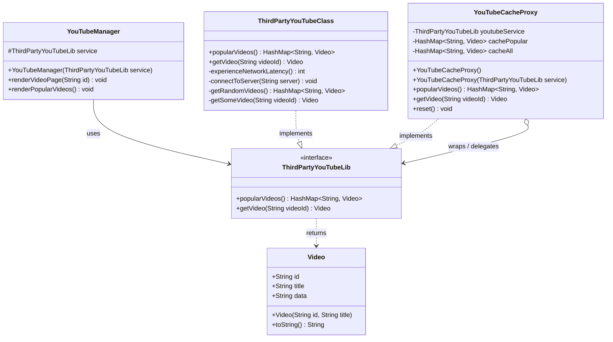
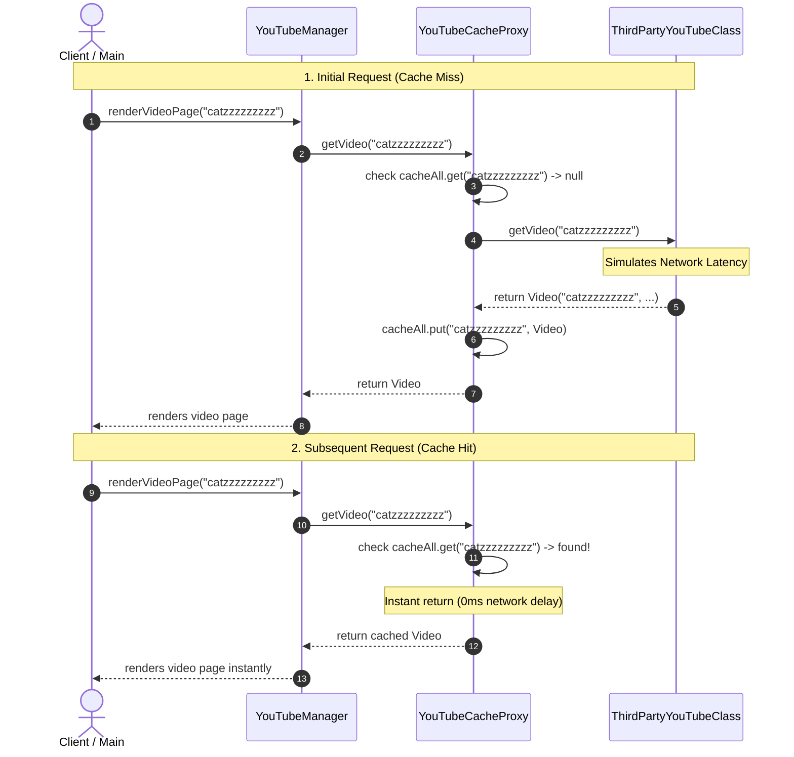

# Refactoring Guru: YouTubeManager — Caching Proxy Design Pattern

A clean Java implementation of the **Caching Proxy** design pattern based on the Refactoring Guru YouTubeManager architecture.

---

## 1. Component Definitions

| Component | Pattern Role | File | Responsibility |
| :--- | :--- | :--- | :--- |
| **`ThirdPartyYouTubeLib`** | **Service Interface (Subject)** | [`ThirdPartyYouTubeLib.java`](file:///c:/Users/HabiburRahmanShalin/workstation/shaleen/iit/DesignPatterns/proxy_design_pattern/YouTubeManager/ThirdPartyYouTubeLib.java) | Defines the contract common to both the Real Subject and the Proxy. Ensures the client can treat them interchangeably. |
| **`ThirdPartyYouTubeClass`** | **Real Subject** | [`ThirdPartyYouTubeClass.java`](file:///c:/Users/HabiburRahmanShalin/workstation/shaleen/iit/DesignPatterns/proxy_design_pattern/YouTubeManager/ThirdPartyYouTubeClass.java) | The concrete service executing heavy network requests, HTTP handshakes, and video downloads. Simulates network latency. |
| **`YouTubeCacheProxy`** | **Proxy (Caching / Surrogate)** | [`YouTubeCacheProxy.java`](file:///c:/Users/HabiburRahmanShalin/workstation/shaleen/iit/DesignPatterns/proxy_design_pattern/YouTubeManager/YouTubeCacheProxy.java) | Implements `ThirdPartyYouTubeLib`, wraps the Real Subject via composition, maintains an in-memory cache, and intercepts calls to eliminate redundant network fetches. |
| **`YouTubeManager`** | **Client / Consumer** | [`YouTubeManager.java`](file:///c:/Users/HabiburRahmanShalin/workstation/shaleen/iit/DesignPatterns/proxy_design_pattern/YouTubeManager/YouTubeManager.java) | The consumer component that renders UI pages and lists. It interacts strictly with `ThirdPartyYouTubeLib`, unaware of caching logic. |
| **`Video`** | **Value / Data Transfer Object** | [`Video.java`](file:///c:/Users/HabiburRahmanShalin/workstation/shaleen/iit/DesignPatterns/proxy_design_pattern/YouTubeManager/Video.java) | Represents video entity payload (`id`, `title`, `data`). |
| **`Main`** | **Client Driver & Benchmark** | [`Main.java`](file:///c:/Users/HabiburRahmanShalin/workstation/shaleen/iit/DesignPatterns/proxy_design_pattern/YouTubeManager/Main.java) | Runs benchmarks comparing execution time of direct Real Subject calls against cached Proxy calls. |

---

## 2. Core Concepts & Short Understanding Notes

### Problem
A 3rd-party library (`ThirdPartyYouTubeClass`) interacts over a remote network. When the GUI or client requests popular video lists or details repeatedly, every invocation hits the remote server, adding latency (100–300ms per call) and consuming bandwidth.

### Solution: Caching Proxy
`YouTubeCacheProxy` acts as an identical stand-in for `ThirdPartyYouTubeClass`:
- **Cache Miss**: On the first request for a resource, the proxy forwards the call to `ThirdPartyYouTubeClass`, caches the returned object in a local `HashMap`, and returns it.
- **Cache Hit**: Subsequent requests for the same video ID or popular list are served immediately from memory without hitting the network.

### Architectural Principles Applied
- **Single Responsibility Principle (SRP)**: `ThirdPartyYouTubeClass` focuses solely on remote API communication. `YouTubeCacheProxy` handles caching, lifetime management, and request interception.
- **Open/Closed Principle (OCP)**: You can introduce new proxies (e.g., logging proxy, authentication proxy) or new service implementations without touching existing client code or library classes.
- **Liskov Substitution Principle (LSP)**: `YouTubeCacheProxy` implements `ThirdPartyYouTubeLib` and can seamlessly replace `ThirdPartyYouTubeClass` anywhere in `YouTubeManager`.

---

## 3. UML Class Diagram

Standalone SVG diagram: [`uml-class-diagram.svg`](file:///c:/Users/HabiburRahmanShalin/workstation/shaleen/iit/DesignPatterns/proxy_design_pattern/YouTubeManager/uml-class-diagram.svg)



---

## 4. UML Sequence Diagram (Cache Miss vs Cache Hit)



---

## 5. Compilation and Execution

### Compile
```powershell
javac proxy_design_pattern\YouTubeManager\*.java
```

### Run
```powershell
java -cp proxy_design_pattern\YouTubeManager Main
```

### Benchmark Results
```text
==================================================
Running Naive Manager (Direct Real Subject Calls):
Elapsed Time: 1320ms

==================================================
Running Smart Manager (Caching Proxy Interception):
Elapsed Time: 868ms

==================================================
BENCHMARK SUMMARY:
Time taken with Real Subject (Naive): 1320ms
Time taken with Proxy (Cached):       868ms
Time saved by Proxy:                  452ms
==================================================
```
